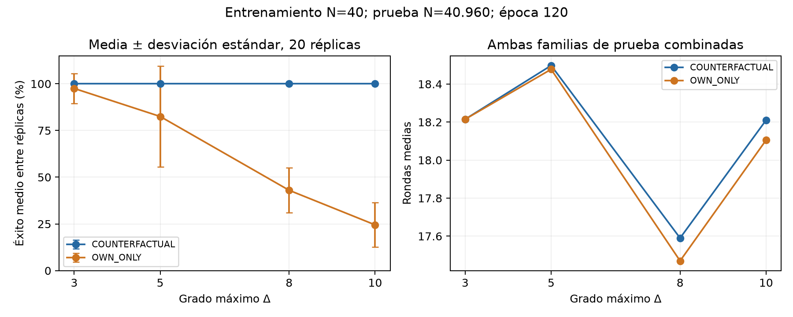

# Aprender algoritmos distribuidos de coloración

Estudiamos si una red neuronal pequeña puede aprender una regla local de coloración y ejecutarla de forma autónoma en grafos mucho mayores que los usados para entrenar. **Entrenamos con 40 nodos y evaluamos hasta 40.960: un aumento de 1.024 veces.**

La pregunta central es si imitar decisiones locales alcanza para producir una coloración global correcta. Una precisión local muy alta puede esconder errores poco frecuentes que invalidan grafos grandes.

**Evaluación final completada — 17 de octubre de 2026, hora de Chile:** terminaron los 565 entrenamientos y las 931.700 evaluaciones de las 1.210 versiones de modelos. Los [resultados completos](results/m6study/2026-10-17-final/README.md) conservan todas las semillas, controles, presupuestos y fallos observados.

## El problema y el algoritmo profesor

Queremos asignar un color a cada nodo de un grafo, de modo que **dos nodos unidos por una arista tengan colores distintos**. Si el máximo número de vecinos de un nodo es Δ, usamos una paleta de Δ+1 colores: por ejemplo, cuatro colores para Δ=3.

El profesor, también llamado *oracle*, implementa una regla aleatorizada de tipo Luby. Todos los nodos comienzan sin color. En cada ronda síncrona, cada nodo aún sin colorear:

1. Decide si participa, con probabilidad 0,5.
2. Descarta los colores ya fijados en sus vecinos.
3. Propone uno de los colores disponibles, elegido uniformemente.
4. Intercambia propuestas con sus vecinos. Si dos participantes vecinos proponen el mismo color, ambos esperan.
5. Confirma su propuesta (`COMMIT`) si es válida; en caso contrario espera (`WAIT`).

Un color confirmado es permanente. Cada nodo usa dos números aleatorios independientes por ronda: uno para participar y otro para elegir el candidato. Una *random tape* es la secuencia de esos números; distintas tapes producen distintas ejecuciones sobre un mismo grafo.

## Qué aprende la red

Usamos **M4B**, una red neuronal de grafos (*GNN*) con tres salidas o «cabezas»:

| Cabeza | Decisión que aprende |
|---|---|
| `PARTICIPATE` | ¿Participo en esta ronda? |
| `CANDIDATE` | ¿Qué color propongo? |
| `COMMIT` | ¿Confirmo esa propuesta o espero? |

Cada nodo aplica la misma red y los mismos pesos. `PARTICIPATE` usa su estado local y su sorteo de participación. Para proponer un color, recibe mensajes aprendidos de sus vecinos; después hay un segundo intercambio que comunica las propuestas para decidir `COMMIT`. En ambos intercambios, los mensajes se resumen mediante un máximo por componente (`MAX`).

La red recibe estados de color y números aleatorios. Debe aprender a interpretar los mensajes: durante la ejecución no recibe una lista de colores disponibles ni decisiones del profesor. Las decisiones de todos los nodos se aplican simultáneamente al terminar cada ronda.

**M4B nombra la arquitectura; M6B-Counterfactual nombra el método de entrenamiento que estudiamos.** Se entrena un modelo distinto por grado y réplica; no estamos transfiriendo un único modelo entre grados. Las dimensiones internas se mantienen fijas:

| Grado máximo Δ | Colores | Parámetros entrenables |
|---|---:|---:|
| 3 | 4 | 8.967 |
| 5 | 6 | 9.737 |
| 8 | 9 | 10.892 |
| 10 | 11 | 11.662 |

La regla usa solo información local y comunicación entre vecinos. La implementación simula esas rondas en un proceso con GPU; los nodos del grafo son los participantes del algoritmo simulado.

## Por qué usamos entrenamiento contrafactual

Entrenamos desde cero con estados extraídos de trayectorias del profesor. El aprendizaje es supervisado: el profesor proporciona ejemplos y etiquetas de decisiones correctas.

El problema delicado está en `COMMIT`: **su etiqueta debe corresponder a la propuesta que realmente está evaluando**. Por ejemplo, si un vecino ya tiene rojo, el profesor puede proponer azul y confirmar. Si la red propone rojo en ese mismo estado, su etiqueta correcta es esperar. Copiar la confirmación del profesor enseñaría una decisión peligrosa.

Durante las primeras diez épocas (*warmup*), `COMMIT` aprende con propuestas del profesor y sus etiquetas correspondientes. Después, M6B-Counterfactual combina dos clases de ejemplos:

- **Propuestas propias:** las que producen las cabezas de la red, con etiquetas recalculadas para esas propuestas.
- **Propuestas contrafactuales:** propuestas modificadas deliberadamente para exponer conflictos con colores permanentes o con propuestas simultáneas. Así se enseña a rechazar errores que aparecen poco en las trayectorias correctas del profesor.

La pérdida conjunta es `L_PARTICIPATE + L_CANDIDATE + 0,5 L_COMMIT_propio + 0,5 L_COMMIT_contrafactual`. Todos los módulos se entrenan desde cero; las decisiones discretas intermedias separan el gradiente de `COMMIT` del de las otras dos cabezas.

Comparamos cuatro métodos para separar los efectos de cada componente:

| Método | Qué supervisión recibe `COMMIT` |
|---|---|
| **COUNTERFACTUAL** | Propuestas propias y propuestas modificadas, siempre con etiquetas concordantes. Es el tratamiento principal. |
| **OWN_ONLY** | Solo propuestas propias después del warmup; repite su evaluación para mantener la ponderación y el presupuesto del tratamiento. Aísla el aporte de los contrafactuales. |
| **ORACLE_MATCHED** | Propuestas del profesor con etiquetas concordantes durante todo el entrenamiento. |
| **TRADITIONAL** | Reproduce la política histórica, incluida la aplicación de etiquetas del profesor a propuestas de la red después del warmup. Es una referencia histórica con esa discrepancia explícita. |

La comparación principal Counterfactual / Own-only comparte datos, inicialización, orden y número de actualizaciones. A la época 120 se verificó que los pesos de `PARTICIPATE`, `CANDIDATE` y del primer módulo de mensajes son exactamente iguales en los 80 pares. Las diferencias quedan en el segundo módulo de mensajes y `COMMIT`.

## Cómo está organizado el estudio

La configuración principal usa **800 grafos de 40 nodos, tres tapes por grafo y 120 épocas**, con 20 réplicas por grado. Una réplica usa una semilla que determina su inicialización, grafos y tapes; los controles emparejados reutilizan esos mismos datos y condiciones.

Las familias de grafos son:

- **REGULAR:** grafos conexos donde todos los nodos tienen grado Δ. Es el entrenamiento principal.
- **IRREGULAR:** grafos conexos obtenidos eliminando aristas, con grados variables y máximo Δ.
- **MIXED:** entrenamiento con mitad REGULAR y mitad IRREGULAR, para estudiar generalización estructural. En la prueba se informan ambas familias por separado.

| Fase | Pregunta | Entrenamientos únicos |
|---|---|---:|
| **A — Tratamiento principal** | ¿Se reproduce Counterfactual en 20 semillas y cuatro grados? | 80 |
| **B — Controles emparejados** | ¿Qué cambia al quitar las propuestas contrafactuales? | 80 |
| **Referencias** | ¿Cómo se compara con supervisión del profesor y entrenamiento histórico? | 15 |
| **C — Presupuestos** | ¿Importa más variar grafos, tapes o actualizaciones? Incluye la ampliación seleccionada con validación. | 310 adicionales |
| **D — Estructura** | ¿Qué aporta entrenar en MIXED? | 80 |
| **Total entrenado** | | **565** |
| **E — Prueba final** | ¿Funcionan los modelos congelados en grafos independientes y mucho mayores? | Sin nuevos entrenamientos |

C comienza con cinco semillas en Δ=3 y amplía tres presupuestos seleccionados mediante validación a 20 semillas y cuatro grados. Se reutilizan configuraciones ya entrenadas, por eso la tabla cuenta entrenamientos únicos. El detalle está en el [protocolo y la ampliación de presupuestos](docs/M6VALIDATION.md).

## Qué mide la evaluación final

Ejecutamos la red ronda tras ronda sobre sus propios estados, sin que el profesor corrija o filtre sus acciones. Las reglas exactas se consultan para registrar diagnósticos después de decidir; no intervienen en la evolución del grafo.

Distinguimos tres resultados:

- **Imitación local:** cuánto coinciden las decisiones con la regla del profesor.
- **Éxito global:** todos los nodos terminan coloreados y ninguna arista une nodos del mismo color, dentro del límite de 256 rondas.
- **Rondas:** cuánto tarda el proceso en terminar.

Una decisión distinta de la del profesor puede seguir produciendo una coloración válida; por eso estas métricas se informan por separado.

También contamos confirmaciones inseguras, conflictos y errores según **k**, la cantidad de colores aún disponibles para un nodo. Tener k=1 es un caso delicado, pero no suponemos que todos los fallos se concentren allí.

La prueba final usa grafos y tapes independientes del entrenamiento y la validación, compartidos entre los modelos de un mismo grado para permitir comparaciones emparejadas:

| Nodos | Grafos REGULAR | Grafos IRREGULAR |
|---|---:|---:|
| 40 | 100 | 100 |
| 160 | 100 | 100 |
| 640 | 100 | 100 |
| 2.560 | 50 | 50 |
| 10.240 | 25 | 25 |
| 40.960 | 10 | 10 |

Antes de abrir esa prueba se fijaron dos formas de tomar los pesos de cada modelo (*checkpoints*): **`best`**, la época elegida exclusivamente por validación, y **`epoch-120`**, la última época común. Esta última conserva el emparejamiento de las cabezas entre Counterfactual y Own-only; `best` puede escoger épocas distintas.

Se evaluaron ambas versiones de los 565 modelos y cuatro épocas intermedias de las 20 réplicas principales Counterfactual Δ=3: **1.210 versiones y 931.700 ejecuciones modelo–grafo**. Son observaciones correlacionadas por compartir grafos o pesos. Los resultados del test no se usan para cambiar el entrenamiento ni la selección.

## Resultados finales publicados

La prueba final terminó el **17 de octubre de 2026 a las 22:43, hora de Chile**. La entrega contiene las **931.700 ejecuciones modelo–grafo** de las 1.210 versiones previstas.

Para los modelos principales a **época 120**, entrenados en REGULAR con 40 nodos, los resultados en **40.960 nodos** son:

| Método | Δ | Réplicas evaluadas | Coloraciones correctas | Confirmaciones inseguras |
|---|---:|---:|---:|---:|
| Counterfactual | 3 | 20/20 | 400/400 | 0 |
| Counterfactual | 5 | 20/20 | 400/400 | 0 |
| Counterfactual | 8 | 20/20 | 400/400 | 0 |
| Counterfactual | 10 | 20/20 | 400/400 | 0 |
| Own-only | 3 | 20/20 | 390/400 | 10 |
| Own-only | 5 | 20/20 | 330/400 | 367 |
| Own-only | 8 | 20/20 | 172/400 | 1.016 |
| Own-only | 10 | 20/20 | 98/400 | 96.781 |

Cada fila combina **20 modelos × los mismos 20 grafos grandes**: diez REGULAR y diez IRREGULAR. Las 400 ejecuciones no son 400 grafos independientes. Las tablas completas incluyen también las referencias, MIXED y los distintos presupuestos.

En los seis tamaños de prueba, Counterfactual principal a época 120 obtiene **61.600/61.600 coloraciones correctas**. El presupuesto sí importa: al reducir a 200 grafos de entrenamiento con tres tapes, baja a 345/400 en Δ=8 y 164/400 en Δ=10 para los grafos de 40.960 nodos.

En Δ=3, ambos métodos usan en promedio aproximadamente 18,2 rondas en esos grafos grandes. La diferencia observada está en la corrección, sin aumento del promedio de rondas en esa comparación. Los intervalos y la variación entre semillas están en las tablas enlazadas; los resultados finitos no establecen corrección universal.

**La elección del checkpoint también importa.** Con la política `best`, Counterfactual Δ=3 presenta 108 fallos de 770 pruebas en la réplica de semilla 17, cuya época seleccionada fue la 10, durante el warmup. Counterfactual Δ=8 presenta un fallo de 770 pruebas en la semilla 18, seleccionada en la época 30. Estos denominadores reúnen todos los tamaños de esa réplica. Los fallos se conservan en los resultados; las dos políticas de selección estaban fijadas antes del test.



Consultar el [análisis final](results/m6study/2026-10-17-final/ANALISIS.md), el [resumen por familia y tamaño](results/m6study/2026-10-17-final/success-summary.csv), las [comparaciones emparejadas](results/m6study/2026-10-17-final/paired-by-seed.csv) y los [fallos individuales](results/m6study/2026-10-17-final/errors.csv). El [manifiesto final](results/m6study/2026-10-17-final/snapshot.json) identifica el protocolo, denominadores y hashes de todos los modelos. Se conserva el [corte parcial del 16 de octubre](results/m6study/2026-10-16/README.md) como registro histórico.

## Dónde seguir leyendo y colaborar

| Archivo o carpeta | Para qué sirve |
|---|---|
| [Análisis final](results/m6study/2026-10-17-final/ANALISIS.md) | Resultados, incertidumbre, controles, presupuestos y conclusiones del estudio completo. |
| [REPORT.md](REPORT.md) | Preguntas científicas, auditoría histórica y decisiones del diseño. |
| [docs/M6STUDY.md](docs/M6STUDY.md) | Protocolo base, instalación CUDA, entrenamiento, reanudación y métricas. |
| [docs/M6VALIDATION.md](docs/M6VALIDATION.md) | Revisión de validación, ampliación de C y protocolo final de E. |
| [configs/m6study/](configs/m6study/) | Planes concretos de cada fase. |
| [src/dcl/oracle.py](src/dcl/oracle.py) | Algoritmo profesor. |
| [src/dcl/m4_models.py](src/dcl/m4_models.py) | Arquitectura M4B y sus tres cabezas. |
| [src/dcl/counterfactual.py](src/dcl/counterfactual.py) | Propuestas modificadas y etiquetas exactas para `COMMIT`. |
| [src/dcl/study/](src/dcl/study/) | Datos, entrenamiento, evaluación, persistencia e informes del estudio actual. |
| [tests/](tests/) | Comprobaciones de reglas, emparejamiento, reanudación y evaluación. |
| [docs/HISTORIA_M1_M4.md](docs/HISTORIA_M1_M4.md) | README histórico: cómo llegamos desde aprender componentes aislados hasta la red completa. |

Para una primera revisión, seguir este recorrido: **este README → análisis final → protocolo → código de entrenamiento y contrafactuales**. Al proponer nuevos experimentos, separar las hipótesis nuevas del protocolo congelado que se evaluó.

## Preparar una copia local

Requiere Python 3.11 o posterior:

```bash
git clone https://github.com/mrioswilson/distributed-coloring-learning.git
cd distributed-coloring-learning
python -m venv .venv
source .venv/bin/activate
python -m pip install -e '.[dev,study]'
```

Para reproducir el entorno GPU usado en el estudio, seguir las [instrucciones de instalación CUDA](docs/M6STUDY.md#instalación-y-comprobaciones) y el [registro de versiones](requirements-m6study.lock). En una copia de trabajo sin otra cola GPU activa, las comprobaciones se ejecutan con `python -m pytest -q`.

GitHub incluye código, planes, tablas, figuras y hashes. Los checkpoints y los resultados originales por grafo permanecen en el servidor, fuera de Git por su volumen. Reanudar la evaluación o regenerar el corte con [el exportador](experiments/export_m6study_results.py) requiere esos archivos originales; las tablas publicadas pueden consultarse directamente.
