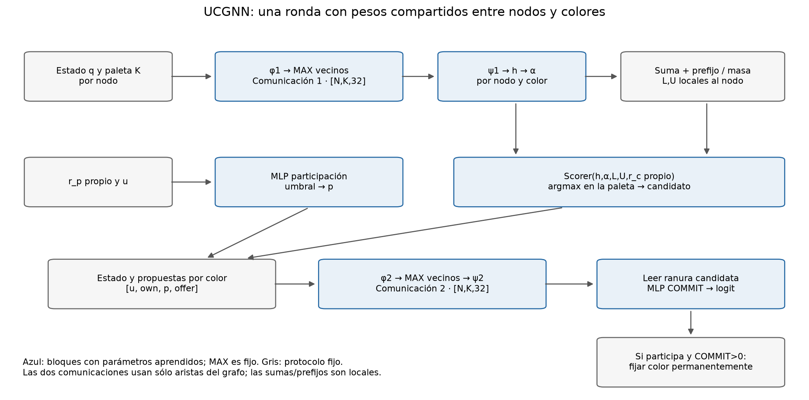
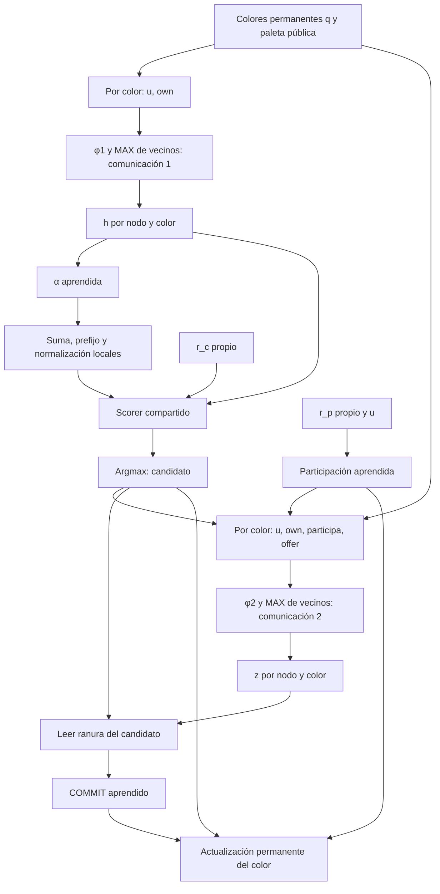
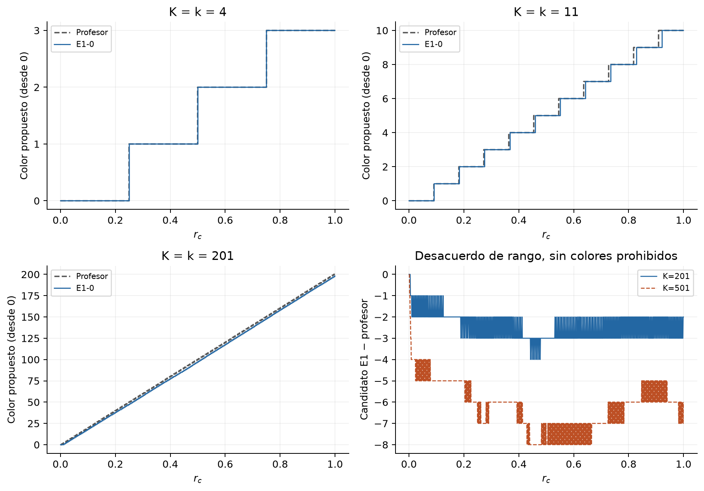
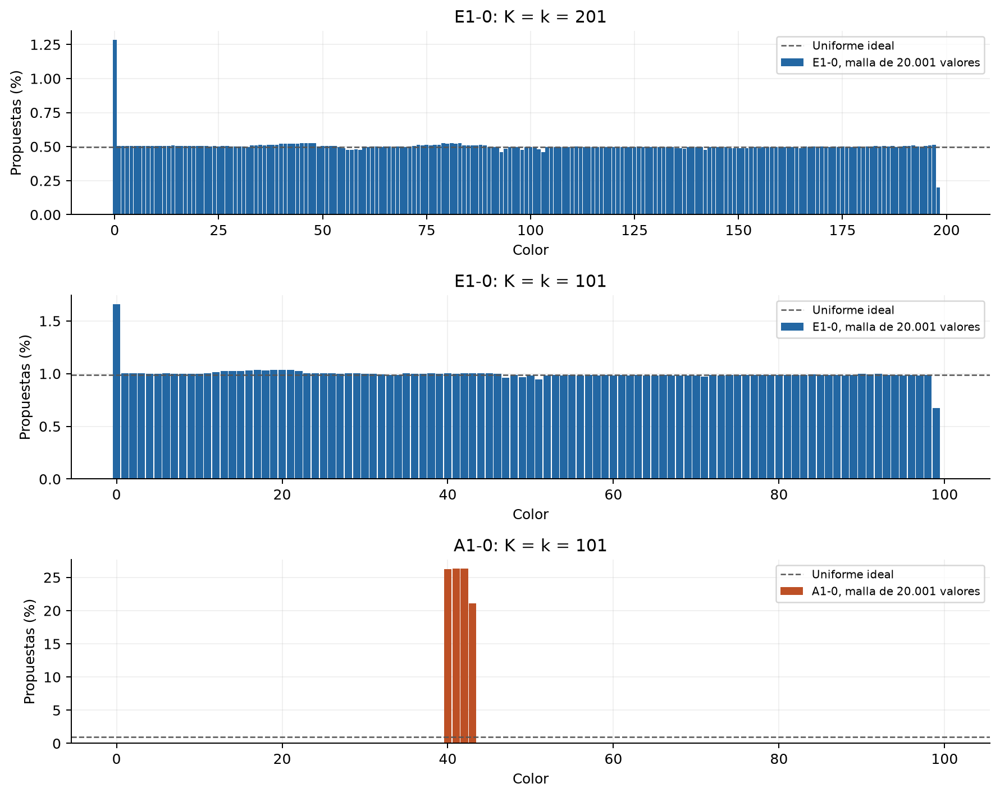
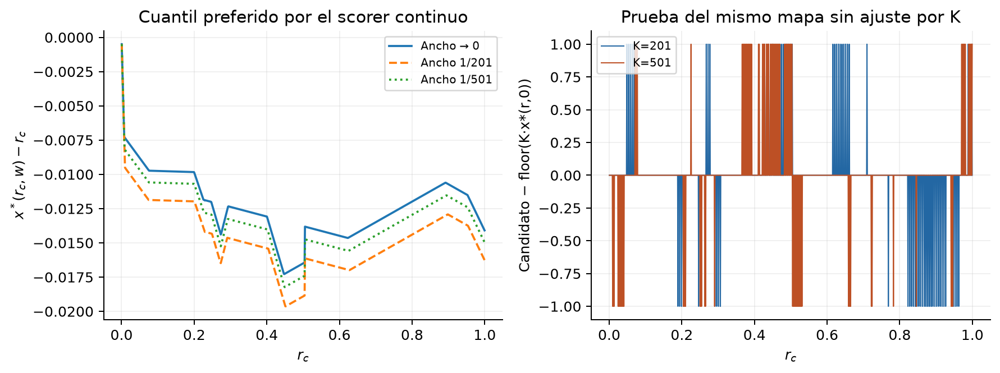
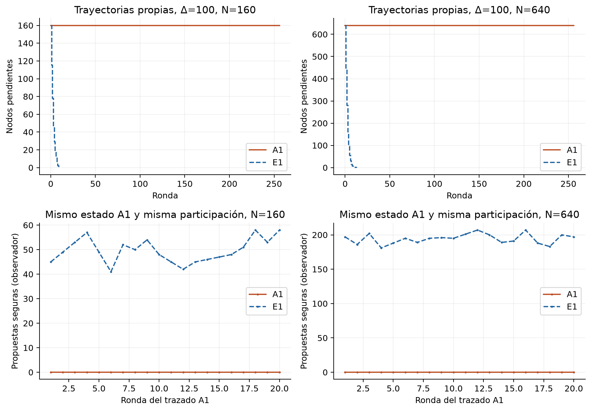

# UCGNN: arquitecturas, reglas aprendidas y mecanismos de transferencia

Auditoría explicativa del 20 de octubre de 2026. Este documento reconstruye la
implementación y estudia mecanismos; no selecciona modelos por su rendimiento.
Se usan checkpoints de época 120, principalmente réplica 0. No se entrenó,
reajustó ni modificó ningún peso ni ninguna cohorte original.

## 1. Qué hemos construido y qué explica esta auditoría

UCGNN combina tres ingredientes diferentes:

1. **Una representación que reduce la dependencia del grado:** mensajes por
   color con entradas binarias, pesos compartidos y agregación por máximo.
2. **Una estructura algorítmica incorporada:** recorrer la paleta ordenada,
   acumular disponibilidad aprendida y normalizar prefijos.
3. **Decisiones aprendidas:** participación, disponibilidad, puntuación de cada
   color y autorización de COMMIT. Ninguna de estas decisiones se sustituye por
   la regla exacta durante el rollout.

La extrapolación no exige que un MLP aprenda desde cero a contar cientos de
vecinos: el máximo elimina multiplicidades y los prefijos implementan una
operación acumulativa. Sí exige que los mensajes aprendidos distingan tipos
locales relevantes y que el puntuador funcione con intervalos cada vez menores.
Esta última propiedad falla como imitación exacta, aunque muchas políticas
resultantes siguen diversificando sus propuestas y terminando correctamente.

**Hallazgo central:** E1-0, con 201 colores libres, elige casi siempre una posición
distinta de la del profesor, pero distribuye las propuestas entre 199 colores.
A1, con 101 colores libres, las concentra en cuatro. Son errores de candidato
con consecuencias globales muy diferentes.

### Rutas y procedencia

| Contenido | Ruta en el host | Ruta dentro de `codex-disco` |
|---|---|---|
| Repositorio principal | `/srv/projects/AlgoLearning/distributed-coloring-learning` | `/workspaces/AlgoLearning/distributed-coloring-learning` |
| Worktree extremo | `/srv/projects/AlgoLearning/ucgnn-extreme-degree-study` | `/workspaces/AlgoLearning/ucgnn-extreme-degree-study` |
| Resultados extremos | `<worktree>/data/ucgnn-extreme/` | Igual, dentro de `/workspaces` |
| Diagnósticos nuevos | `<principal>/results/ucgnn/2026-10-20-mechanisms/` | Igual, dentro de `/workspaces` |

El worktree tiene metadatos Git con rutas del contenedor; se inspeccionó allí.
El código universal es idéntico en ambos árboles. El inventario nuevo carga los
siete checkpoints UCGNN y los cuatro especialistas M6B de referencia, comprueba
formas y conserva hashes completos en
[model-inventory.json](../results/ucgnn/2026-10-20-mechanisms/model-inventory.json).
Las citas de líneas corresponden a los archivos locales auditados.

## 2. Notación y regla del profesor

Sea $G=(V,E)$, $N=|V|$, $M=2|E|$ el número de aristas dirigidas que almacena
PyTorch, y $K=\Delta+1$. El color permanente es $q_v\in\{-1,0,\ldots,K-1\}$;
$u_v=\mathbf1[q_v=-1]$. Cada ronda consume dos uniformes independientes por nodo,
$r^p_v,r^c_v\in[0,1)$, incluso para nodos ya coloreados.

El profesor define

$$
A_v=\{c:0\le c<K,\;\forall w\in N(v),q_w\ne c\},\quad k_v=|A_v|,
$$

$$
p_v^*=u_v\mathbf1[r^p_v<1/2],\qquad
c_v^*=A_v[\lfloor r^c_vk_v\rfloor].
$$

La lista $A_v$ está ordenada numéricamente. Confirma un participante si ningún
vecino fijó su candidato ni otro vecino participante propone ese color.
Los confirmados conservan el color para siempre. Véanse
[muestreo del profesor:64](/srv/projects/AlgoLearning/distributed-coloring-learning/src/dcl/oracle.py:64) y
[etiquetas exactas:44–68](/srv/projects/AlgoLearning/distributed-coloring-learning/src/dcl/universal/rules.py:44).

El conjunto $A_v$, su tamaño y las etiquetas exactas **no entran al forward**.
Se utilizan para supervisión o para observar una decisión ya fijada.

## 3. M6B: referencia especializada por grado

M6B Counterfactual usa la clase **`M4B`**, no una arquitectura neuronal nueva
llamada M6B. La diferencia M6B corresponde al entrenamiento y al presupuesto.

### Entrada y codificación

Por nodo,

$$
x_v=[\operatorname{onehot}_{K+1}(q_v+1),r^p_v,r^c_v]\in\mathbb R^{K+3}.
$$

La posición 0 representa «sin colorear»; la posición $c+1$, color $c$.
La entrada completa tiene forma `[N,K+3]`; las aristas, `[2,M]`.
No recibe propuestas ni COMMIT como observaciones iniciales.
[Codificación:59–106](/srv/projects/AlgoLearning/distributed-coloring-learning/src/dcl/m4_data.py:59).

Con $d=32,H=64$, el forward duro de referencia es:

$$
\ell^p_v=P(x_v[:K+2]),\quad
m^1_v=\phi_1(x_v)\in\mathbb R^d,\quad
R^1_v=\max_{w\in N(v)}m^1_w,
$$

$$
s_v=C([x_v,R^1_v])\in\mathbb R^{K+1},\quad
p_v=u_v\mathbf1[\ell^p_v>0],\quad j_v=\arg\max_j s_{vj}.
$$

La clase candidata 0 significa «sin candidato»; la clase $c+1$, color $c$.
Los nodos ya coloreados se fuerzan a esa clase 0. Se construye

$$
y_v=[x_v,p_v,\operatorname{onehot}_{K+1}(j_v)]\in\mathbb R^{2K+5},
$$

$$
m^2_v=\phi_2(y_v)\in\mathbb R^d,\quad
R^2_v=\max_{w\in N(v)}m^2_w,\quad
\ell^C_v=J([y_v,R^2_v]).
$$

Se actualiza $q_v\leftarrow j_v-1$ sólo si $u_v,p_v,j_v>0,\ell^C_v>0$.
El máximo es componente a componente, no un conteo de vecinos ni una atención.
Los mensajes de M6B incluyen indirectamente ambos uniformes porque sus MLPs
reciben `x`. La primera capa de participación excluye únicamente $r^c_v$.

| Módulo M4B/M6B | Capas lineales, con ReLU intermedia | Dependencia en K |
|---|---|---|
| `participation_head` | $K+2\to32\to1$ | Entrada |
| `message1` | $K+3\to32\to32$, ReLU final | Entrada |
| `candidate_head` | $K+35\to64\to K+1$ | Entrada y salida |
| `message2` | $2K+5\to32\to32$, ReLU final | Entrada |
| `commit_head` | $2K+37\to64\to1$ | Entrada |

Fuente: [constructor M4B:233–309](/srv/projects/AlgoLearning/distributed-coloring-learning/src/dcl/m4_models.py:233),
[forward:311–400](/srv/projects/AlgoLearning/distributed-coloring-learning/src/dcl/m4_models.py:311),
[mensajes discretos:14–71](/srv/projects/AlgoLearning/distributed-coloring-learning/src/dcl/m4_models.py:14),
[ejecución autónoma:64–95](/srv/projects/AlgoLearning/distributed-coloring-learning/src/dcl/study/evaluation.py:64).

El total es **$385K+7427$ parámetros**: 8.967, 9.737, 10.892 y 11.662 para
Δ=3/5/8/10. Cambiar K cambia matrices de entrada y la cabeza candidata; un
checkpoint no admite directamente otra paleta. Cada índice de color tiene
coordenadas y salidas propias, sin compartición obligatoria entre ellas.

PARTICIPATE aprende un umbral; CANDIDATE aprende la selección ordenada del
profesor y a reconocer colores ocupados; COMMIT aprende seguridad para las
propuestas que recibe. En entrenamiento Counterfactual hay diez épocas de
COMMIT con propuestas del profesor y después propuestas propias más
contrafactuales, con etiquetas recalculadas. En inferencia las tres decisiones
son de la red. `hard_messages=False` permite representaciones suaves, pero no es
la ruta principal M6B Counterfactual evaluada.
[Entrenamiento:57–88](/srv/projects/AlgoLearning/distributed-coloring-learning/src/dcl/study/train.py:57).

## 4. UCGNN: forward completo, dimensiones y parámetros

### 4.1. No existe un vector aprendido por nombre de color

`UniversalColorGNN(hidden_dim=64, message_dim=32, variant=...)` no recibe K.
El forward recibe `colors[N]`, `rp[N]`, `rc[N]`, `edge_index[2,M]` y `palette[N]`.
Los colores son enteros; los uniformes del modelo, float32.

En lotes mixtos se usa $\bar K=\max_v K_v$ para reservar ranuras y una máscara
$I_{vc}=\mathbf1[c<K_v]$. En las fórmulas siguientes K significa esa dimensión
de almacenamiento; dentro de cada grafo la paleta declarada es común.
`palette.max()` fija el relleno del lote: no es una reducción de estados de
nodos para tomar decisiones.
[Ranuras:78–90](/srv/projects/AlgoLearning/distributed-coloring-learning/src/dcl/universal/model.py:78).

Se calcula la igualdad determinista

$$
o_{vc}=\mathbf1[q_v=c].
$$

El número $c$ no se introduce como escalar, embedding ni $c/K$. Sólo sirve
para construir igualdades, ordenar el prefijo y devolver el índice elegido.
Una ranura nueva se procesa con los mismos pesos que las anteriores.

### 4.2. Primera comunicación y representación $h(v,c)$

$$
f^1_{vc}=[u_v,o_{vc}]\in\{0,1\}^2,
\quad m^1_{vc}=\phi_1(f^1_{vc})\in\mathbb R_{\ge0}^{32},
$$

$$
R^1_{vc}=\max_{w\in N(v)}m^1_{wc},\qquad
h_{vc}=\psi_1([u_v,R^1_{vc}])\in\mathbb R_{\ge0}^{32}.
$$

Son MLPs aprendidas con ReLU final. El código aplana `[N,K,32]` a `[N,32K]`
para agregar con `scatter_reduce(...,reduce="amax")` y luego restaura las
ranuras. No mezcla colores en esa agregación. Cero es el valor para ausencia
de vecinos; incluirlo en el máximo no altera mensajes no negativos.
[`neighbor_max`:27–42](/srv/projects/AlgoLearning/distributed-coloring-learning/src/dcl/universal/model.py:27).

El estado $h$ se recalcula en cada ronda: no es una memoria recurrente ni
persiste entre rondas. La memoria temporal del protocolo es el color fijado.

### 4.3. Disponibilidad, prefijos y puntuación

$$
\alpha_{vc}=I_{vc}\,\sigma(a^\top h_{vc}+b),\qquad
\widehat k_v=\sum_c\alpha_{vc},\qquad
S_{vc}=\sum_{c'<c}\alpha_{vc'},
$$

$$
D_v=\max(\widehat k_v,0.5),\quad
L_{vc}=S_{vc}/D_v,\quad U_{vc}=(S_{vc}+\alpha_{vc})/D_v.
$$

En NORMALIZED,

$$
s_{vc}=F([h_{vc},\alpha_{vc},L_{vc},U_{vc},r^c_v]).
$$

Se conserva un logit por color; fuera de la paleta vale `NEG=-1e9`.
No hay una máscara de colores ocupados. El scorer debe aprender a asignarles
puntuaciones menores. No requiere que el logit ganador sea positivo.

### 4.4. PARTICIPATE y CANDIDATE

$$
\ell^p_v=P([r^p_v,u_v]),\quad
p_v=u_v\mathbf1[\ell^p_v>0],\quad
c_v=\begin{cases}\arg\max_{c<K_v}s_{vc},&u_v=1\\-1,&u_v=0.\end{cases}
$$

El candidato se calcula también para quien **no participa**. No se muestrea
una distribución softmax durante inferencia: el azar procede del uniforme
de entrada y el argmax es determinista. La softmax está implícita en la pérdida
de entropía cruzada del entrenamiento. Las sigmoides de los logits de
participación/COMMIT pueden interpretarse como probabilidades de clasificación;
el protocolo ejecuta sus umbrales duros, no sorteos Bernoulli adicionales.
Los empates del argmax se resuelven por la primera posición de PyTorch.

### 4.5. Segunda comunicación y COMMIT

Con $e_{vc}=\mathbf1[c_v=c]$,

$$
f^2_{vc}=[u_v,o_{vc},p_v,e_{vc}]\in\{0,1\}^4,
\quad m^2_{vc}=\phi_2(f^2_{vc})\in\mathbb R_{\ge0}^{32},
$$

$$
R^2_{vc}=\max_{w\in N(v)}m^2_{wc},\quad
z_{vc}=\psi_2([f^2_{vc},R^2_{vc}])\in\mathbb R_{\ge0}^{32},
$$

$$
g_v=\sum_c e_{vc}z_{vc},\qquad
\ell^C_v=J([g_v,p_v,u_v,\sum_c e_{vc}]).
$$

Para un nodo sin colorear con candidato válido, `offer` es one-hot, por lo
que $g_v=z_{v,c_v}$ y su suma vale 1. Para uno fijado, no hay candidato,
$g_v=0$ y su suma vale 0. No se suman evidencias de todos los colores para
decidir COMMIT: se lee la ranura del candidato propio.

Un vecino que no participa también lleva `offer`, pero con $p=0$. La MLP
de mensajes tiene que aprender la conjunción «participa **y** propone mi color»;
el máximo por sí solo no calcula esa conjunción.

### 4.6. Estado actualizado y algoritmo de una ronda

$$
q_v^{t+1}=\begin{cases}
c_v,&u_vp_v\mathbf1[c_v\ge0]\mathbf1[\ell^C_v>0]=1,\\
q_v^t,&\text{en otro caso.}
\end{cases}
$$

```text
leer q, r_p, r_c y paleta pública
para cada color: formar [sin_color, color_propio==c]
comunicar φ1; agregar MAX de vecinos por ranura
calcular h, α, suma de α y prefijo exclusivo
calcular extremos normalizados y puntuar cada color
decidir participar por logit>0; candidato = argmax dentro de la paleta
para cada color: formar [sin_color, color_propio==c, participa, candidato==c]
comunicar φ2; agregar MAX de vecinos por ranura
leer z de la ranura del candidato; decidir COMMIT por logit>0
fijar el candidato si se participa y COMMIT es positivo
después de decidir: observar con reglas exactas, sin corregir la acción
```

La ejecución es síncrona. Hay dos dependencias de comunicación vecinal por
ronda; una propuesta del vecino ya resume su primera comunicación, de modo
que COMMIT puede depender causalmente de información a distancia dos a través
de esa propuesta. No consulta regiones arbitrariamente lejanas ni estadísticas
globales del grafo. A lo largo de varias rondas, los colores permanentes también
transportan historia local.

### 4.7. Inventario operación por operación

Las dimensiones H=64 y d=32 son constantes. Las funciones se aplican con
los mismos pesos a todos los nodos y colores.

| Operación | Entrada → salida | Aprendido / determinista | Dependencia y acceso | Código |
|---|---|---|---|---|
| `_slots` | `[N]`, `[N]` → `own[N,K]`, máscara, `u[N]` | Igualdad, rango y máscara públicos | O(NK), estado propio | [78](/srv/projects/AlgoLearning/distributed-coloring-learning/src/dcl/universal/model.py:78) |
| `message1` | `[N,K,2]` → `[N,K,32]` | MLP 2→32→32 | O(NK), sólo emisor | [66](/srv/projects/AlgoLearning/distributed-coloring-learning/src/dcl/universal/model.py:66) |
| `neighbor_max` | `[N,32K]`, `[2,M]` → `[N,32K]` | MAX, sin pesos | O(MKd), vecinos inmediatos | [99](/srv/projects/AlgoLearning/distributed-coloring-learning/src/dcl/universal/model.py:99) |
| `state1` | `[N,K,33]` → `[N,K,32]` | MLP 33→64→32 | O(NKHd), información local recibida | [100](/srv/projects/AlgoLearning/distributed-coloring-learning/src/dcl/universal/model.py:100) |
| `availability` | `[N,K,32]` → `[N,K]` | Linear 32→1 + sigmoid | O(NKd), por ranura | [101](/srv/projects/AlgoLearning/distributed-coloring-learning/src/dcl/universal/model.py:101) |
| `sum`,`cumsum` | `[N,K]` → masa `[N]`, prefijos `[N,K]` | Suma y prefijo exclusivos | O(NK), entre colores del mismo nodo | [102](/srv/projects/AlgoLearning/distributed-coloring-learning/src/dcl/universal/model.py:102) |
| `clamp_min`, división | masa, prefijo, α → L,U `[N,K]` | Normalización fija | O(NK), nunca entre nodos | [104](/srv/projects/AlgoLearning/distributed-coloring-learning/src/dcl/universal/model.py:104) |
| `scorer` | `[N,K,36]` → `[N,K]` | MLP 36→64→1, sin sesgo final | O(NKHd), usa r_c propio | [107](/srv/projects/AlgoLearning/distributed-coloring-learning/src/dcl/universal/model.py:107) |
| `participation` | `[N,2]` → `[N]` | MLP 2→32→1 | O(N), usa r_p y u | [113](/srv/projects/AlgoLearning/distributed-coloring-learning/src/dcl/universal/model.py:113) |
| `argmax`, umbral | logits → p,c `[N]` | Decisiones duras | O(NK), paleta propia | [137](/srv/projects/AlgoLearning/distributed-coloring-learning/src/dcl/universal/model.py:137) |
| `message2` | `[N,K,4]` → `[N,K,32]` | MLP 4→32→32 | O(NK), estado y propuesta del emisor | [127](/srv/projects/AlgoLearning/distributed-coloring-learning/src/dcl/universal/model.py:127) |
| Segundo MAX | `[N,32K]` → `[N,32K]` | MAX, sin pesos | O(MKd), vecinos inmediatos | [130](/srv/projects/AlgoLearning/distributed-coloring-learning/src/dcl/universal/model.py:130) |
| `state2` | `[N,K,36]` → `[N,K,32]` | MLP 36→64→32 | O(NKHd) | [131](/srv/projects/AlgoLearning/distributed-coloring-learning/src/dcl/universal/model.py:131) |
| Lectura del candidato | `offer`, z → `[N,32]` | Producto y suma one-hot | O(NKd), sólo colores propios | [133](/srv/projects/AlgoLearning/distributed-coloring-learning/src/dcl/universal/model.py:133) |
| `commit_head` | `[N,35]` → `[N]` | MLP 35→64→1 | O(NHd), logit final | [134](/srv/projects/AlgoLearning/distributed-coloring-learning/src/dcl/universal/model.py:134) |
| Actualización | q,p,c,logit → q nuevo | Regla permanente del protocolo | O(N) | [139–145](/srv/projects/AlgoLearning/distributed-coloring-learning/src/dcl/universal/evaluation.py:139) |

No hay información del profesor en esta tabla. Los tensores de etiquetas están
separados y `UBatch.inputs()` devuelve sólo las cinco observaciones permitidas.
[Datos:82–111](/srv/projects/AlgoLearning/distributed-coloring-learning/src/dcl/universal/data.py:82).



La especificación del flujo completo, incluida la intervención de estado y
propuestas en la segunda etapa, también se conserva en Mermaid:



### 4.8. Los 16.035 parámetros, contados desde el checkpoint

| Módulo | Parámetros NORMALIZED |
|---|---:|
| `message1` | 1.152 |
| `state1` | 4.256 |
| `availability` | 33 |
| `scorer` | 2.432 |
| `participation` | 129 |
| `message2` | 1.216 |
| `state2` | 4.448 |
| `commit_head` | 2.369 |
| **Total** | **16.035** |

No término contiene K. El número de **aplicaciones** de estos módulos sí crece
con K. El sesgo final del scorer se eliminó: una constante compartida por todos
los colores no altera su softmax ni su argmax.

## 5. NORMALIZED, A1 y los 64 parámetros adicionales

### La magnitud normalizada es masa aprendida, no el identificador ni K

E1 divide el prefijo $S_{vc}$ y su extremo $S_{vc}+\alpha_{vc}$ por
$\max(\sum_c\alpha_{vc},0.5)$. No divide por K ni introduce directamente
$c/K$. Si hay k colores libres con α≈a común y los ocupados tienen α≈0,
la masa es ≈ak y los intervalos libres son aproximadamente $j/k,(j+1)/k$.

En aritmética real, $0\le\alpha\le1$, $0\le L\le U\le1$; la suma y los
prefijos sin normalizar pueden crecer con K. Las representaciones h también
tienen soporte limitado por los tipos de entrada y el máximo. Al aumentar K,
el scorer normalizado mantiene entradas en el mismo rango pero debe resolver
intervalos de ancho ≈1/k nunca vistos en Δ=3. Eso facilita transferencia de
escala, sin garantizar precisión de fronteras ni una distribución uniforme.

**No interpretar $\widehat k$ como conteo exacto.** Con los 201 colores libres
del diagnóstico, E1-0 produce α≈0,477090 y masa **95,8951**, no 201.

**Dos límites a la idea de invariancia por escala:** el scorer recibe también
α sin normalizar y la guarda 0,5 puede activarse. Multiplicar todos los α por
una constante conserva los cocientes sólo si no cambia la guarda; tampoco
conserva necesariamente los logits del scorer. El diagnóstico relativo de
disponibilidad no demuestra invariancia de la política completa. En E1-0,
α libre puede ser ≈0,419739: con k=1 la masa puede quedar por debajo de 0,5,
y el extremo superior no tiene por qué ser 1.

### Comparación literal de las entradas del scorer

$$
\begin{array}{ll}
\text{E1:}&[h_{vc},\alpha_{vc},S_{vc}/D_v,(S_{vc}+\alpha_{vc})/D_v,r^c_v]\in\mathbb R^{36};\\
\text{A1:}&[h_{vc},\alpha_{vc},S_{vc},S_{vc}+\alpha_{vc},\widehat k_v,r^c_v]\in\mathbb R^{37}.
\end{array}
$$

A1 **añade la masa total como coordenada explícita** además de sustituir los
dos extremos normalizados por prefijos crudos. Su primera matriz del scorer
es `[64,37]`, frente a `[64,36]`: **64×(37−36)=64 pesos adicionales**. Los sesgos
no cambian. Su scorer tiene 2.496 parámetros y el total, 16.099.
[Constructor:69–71](/srv/projects/AlgoLearning/distributed-coloring-learning/src/dcl/universal/model.py:69),
[bifurcación:107–111](/srv/projects/AlgoLearning/distributed-coloring-learning/src/dcl/universal/model.py:107).

Además, aunque la semilla nominal es la misma, la matriz de tamaño diferente
consume otra cantidad de números aleatorios. La inicialización del scorer y
la de `participation`, `message2`, `state2` y `commit_head`, creados después,
ya no coinciden. `message1`, `state1` y `availability`, creados antes, sí
coinciden inicialmente. Se verificó reconstruyendo la inicialización y
comparando tensores; al final del entrenamiento todos esos módulos difieren.

Por tanto, A1 es un **control arquitectónico relacionado**, pero no una
intervención que quite únicamente una división manteniendo pesos, entradas e
inicialización restantes idénticos. Sus negativos son evidencia compatible con
un problema de escala, no una identificación causal aislada de la normalización.
[Comparación verificable](../results/ucgnn/2026-10-20-mechanisms/checkpoint-comparisons.csv).

## 6. E1, E2, E3, E2F y E3F: diferencias reales de entrenamiento

Todos usan la misma clase NORMALIZED, las mismas formas de parámetros, pérdidas,
Adam a 10⁻³, lotes de 128 **rondas completas**, grafos REGULAR de N=40, tres cintas por grafo,
120 épocas y warmup de diez. Se verificó que la inicialización de todos los
NORMALIZED de semilla 0 coincide exactamente, incluido C1.

| Modelo | Grados | Grafos por grado | Trayectorias | Rondas del dataset, s0 | Actualizaciones totales, s0 | Grafos de validación por grado |
|---|---|---|---:|---:|---:|---:|
| E1 | 3 | 800 | 2.400 | 18.909 | 17.760 | 200 |
| E2 | 3,10 | 400+400 | 2.400 | 19.063 | 17.880 | 100 |
| E3 | 3,5,8,10 | 200×4 | 2.400 | 19.096 | 18.000 | 50 |
| E2F | 3,10 | 800+800 | 4.800 | 38.302 | 36.000 | 100 |
| E3F | 3,5,8,10 | 800×4 | 9.600 | 76.887 | 72.120 | 50 |

Una trayectoria del profesor aporta tantas rondas como tarda en terminar;
las pérdidas se promedian sobre los nodos aún sin colorear del lote. No se
pondera cada grado para darle exactamente el mismo peso por actualización.
Cada época permuta la lista completa de rondas y une grafos disjuntos,
desplazando índices de aristas. No hay conexiones entre ejemplos.
[Recolección:50–79](/srv/projects/AlgoLearning/distributed-coloring-learning/src/dcl/universal/data.py:50),
[lotes:99–111](/srv/projects/AlgoLearning/distributed-coloring-learning/src/dcl/universal/data.py:99),
[permutación y actualizaciones:225–235](/srv/projects/AlgoLearning/distributed-coloring-learning/src/dcl/universal/train.py:225).

La validación local usa MIXED, alternando grafos REGULAR e IRREGULAR, con una
cinta por grafo y 200 grafos totales repartidos entre los grados de cada modelo.

Con paletas mixtas cambia la segunda dimensión de los tensores, hasta K máximo
del lote. El relleno se enmascara en α y en los logits; las capas lineales
conservan sus tamaños. E2/E3 observan anchos de intervalo menores que 1/4,
estados con más colores ocupados y conflictos con otros nombres de color.
El alfabeto binario por ranura sigue siendo el mismo.

No cambia sólo la lista de grados: cambian los grafos y estados observados,
su ponderación por duración, el número de actualizaciones, la composición de
lotes, la validación por grado y el número de rollouts de validación total
(16 por grado). Esto puede cambiar `best`; no selecciona la época 120.
E2F/E3F cambian además la cantidad de datos y actualizaciones. No permiten
atribuir una diferencia de rendimiento exclusivamente a diversidad de grados.

## 7. E1 frente a C1: pérdidas, etiquetas y rutas de gradiente

Para nodos sin colorear, la pérdida es

$$
\mathcal L=\operatorname{BCE}(\ell^p,p^*)+
\operatorname{CE}(s,c^*)+
\tfrac12\operatorname{BCE}(\ell^C_{own},y_{own})+
\tfrac12\operatorname{BCE}(\ell^C_{cf},y_{cf}).
$$

Durante las primeras diez épocas, ambas ramas COMMIT usan propuestas y etiquetas
del profesor: son el mismo término duplicado con pesos 1/2, equivalente a una
pérdida de peso 1. Las tres partes se entrenan desde el comienzo.

Después, **own** usa los p,c duros de la red, pero sobre estados de trayectorias
del profesor. La etiqueta se recalcula exactamente para esas propuestas; no
se usa la etiqueta de COMMIT del profesor si cambió la propuesta.

En E1, **cf** parte de las propuestas del profesor y modifica algunas:

- Cada arista de vecino fijado a nodo sin colorear tiene probabilidad 0,17 de
  forzar participación y proponer el color ya fijado.
- Cada arista no dirigida entre nodos sin colorear tiene probabilidad 0,04 de
  forzar a ambos a participar con el mismo color uniforme de la paleta.
- Se baraja el orden; las inyecciones posteriores pueden sobrescribir las
  anteriores. No se altera el color permanente. También quedan propuestas
  válidas sin modificar; no se prescribe un balance exacto positivo/negativo.

Finalmente se recalcula la etiqueta de seguridad para **todas** las propuestas
resultantes. En C1, la rama llamada `cf` repite own: mismo presupuesto de dos
evaluaciones COMMIT, mismo peso total, sin propuestas artificiales.
[Pérdida real:70–106](/srv/projects/AlgoLearning/distributed-coloring-learning/src/dcl/universal/train.py:70),
[generador contrafactual:71–103](/srv/projects/AlgoLearning/distributed-coloring-learning/src/dcl/universal/rules.py:71).

| Pérdida | Módulos con camino de gradiente |
|---|---|
| PARTICIPATE | `participation` |
| CANDIDATE | `message1`, `state1`, `availability`, `scorer` |
| COMMIT own/cf | `message2`, `state2`, `commit_head` |

Umbrales, argmax y conversiones NumPy separan las ramas. El gradiente de COMMIT
no modifica el generador de candidatos ni participación. No hay parámetros
compartidos entre sus MLPs. La auditoría verificó estas rutas con autograd sin
hacer un paso de optimización; una ruta existente puede tener gradiente numérico
muy pequeño cuando el clasificador ya está saturado.
[Datos del diagnóstico](../results/ucgnn/2026-10-20-mechanisms/gradient-routing.csv).

En época 120, E1-0 y C1 tienen pesos **idénticos bit a bit** en participación,
mensajes/estados de etapa 1, disponibilidad y scorer. Sólo difieren `message2`,
`state2` y `commit_head`. La política candidata idéntica puede evitar situaciones
con vecinos fijados y ocultar una regla COMMIT incompleta en rollouts autónomos.
Los logs no conservan cada etiqueta de cada actualización; no se afirma que C1
jamás haya recibido un negativo de ese tipo durante entrenamiento.

### Qué regla omite C1, medida exhaustivamente en su canal COMMIT

Para un nodo sin colorear que participa con candidato c, la entrada propia de
esa ranura es `[1,0,1,1]`. Un vecino sólo puede aportar seis tipos:

| Tipo | `[u,own,p,offer]` en la ranura c | Significado |
|---:|---|---|
| 0 | `[0,0,0,0]` | Fijado en otro color |
| 1 | `[0,1,0,0]` | Fijado en c: conflicto |
| 2 | `[1,0,0,0]` | No participa, otro candidato o ninguno |
| 3 | `[1,0,0,1]` | No participa, propone c |
| 4 | `[1,0,1,0]` | Participa, propone otro color |
| 5 | `[1,0,1,1]` | Participa, propone c: conflicto |

MAX sólo depende del conjunto de tipos presentes: hay $2^6=64$, incluidas
combinaciones que requieren más vecinos que los del entrenamiento Δ=3.
E1-0 coincide 64/64 con «no aparece tipo 1 ni tipo 5», con margen mínimo
absoluto de logit 13,5465 en la tabla CUDA. **C1 coincide 64/64 con «no aparece
tipo 5»**, ignorando el tipo 1; su margen mínimo es 12,8534. Por eso obtiene
48/64 reglas seguras y acepta los 16 conjuntos que contienen tipo 1 sin tipo 5.

Esto caracteriza una función local sobre un alfabeto finito, no son 64 grafos
aleatorios. Es evidencia mucho más específica que un porcentaje de rollouts,
pero no certifica terminación ni imitación completa, ni sustituye una prueba
formal de errores de redondeo para todas las formas de ejecución.
[Implementación del barrido:154–179](/srv/projects/AlgoLearning/ucgnn-extreme-degree-study/src/dcl/extreme/diagnostics.py:154).

## 8. Por qué el máximo facilita reutilizar reglas entre grados

En etapa 1, para una ranura c sólo existen tres entradas del vecino:
`[1,0]` (sin colorear), `[0,0]` (fijado en otro color), `[0,1]` (fijado en c).
La MLP evalúa tres vectores y el máximo depende de un subconjunto de ellos:
a lo sumo ocho agregados, independientemente de cuántos vecinos haya.
Esta reducción describe las operaciones matemáticas; kernels float32 con
distintas formas de lote pueden introducir pequeñas diferencias de redondeo.

Para cualquier nodo, **todos sus colores libres reciben el mismo h y el mismo
α**, porque ningún vecino aporta `[0,1]` en esas ranuras. Sus diferencias vienen
del prefijo y del uniforme. Con E1-0, los cuatro tipos de contexto libre dan
α≈0,51894 (sin vecinos), 0,47709 (sólo sin colorear), 0,48083 (sólo fijados
en otros colores) y 0,41974 (ambos). Las ranuras ocupadas dan aproximadamente
8,52×10⁻⁸ o 1,16×10⁻⁷. Se evaluaron los ocho conjuntos de tipos, no se dedujo
la disponibilidad de la magnitud absoluta 0,5.
[Tabla medida](../results/ucgnn/2026-10-20-mechanisms/availability-type-sets.csv).

Así, la masa libre común se cancela aproximadamente en los cocientes y
aparecen intervalos casi uniformes en el **rango de colores libres**. El sesgo
de los ocupados no es cero exacto y puede acumularse; no se extrapola esta
aproximación a K arbitrario. La guarda y los float32 también importan.

La seguridad de etapa 2 tiene una reducción análoga a seis tipos. La dificultad
que permanece continua y dependiente de k es la selección por intervalo. Esta
separación ofrece un mecanismo concreto para entender transferencia de grado:
reconocimiento local sobre alfabetos pequeños, una operación acumulativa fija
y un scorer compartido que aproxima una selección por cuantil.

## 9. E1 colorea, aunque casi nunca elija el candidato exacto de Luby

### 9.1. Reproducción del diagnóstico K=k=201

El estado original es una **estrella de 201 nodos**: centro sin colorear,
200 hojas vecinas, todas sin colorear. No hay colores fijados, de modo que
los 201 colores están disponibles. Las hojas no están conectadas entre sí.
El grado máximo declarado es 200 y la paleta, 201. No se suministra a la red
una lista de colores libres: el diagnóstico calcula sus mensajes reales.

Se mantiene fijo h y α del centro y se cambia únicamente r_c. La malla
principal es

$$
r_i=\operatorname{float32}\left((i+0.5)/1001\right),\quad i=0,\ldots,1000.
$$

Se añaden por separado las fronteras j/k representables y sus float32 adyacentes,
además de los extremos 0 y el predecesor de 1. El profesor se evalúa en **el mismo
valor representable**. El cálculo en caché conserva exactamente la primera
comunicación del centro; no supone una disponibilidad ideal dentro del modelo.
[Construcción:22–110](/srv/projects/AlgoLearning/ucgnn-extreme-degree-study/src/dcl/extreme/diagnostics.py:22).

Esta auditoría reprodujo todos los candidatos guardados en las seis sondas
estudiadas, incluidas las fronteras: cero diferencias con los NPZ originales.
Los siguientes ejemplos usan posiciones de la malla, no números redondeados
introducidos de nuevo en la red:

| r_c, aproximado | Profesor, K=201 | E1-0 | Diferencia de rango |
|---:|---:|---:|---:|
| 0,000500 | 0 | 0 | 0 |
| 0,050450 | 10 | 8 | −2 |
| 0,100400 | 20 | 18 | −2 |
| 0,250250 | 50 | 47 | −3 |
| 0,500000 | 100 | 97 | −3 |
| 0,749750 | 150 | 148 | −2 |
| 0,899600 | 180 | 178 | −2 |
| 0,949550 | 190 | 188 | −2 |
| 0,999501 | 200 | 198 | −2 |



En la malla principal hay **5/1.001 coincidencias**, ningún candidato prohibido,
199 colores distintos y una función monótona de r_c, con rango 0…198. Faltan los
colores 199 y 200 en ese barrido. No es una permutación arbitraria de colores:
mantiene el orden y muestra un desplazamiento pequeño en coordenadas
normalizadas, grande respecto del ancho 1/201.

### 9.2. Distribución y colisiones: métricas diferentes de la coincidencia

Para estimar descriptivamente la ley inducida por un uniforme se usó otra malla
de **20.001 puntos medios**, sin fronteras añadidas. Si q_c es su frecuencia,
$\sum_c q_c^2$ aproxima la probabilidad de que dos propuestas independientes
coincidan; $1/\sum_c q_c^2$ es el número efectivo de colores de esa distribución.
Son cuadraturas deterministas, sin intervalos de confianza binomiales.

| Política y estado | Colores distintos | Coincidencia en malla original | $\sum q_c^2$, malla densa | Uniforme ideal | Colores efectivos |
|---|---:|---:|---:|---:|---:|
| E1-0, K=4, todos libres | 4 | 999/1.001 | 0,2500003 | 0,25 | 4,00 |
| E1-0, K=11, todos libres | 11 | 939/1.001 | 0,0910867 | 0,0909091 | 10,98 |
| E1-0, K=101, todos libres | 100 | 43/1.001 | 0,0100565 | 0,0099010 | 99,44 |
| E1-0, K=201, todos libres | 199 | 5/1.001 | 0,0050978 | 0,0049751 | 196,16 |
| E1-0, K=501, todos libres | 495 | 2/1.001 | 0,0020876 | 0,0019960 | 479,01 |
| A1-0, K=101, todos libres | 4 | 10/1.001 | 0,2520561 | 0,0099010 | 3,97 |

En K=201, el coste de colisión por pares de E1 es aproximadamente **1,025 veces**
el uniforme, pese a perder el 99,5 % de coincidencia exacta con el profesor.
No es perfectamente uniforme: el color más frecuente ocupa ≈1,285 % de la
malla densa, frente a 0,498 % ideal. Pero tampoco hay un colapso a cuatro colores.
[Datos completos](../results/ucgnn/2026-10-20-mechanisms/selection-summary.csv).



### 9.3. El estado no es una rareza de laboratorio

En la primera ronda de cualquier grafo de grado positivo todos los vecinos
están sin colorear. Para cada ranura, MAX recibe exactamente el mismo tipo
`[1,0]` que en esa estrella, independientemente del grado o de las conexiones
entre vecinos. El estado de etapa 1 del centro coincide, aunque el grafo global
no sea una estrella. También puede repetirse después si ningún vecino se fijó.

En las **95 ejecuciones de E1-0 con Δ=200**, los registros originales contienen
347.134 decisiones de nodos sin colorear. **136.581 (39,35 %) tienen k=201**;
la concordancia de candidato en ellas es 667/136.581 ≈0,488 %. Es consistente
con el barrido, y no se oculta en estados inaccesibles. Esas decisiones dieron
47.820 confirmaciones, cero candidatos prohibidos y cero commits inseguros.
Las otras semillas se conservan separadas: sus distorsiones no son idénticas.
[Frecuencias por semilla](../results/ucgnn/2026-10-20-mechanisms/autonomous-K201-frequency.json).

### 9.4. Una aproximación del scorer que puede ponerse a prueba

En ese contexto h y α son constantes entre colores. Escribiendo x=L,
w=U−L≈1/K y r=r_c, el scorer de una capa oculta ReLU se reduce exactamente,
como función real de sus entradas, a

$$
s(x,r,w)=\sum_{j=1}^{64}v_j\operatorname{ReLU}(B_j+A_jx+R_jr+C_jw),
$$

donde $A_j=W_{j,L}+W_{j,U}$, $C_j=W_{j,U}$ y B absorbe h, α y el sesgo.
Para r,w fijos es lineal por tramos en x. Un máximo continuo en
([0,1-w]) se alcanza en los extremos o en una frontera ReLU

$$
x_j(r,w)=-(B_j+R_jr+C_jw)/A_j.
$$

Se evaluaron esos candidatos analíticos usando los pesos del checkpoint en
float64, sin ajustar una curva a las elecciones. Es una sonda continua de la
red entrenada; no una nueva política usada en los experimentos.

Por ejemplo, cerca de r=0,5, la frontera de la unidad de índice 38 produce

$$
x^*(r,w)\approx1.01502978r-0.02401213-0.48468964w.
$$

Para r=0,5, w=1/201, el máximo continuo es ≈0,481091; el color discreto elegido
es 97. Para w=1/501, es ≈0,482535; el color elegido es 242, frente a 250 del
profesor. Otras zonas de r activan otras fronteras; no hay un desplazamiento
constante único válido en todo [0,1).

**Hipótesis aproximada restringida:** con vecinos todos sin colorear, E1 usa
una selección por cuantil deformado $g(r)=x^*(r,0)$, con correcciones por ancho
y discretización, en vez del cuantil identidad $g(r)=r$.

La prueba descriptiva `floor(K*g(r))`, sin reajuste por K, acierta **907/1.001**
candidatos de K=201 y **888/1.001** de K=501; en los desacuerdos se desvía como
máximo una posición. Por tanto, queda falsada como identidad exacta, pero ofrece
una aproximación mucho mejor que `floor(K*r)` en esas sondas. Esto no prueba un
mecanismo único para contextos con vecinos fijados ni un algoritmo alternativo
conocido. Una prueba externa debe variar K, ocupación y tipos de vecino sin
volver a estimar g después de observar los resultados.
[Prueba y figuras](../results/ucgnn/2026-10-20-mechanisms/quantile-hypothesis-check.json).



### 9.5. Las cinco propiedades que no deben confundirse

| Propiedad | Qué exigiría | Qué muestran los datos |
|---|---|---|
| Candidato idéntico al profesor | Mismo color para el mismo estado y r_c | Falla mucho con K grande |
| Candidato disponible | Ningún vecino fijó ese color | Se conserva en las sondas estudiadas; no se impone como máscara |
| Propuestas suficientemente diversas | Ley conjunta con pocas colisiones locales | E1 conserva muchos colores efectivos en el estado libre; A1 colapsa |
| Confirmaciones seguras | Nunca confirmar una propuesta en conflicto | E1 pasa el diagnóstico de tipos y los rollouts medidos; C1 tiene una omisión concreta |
| Terminación con coloración correcta | Todos fijados, ninguna arista monocromática | Éxito finito medido; no se deduce de las otras cuatro sin una condición de progreso |

No se requiere imitar el candidato de Luby para producir otra elección válida
y dispersa. Y un COMMIT seguro puede rechazar todas las propuestas: seguridad
no implica progreso. Ahí se resuelve la aparente contradicción entre el barrido
de E1-0 y las 8.629 coloraciones correctas de las cinco réplicas.

La separación también tiene una justificación inductiva: **si** COMMIT aplica
siempre la regla exacta, una coloración parcial inicialmente correcta permanece
correcta al añadir confirmaciones, porque no igualan a un vecino fijado ni a
otra confirmación vecina simultánea. Esto no exige candidatos idénticos a los
del profesor. La implicación es matemática; certificar todas las ejecuciones
numéricas del COMMIT aprendido y demostrar progreso son obligaciones distintas.

## 10. A1: reconstrucción del bloqueo por colisiones

Los 43 negativos históricos son de A1, Δ=100, N=160/640, familias REGULAR e
IRREGULAR. El corte es 256 rondas, no un timeout de recursos. Se reconstruyeron
las 256 rondas de cuatro negativos, uno por combinación familia/tamaño, usando
el evaluador original y sus mismos grafos, cintas y pesos. Coinciden los hashes
de colores finales de los cuatro casos. No son cuatro muestras nuevas.

### Distribución en el estado inicial equivalente

Con K=101, todos los colores libres y el mismo estado de etapa 1, A1 selecciona
sólo **40,41,42,43**. En la malla densa sus probabilidades aproximadas son
26,23 %, 26,35 %, 26,35 % y 21,07 %. No hay una cabeza de cuatro salidas que lo
obligue: se evalúan 101 ranuras; la concentración surge del scorer con prefijos
y masa crudos. E1 distribuye propuestas entre 100 colores en la misma sonda.

Se compararon también los mismos estados del grafo y los mismos uniformes:

| Grafo, primera ronda | Participantes A1/E1 | Colores propuestos A1/E1 | Participantes en colisión simultánea A1/E1 | Propuestas seguras y confirmadas A1/E1 |
|---|---:|---:|---:|---:|
| IRREGULAR, N=160 | 82/82 | 4/63 | 82/16 | 0/66 |
| REGULAR, N=160 | 81/81 | 4/56 | 81/36 | 0/45 |
| IRREGULAR, N=640 | 328/328 | 4/98 | 328/95 | 0/233 |
| REGULAR, N=640 | 313/313 | 4/92 | 313/117 | 0/196 |

En cada ronda del trazado de A1 se evaluó E1 **sin aplicarlo al estado futuro de
A1**. Hay además una comparación de candidatos con participación común
`rp<0.5`, para aislarlos de las pequeñas diferencias entre umbrales aprendidos.
Las trayectorias propias de E1 se ejecutaron aparte sobre los mismos grafos y
cintas: terminan en 11/9/12/13 rondas, respectivamente.
[Comparación de estados equivalentes](../results/ucgnn/2026-10-20-mechanisms/matched-state-candidate-comparison.csv).

### Evolución temporal, no sólo la primera ronda

| Caso reproducido | Primer COMMIT A1 | Confirmaciones A1 hasta ronda 256 | Pendientes al corte | Rondas E1 en trayectoria propia |
|---|---:|---:|---:|---:|
| IRREGULAR, N=160 | 143 | 29 | 131 | 11 |
| REGULAR, N=160 | Ninguno | 0 | 160 | 9 |
| IRREGULAR, N=640 | 95 | 97 | 543 | 12 |
| REGULAR, N=640 | Ninguno | 0 | 640 | 13 |

En IRREGULAR-n160 hay 18 rondas con progreso; la última es la 220. En
IRREGULAR-n640 hay 39; la última es la 149. Tras algunas confirmaciones cambia
la disponibilidad y aparecen ocasionalmente cinco o seis colores propuestos,
pero el avance no basta. Se conservan participantes, histogramas por color,
conflictos, propuestas seguras, COMMIT y estados de **todas** las rondas en
[round-traces.csv](../results/ucgnn/2026-10-20-mechanisms/round-traces.csv) y
los ocho `trace-*.npz` del mismo directorio.



### Cuantificación aproximada del mecanismo

En el estado inicial, todos los nodos de grado positivo tienen la misma ley
q de candidatos. Con uniformes independientes y probabilidad de participar p,
la probabilidad de una propuesta segura en un nodo de grado d es

$$
P(\text{segura})=p\sum_c q_c(1-pq_c)^d.
$$

Es una expresión para ese estado homogéneo, suponiendo sólo ausencia de
conflictos fijados; no es una ley de todo el rollout. El promedio del número
de propuestas seguras se obtiene sumando por nodo, sin suponer independencia
entre los eventos de confirmación de nodos adyacentes.

Con las leyes de las mallas densas y p medido, en el REGULAR-n160 se esperan
aproximadamente **0,000297** propuestas seguras iniciales por ronda para A1,
frente a **48,34** para E1. En REGULAR-n640, **0,001187** frente a **193,37**.
Son aproximaciones de cuadratura, no probabilidades certificadas. Concuerdan
con cero progreso observado de A1 y muchas confirmaciones de E1.

El bloqueo no es necesariamente un estado absorbente para siempre: sigue
habiendo probabilidad positiva de propuestas sin colisión. La evidencia muestra
progreso extremadamente escaso dentro del presupuesto de 256 rondas. COMMIT
está haciendo su trabajo de rechazar colisiones; el problema observado está
en la diversificación de candidatos. Esto localiza el fallo funcional de A1,
sin aislar causalmente cuál de sus diferencias arquitectónicas lo produjo.

## 11. Dos ejemplos numéricos con los mismos pesos E1-0

Son estados pedagógicos construidos para esta auditoría; sus valores se
calcularon con el checkpoint real, no son resultados nuevos de la cohorte final.
Los vectores completos están en `example-K*-tensors.npz`; aquí se muestran
las cantidades necesarias para seguir el cálculo.

### A. Δ=3, cuatro colores

Estrella con centro v=0 y hojas 1,2,3:

```text
colores antes = [-1, 0, 2, -1]
r_p           = [0.2, 0.9, 0.9, 0.1]
r_c           = [0.63, 0.35, 0.65, 0.1]
```

Para el centro, c=0 y 2 están ocupados; c=1 y 3, libres. En cada ranura las
hojas aportan `[u,own]`; por ejemplo, para c=0 son `[0,1]`, `[0,0]`, `[1,0]`.
Para c=1 son `[0,0]`, `[0,0]`, `[1,0]`. Tras MLP y MAX, los primeros cuatro
componentes de h son aproximadamente `[0,0,0,0.53055]` en ocupados y
`[0,0,0.58010,0]` en libres; los 32 componentes se usan en la red.

| c | α | Prefijo aproximado | [L,U] aproximado | Logit candidato |
|---:|---:|---:|---|---:|
| 0 | 1,16×10⁻⁷ | 0 | [0; 1,38×10⁻⁷] | −151,8263 |
| 1 | 0,419739 | 1,16×10⁻⁷ | [≈0; 0,5] | −76,3022 |
| 2 | 1,16×10⁻⁷ | 0,419739 | [0,5; 0,5000001] | −114,6844 |
| 3 | 0,419739 | 0,419739 | [0,5000001; 1] | **−40,9041** |

La masa es 0,839478. Gana c=3 aunque su logit sea negativo. El profesor también
elige 3: `A=[1,3]`, `floor(0.63*2)=1`. El logit de participación del centro es
73,4939. Las propuestas duras son `[3,-1,-1,0]`; participan centro y hoja 3.

En la ranura c=3 del centro, la entrada propia de etapa 2 es `[1,0,1,1]`;
las hojas fijadas en 0/2 aportan `[0,0,0,0]` y la hoja 3, que propone 0,
`[1,0,1,0]`. No hay tipo conflictivo. El logit COMMIT del centro es **17,0652**;
la hoja 3 también confirma. Resultado: `[3,0,2,0]`. Las dos hojas con color 0
no son vecinas entre sí; la coloración es correcta.

Formas: f1 `[4,4,2]`, m1/h `[4,4,32]`, scorer `[4,4,36]`, f2 `[4,4,4]`,
z `[4,4,32]`, entrada COMMIT `[4,35]`.
[Valores completos](../results/ucgnn/2026-10-20-mechanisms/example-K4.json).

### B. Δ=10, once colores, sin cambiar un peso

Estrella con centro y diez hojas; colores iniciales
`[-1,0,2,4,-1,-1,-1,-1,-1,-1,-1]`. El centro usa los mismos r_p=0,2 y r_c=0,63.
Sólo la última hoja participa además del centro, con r_p=0,1 y r_c=0,1.

En el centro, los ocho libres son `[1,3,5,6,7,8,9,10]`. Sus h libres conservan
el mismo patrón local del ejemplo anterior, porque hay vecinos fijados en
otros colores y vecinos sin colorear. α libre sigue siendo ≈0,419739; la masa
sube a **3,357911** y el ancho de cada intervalo libre pasa de ≈1/2 a ≈1/8.

| c libre | [L,U] aproximado | Logit candidato |
|---:|---|---:|
| 1 | [0; 0,125] | −95,0715 |
| 3 | [0,125; 0,250] | −79,6771 |
| 5 | [0,250; 0,375] | −64,2827 |
| 6 | [0,375; 0,500] | −48,8882 |
| **7** | **[0,500; 0,625]** | **−33,4938** |
| 8 | [0,625; 0,750] | −34,4031 |
| 9 | [0,750; 0,875] | −52,3531 |
| 10 | [0,875; 1] | −70,4746 |

**La red elige 7; el profesor, 8.** El punto 0,63 cae en el intervalo exacto
de 8, pero el scorer prefiere la ranura anterior. Ésta es una divergencia real
con candidato disponible, no una selección exacta oculta en el preprocesamiento.
COMMIT del centro vale 18,0897 y confirma 7 de forma segura. La última hoja
propone y confirma 1. Quedan otras hojas pendientes porque no participaron.

La hoja 7 también propone 7, pero no participa; la hoja 10 participa proponiendo
1. El centro confirma correctamente: no confunde «algún vecino participa» y
«algún vecino propone 7» con que **un mismo vecino haga ambas cosas**. La MLP
del mensaje se aplica antes del máximo y puede codificar esa conjunción.

Ahora f1 es `[11,11,2]`, h `[11,11,32]`, scorer `[11,11,36]`, f2 `[11,11,4]`
y entrada COMMIT `[11,35]`. Cambian N y el número de ranuras; **no cambia
ninguna matriz aprendida**. [Valores](../results/ucgnn/2026-10-20-mechanisms/example-K11.json) y
[ranuras completas](../results/ucgnn/2026-10-20-mechanisms/example-K11-slots.csv).

## 12. Complejidad distribuida y costes de PyTorch

Sea T el número de rondas ejecutadas, d el ancho de mensaje y H el oculto.
Las expresiones cuentan cálculo por ronda incluso para nodos ya coloreados:
el forward actual sigue evaluándolos. Se omiten constantes de las pocas MLPs.

| Recurso | M6B/M4B | UCGNN original |
|---|---|---|
| Parámetros, d=32,H=64 | $385K+7427$ | 16.035 NORMALIZED; 16.099 RAW_PREFIX |
| Activaciones por nodo | $O(K+H+d)$ | $O(K(H+d))$ |
| Mensaje por arista y etapa | d floats | Kd floats |
| Temporal de mensajes sin fragmentar | $O(Md)$ | $O(MKd)$ |
| Temporal por arista procesada | $O(d)$ | $O(Kd)$ |
| Cálculo local por nodo | $O(K(H+d)+d^2+dH+\deg(v)d)$ | $O(K(d^2+dH)+\deg(v)Kd)$ |
| Volumen lógico por arista dirigida y ronda, float32 | $2d·32=2048$ bits | $2Kd·32=2048K$ bits |
| Comunicaciones vecinales por ronda | 2 | 2 |
| Tiempo de una ejecución | $O(T[N(K(H+d)+d^2+dH)+Md])$ | $O(T[NK(d^2+dH)+MKd])$ |
| Rondas de comunicación totales | 2T | 2T |

Con d,H fijos, el trabajo local es O(K+grado) en M6B y O(K(1+grado)) en UCGNN.
Si K≈Δ y grado≈Δ, el segundo puede ser cuadrático en Δ **por nodo**.
No es una adyacencia densa N×N. Las aristas usan almacenamiento disperso
adicional O(M). En entrenamiento autograd conserva activaciones para el
backward; la tabla describe inferencia y los temporales principales.

¿De dónde salen **32K floats**? `message1(f1)` y `message2(f2)` producen
`[N,K,32]`; `reshape(N,K*32)` seguido de `z[source]` recopila una fila de 32K
por cada arista dirigida para el máximo. Los pesos no dependen de K, la fila sí.
El volumen lógico por ronda es (2M K·32·4) bytes. No se midió una red física:
en PyTorch son operaciones de gather/scatter sobre memoria.

La fragmentación original de aristas reduce el temporal a O(B_e Kd), con B_e
aristas por bloque; no elimina las activaciones por nodo. El adaptador extremo
usa b=8 colores por bloque y mensajes de hasta 32 MiB; mantiene masa, extremos
y puntuaciones O(NK), y bloques O(Nb(H+d)+B_e bd). Recalcula la primera etapa
para puntuar después de conocer la masa global **del nodo**. Procesa un volumen
de agregación de (3MKd·4) bytes, pero no necesita una tercera dependencia
vecinal: puede reconstruirla con la misma información del estado inicial.
[Adaptador:39–104](/srv/projects/AlgoLearning/ucgnn-extreme-degree-study/src/dcl/extreme/runtime.py:39).

### Posibilidad de comprimir mensajes sin cambiar la función

En UCGNN, m1 depende sólo del color/sin-color del emisor; m2, de ese estado,
participación y candidato. Todos conocen los mismos pesos. En principio, se
pueden enviar estos datos discretos y reconstruir localmente los K mensajes
neuronales en el receptor, conservando su máximo y la política.

Con $b_K=\lceil\log_2(K+1)\rceil$, es suficiente enviar b_K bits de color en
etapa 1 y $2b_K+1$ bits de color, candidato y participación en etapa 2:
**3b_K+1 bits por arista dirigida y ronda**. Si se conserva el color recibido
en etapa 1, la segunda etapa sólo necesita candidato y participación y el
total suficiente baja a **2b_K+1**. Son codificaciones suficientes, no cotas
inferiores óptimas ni una implementación ya realizada. Incluso p=0 conserva
un candidato en el forward real; omitirlo requiere demostrar que no altera
la MLP de mensajes, o enviarlo como se propone aquí.

M6B no admite automáticamente esa misma codificación discreta: sus mensajes
dependen también de r_p y r_c presentes en x. Preservar su forward exigiría
comunicar esos float32 u otra representación equivalente.

Esta posibilidad reduce comunicación, no necesariamente cómputo local ni
memoria de ranuras. No se implementó una arquitectura nueva. Para afirmar un
algoritmo distribuido eficiente faltarían una implementación y medición de
mensajes comprimidos, un modelo explícito de ancho de banda y un resultado
sobre T o su cola. El límite experimental 256 no es una cota teórica de
terminación; las mediciones de éxito no demuestran O(log N) ni otro orden.

## 13. Clasificación de las conclusiones científicas

**A. Aprendido.** Los pesos de mensajes y estados, la disponibilidad α, la curva
de participación, el scorer y COMMIT. La red aprende reconocedores locales y
una aproximación de selección; no se le entrega A(v).

**B. Incorporado determinísticamente.** Igualdades de color, ranuras compartidas,
MAX, orden de paleta, suma, prefijo, normalización y guarda, argmax/umbrales,
permanencia de colores y consumo de cinta. El sesgo algorítmico es sustancial
y debe formar parte de la descripción del resultado.

**C. Generalización observada.** E1 entrenado en Δ=3,N=40 tiene éxito finito en
grados/paletas mayores y hasta N=40.960 en las coberturas documentadas. Las
8.629 ejecuciones extremas comparten 1.765 grafos; Δ=500 es un sondeo de cinco
familias, una réplica, no una batería de cinco semillas. E2/E3 y secundarios
están descritos por separado en el [informe de cierre](../results/ucgnn/2026-10-20-final/INFORME.md).

**D. No demostrado.** Corrección/terminación para todos los grafos y grados,
uniformidad de candidatos en todos los estados, estabilidad numérica para
paletas arbitrarias, ausencia de propuestas prohibidas en todo estado posible,
una cota de rondas o comunicación eficiente de la implementación actual.

**E. Evidencia de una regla reutilizable.** Mismo objeto/tensores de parámetros,
alfabetos locales finitos, reconocimiento medido de disponibilidad y COMMIT,
comportamiento repetible en ranuras nuevas y éxito sobre grafos nuevos. Esto
es más específico que aceptar una forma de tensor variable, pero no reemplaza
las propiedades no demostradas.

**F. Por qué no es el profesor exacto.** El scorer elige fuera del intervalo
correcto aun con extremos casi exactos; participación aproxima un umbral;
las trayectorias divergen. Además, el profesor consume float64 y la red recibe
float32: una implementación idéntica de la regla sobre float32 tampoco
garantizaría coincidencia en todas las fronteras del tape float64.

**G. Por qué no afirmar eficiencia distribuida actual.** Los mensajes lógicos
implementados crecen como K; las activaciones y el cálculo también. Dos
comunicaciones por ronda y parámetros constantes no implican coste total
constante ni una cota favorable sobre T.

**H. Hipótesis plausible.** Disponibilidad por tipos locales, prefijos casi de
rango, selección por un cuantil monótono deformado que conserva diversidad, y
COMMIT que aprende la regla local de exclusión. Se ha descompuesto y verificado
gran parte de ese mecanismo; falta caracterizar la selección y el progreso
en todos los contextos.

**I. Prueba más discriminante.** Separar validez, ley de propuestas y progreso en
una grilla nueva de contextos, ajustando una descripción del scorer sólo en
un subconjunto y prediciendo paletas/patrones retenidos. Comparar medidas de
colisión con progreso en estados equivalentes. Un nuevo porcentaje global
de éxito distinguiría mucho menos entre estas hipótesis.

**J. Próximo avance.** Obtener una caracterización verificable del generador de
candidatos y una condición de progreso, combinada con la reducción finita de
COMMIT. Eso conectaría el éxito empírico con una afirmación algorítmica
explicable. La compresión de comunicación es una línea complementaria,
actualmente una posibilidad técnica y no un resultado implementado.

## 14. Reproducción y alcance de esta entrega

Desde el repositorio principal dentro de `codex-disco`, con la GPU libre:

```bash
OMP_NUM_THREADS=1 OPENBLAS_NUM_THREADS=1 CUBLAS_WORKSPACE_CONFIG=:4096:8 \
  .venv/bin/python experiments/ucgnn_explain_models.py \
  --output results/ucgnn/2026-10-20-mechanisms
.venv/bin/python experiments/ucgnn_plot_explanation.py \
  --root results/ucgnn/2026-10-20-mechanisms
```

El script toma el bloqueo GPU del estudio, ejecuta sólo diagnósticos y comprueba
que hashes de pesos y checkpoints se conservan. Los trazados se almacenan en
un directorio separado; los datos de entrenamiento y evaluación originales se
leen. Hay CSV para inspección, NPZ para todos los tensores de ejemplos/trazas,
figuras PNG y SVG y un inventario de procedencia.

Las comparaciones controladas, la cuadratura de propuestas y la sonda continua
son análisis post hoc explicativos. No se usaron para seleccionar checkpoints,
entrenar ni aumentar una tasa de éxito. Las cinco propuestas futuras se
encuentran en [UCGNN_PREGUNTAS_ABIERTAS.md](UCGNN_PREGUNTAS_ABIERTAS.md).
