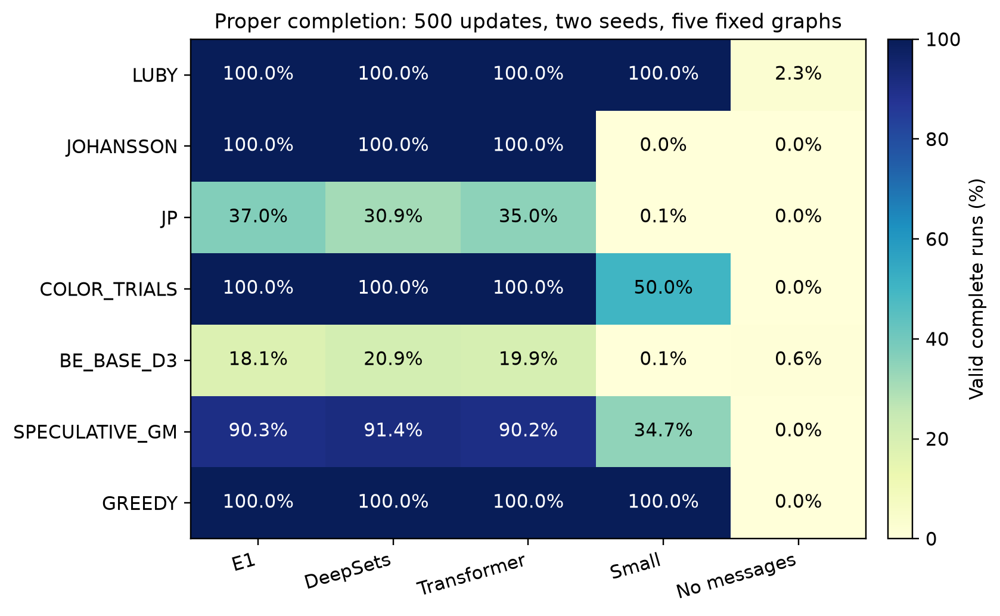
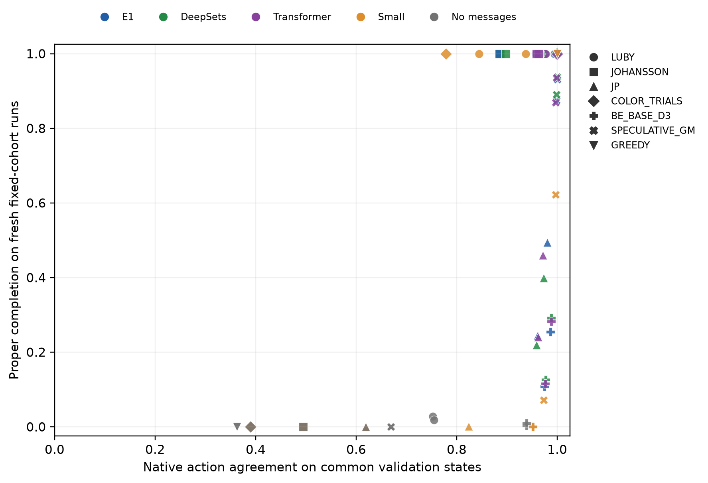
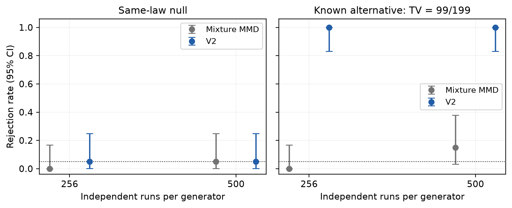
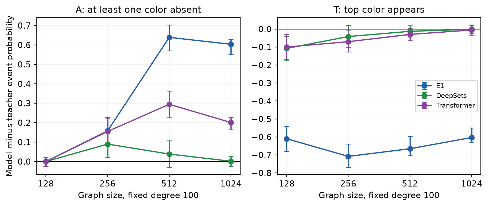
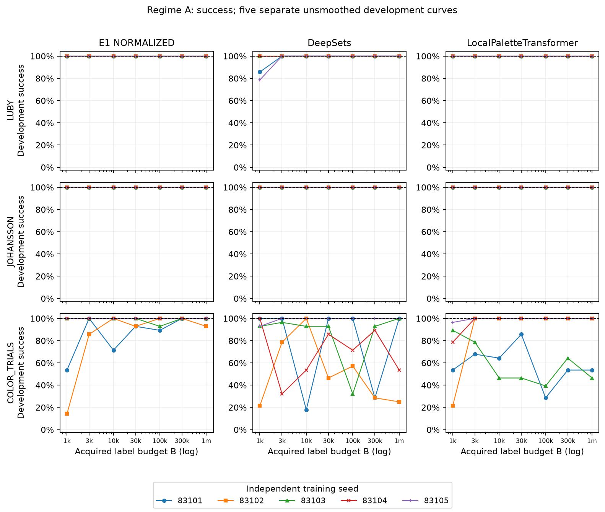
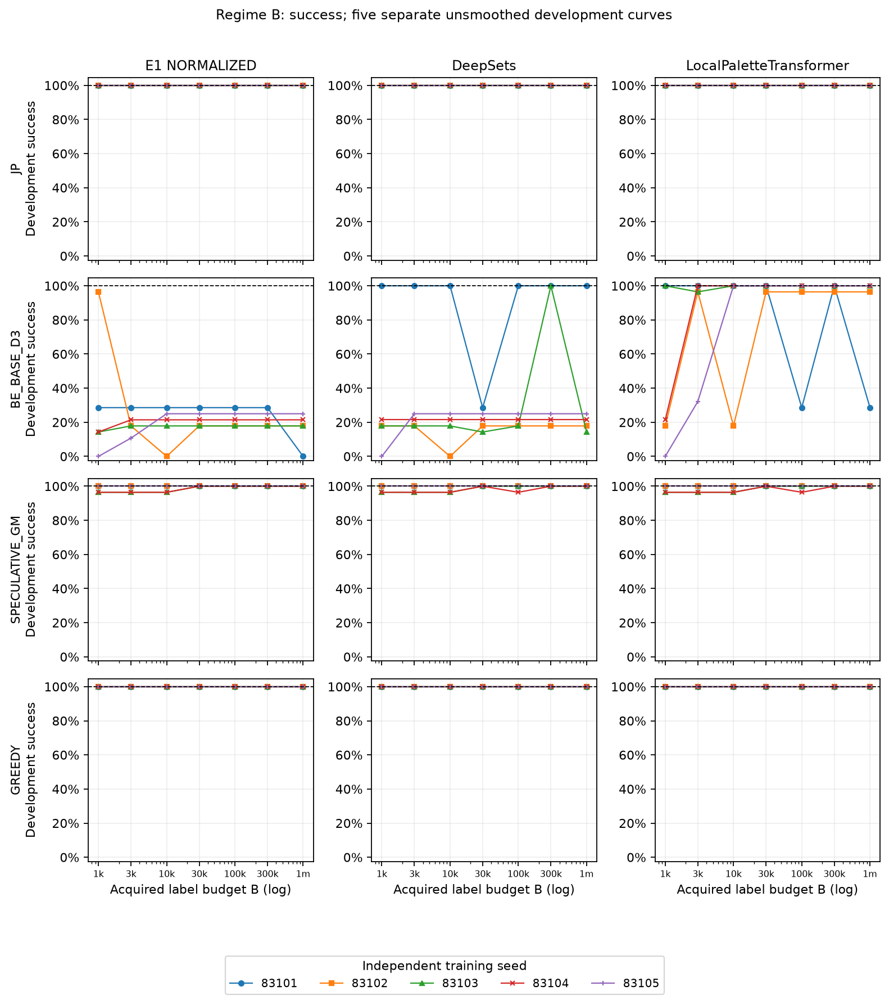

# Learning Distributed Algorithms from Algorithmic Teachers

Unpublished integrated research draft, 23 October 2026. Author list and order
remain to be agreed. Historical contributions are attributed by Git provenance.

# Abstract {.unnumbered}

Learning a distributed algorithm can mean predicting its actions, reproducing
its transitions, solving its task, matching its running time, or generating
the same probability law over solutions. These objectives need not coincide.
We investigate distributed graph coloring through seven explicitly scoped
algorithmic teachers and shared neural policies. A historical five-seed
architecture study finds that normalized node/color networks, DeepSets palette
scorers and local palette Transformers each complete all 1,520 held-out
evaluations, while aggregation and representation controls expose failures.
A complementary seven-teacher study shows that almost-perfect local action
accuracy can coexist with substantial autonomous failure. We integrate the
three palette architectures with every native teacher, add small and
no-communication controls, and train 70 balanced short-budget replicas. We
separately audit teacher safety and termination, compare independent scalar
specifications on 103 small graph representatives, and distinguish supplied
arithmetic and schedules from learned decisions. Statistical reconciliation
aligns the compared output laws and shows agreement between two procedures
on six identical archival banks. Fresh known-law controls reveal a large
power difference for localized alternatives. Our evidence supports a scoped
separation between functional generalization and fidelity to a teacher's
complete solution law. Missing historical collaborator weights prevent a
complete numerical replay of that cohort; no conclusion imputes those
artifacts or turns a nonrejection into equality.

A separate controlled-supervision study trains 735 fresh policies across seven teachers, three architectures, seven label budgets and five training seeds. Its strict benchmark certifies 12 of 21 teacher/architecture packages only when all five policies complete 1,000 final executions each without failure. Explicit information regimes, nonmonotone per-seed curves and fixed-label optimization controls separate this finite empirical certification from universal correctness and theoretical sample-complexity claims.

A counterfactual extension adds admissible phase-specific oracles and fixed-label optimization controls. It closes all nine previously pending teacher/core packages on fresh five-policy, 1000-execution batteries while preserving the twelve historical certifications. Concordant controls also close those cells; counterfactual continuation fidelity and required optimizer effort differ. Complete-output coupling, information ablations and larger-graph transfer delimit what functional success establishes.

# Introduction

A distributed coloring algorithm is an executable local rule embedded in a
communication model. A neural learner trained from its trajectories must
represent that rule, survive the states induced by its own decisions, and
remain meaningful when the number of neighbors or colors changes. A proper
coloring at the end of an execution is one useful outcome, but it leaves
several questions unanswered. Did the network make the same decisions? Did
it use the same information? Did it preserve the teacher's progress guarantee?
Did it sample the same coloring distribution?

These questions become sharper when teachers differ. Random trials use
private randomness to resolve conflicts; priority rules exploit distinct
identifiers; color-wise preferences compare several possible colors; auxiliary
color reduction uses finite-field representations; speculative programs repair
temporary conflicts; and sequential greedy coloring assumes a supplied order.
A common neural interface can compare their local decisions only if those
differences remain explicit. Equal parameter counts do not compensate for
different supplied information or computational schedules.

We study five notions of learning: **action fidelity**, agreement on common
teacher states and private inputs; **transition fidelity**, agreement of
updated states; **functional validity**, producing a proper complete coloring;
**complexity fidelity**, preserving an appropriate teacher-specific cost; and
**distributional fidelity**, agreement of the probability laws of complete
solutions on a fixed labeled graph. The central question is how these notions
relate across teacher, architecture and evaluation regime.

The project combines two complementary lines. The degree-generalization
studies emphasize variable palettes, neighborhood aggregation, conditional
safety/progress and full labeled output distributions. The native-teacher
studies emphasize distinct algorithms, supplied phase interfaces, local
imitation and autonomous size transfer. Their results are not pooled as if
they used one protocol. Instead we reconstruct the definitions, preserve
their separate cohorts and add a balanced integration experiment.

We add a second central axis: how much supervision each architecture needs
to achieve perfect functional performance within a defined benchmark.
An acquired node/action-component label is counted separately from a trajectory,
round, data replay or optimizer update. Information compatibility precedes
the comparison. The primary empirical gate requires all five independently
trained policies to complete every final execution without a single failure;
the observation and optimization budgets remain separate experimental factors.

Our strongest conclusion is deliberately qualified: some learned local
policies generalize functionally while differing from their teacher in
observable full-output laws. This is not a claim that every successful model
must differ, or that every difference can be detected at our sample sizes.
Symmetry can force equality on particular graphs, and a valid coupling can
certify approximate agreement on a fixed graph. A coherent account must
accommodate all of these outcomes.

## Contributions and their status

First, we specify a teacher/architecture interface preserving seven native
action alphabets and their supplied information. E1, DeepSets and local palette
attention are represented for each teacher, with a controlled short-budget
experiment and two additional baselines. This is a framework and empirical
study, not seven newly invented distributed algorithms.

Second, we provide conditional proofs for the coded exact teacher rules,
an independent scalar transition audit and explicit limits of finite testing.
A repaired input-domain guard has a saved failing regression. We separate
correctness of a mathematical teacher from correctness of an arbitrary
trained numerical policy.

Third, we reconcile the statistical objects before comparing findings.
Matched-bank replays preserve original statistics; fresh known-law controls
quantify a finite-sample sensitivity difference. Existing factorial data add
observable-event bounds and size/degree interactions without asserting a
monotone law for total variation.

Fourth, the repository supplies an evidence ledger, complete scientific audit,
frozen checkpoint manifests, historical negative results, executable
reproduction commands and remotely verified recovery artifacts. Historical
collaborator checkpoint-level reproduction remains explicitly incomplete.

# Related work

Neural algorithmic reasoning studies learned execution of algorithmic
computation [@velickovic2021nar]. CLRS supplies a common benchmark spanning
classical algorithm families [@velickovic2022clrs]. Our question focuses on
repeated local decisions in specified distributed interpreters, including
randomness and stopping semantics, and evaluates a solution law as well as
task success. We do not claim that trajectory imitation or algorithmic
generalization is new.

Distributed locality restricts the information available within a bounded
communication radius [@linial1992locality]. Connections between local algorithms
and GNN expressiveness clarify the importance of inputs, depth and aggregation
[@sato2019approximation; @loukas2020depth]. Those results do not imply that
a particular optimized network generalizes correctly. Our controlled
observations and conditional proofs concern explicit architectures and
teachers, rather than a universal GNN expressivity theorem.

Deep Sets gives a principled shared-function/pooling construction for sets
[@zaheer2017sets], while attention supplies content-dependent interaction
[@vaswani2017attention]. Here both act over each node's palette; graph
communication remains a neighborhood operation. Our positional palette
features retain color-name information, so these models must not be
described as fully color-permutation invariant.

Imitation learning encounters a state-distribution shift when learner actions
affect later observations [@ross2011dagger]. We use teacher trajectories and
counterfactual COMMIT labels, and evaluate autonomous rollouts. This is not
equivalent to on-policy dataset aggregation. Work on asynchronous GNN
inference also warns that synchronized behavior need not survive changed
execution semantics [@solodova2025hogwild]; this paper does not test
asynchronous correctness.

The teachers draw on randomized coloring [@luby1993randomness;
@johansson1999coloring], priority coloring [@jones1993parallel], polynomial
and iterative reduction [@linial1992locality; @kuhn2006complexity;
@barenboim2008linear], color-wise preference trials
[@schneider2010symmetry] and speculative repair
[@gebremedhin2000scalable]. We state the implemented specialization rather
than transferring the full complexity guarantee of each cited paper.

Kernel two-sample tests compare probability laws through MMD
[@gretton2012kernel]. Characteristicness is an identifiability property,
not a finite-sample power guarantee. Random-permutation calibration and
familywise correction require their own assumptions
[@hemerik2018exact; @holm1979simple]. Our honest witness omnibus is a
specified empirical instrument; no general minimax optimality or universal
dominance is claimed. This is a scoped primary-source review, checked on
23 October 2026, rather than an exhaustive novelty determination.

# Formal model and notions of fidelity

Let $G=(V,E)$ be a fixed finite simple undirected labeled graph, $n=|V|$,
and let $C_v$ be the allowed colors of vertex $v$. A state contains a partial
coloring $q_v\in C_v\cup\{-1\}$ and any explicitly declared auxiliary
variables. A proper partial state has no equal fixed colors across an edge.
For permanent-color trial teachers,

$$ A_v(q)=C_v\setminus\{q_u:u\in N(v),q_u\ge0\}. $$

In the local-palette studies, $C_v=\{0,\ldots,d(v)\}$. Native degree-three
comparisons use a common $C_v=\{0,1,2,3\}$ even at vertices of lower degree.
The two settings coincide on cubic graphs and generally differ on irregular
ones. No common maximum-degree input is supplied to the local-palette E1
policy. Some native adapters explicitly use the known bound 3.

A protocol step maps a current state and private input to participation $B$,
candidate $C$, confirmation $J$, an auxiliary choice, or a repair mark, according
to its native phase. A permanent fixation is applied only at a pending,
permitted participating node with a candidate and positive COMMIT. Palette
range, pending-node gating, native phases and schedules are supplied
mechanisms; availability and conflict decisions are learned unless explicitly
identified as an exact-teacher baseline.

For a frozen teacher $T$ and policy $M$, action fidelity evaluates their decisions
on identical input states and explicit random arrays. Transition fidelity
also evaluates the resulting states. Functional success is the event that
all vertices receive an allowed color and every edge has different endpoint
colors. These three predicates need not coincide. A policy may produce another
valid solution after its first action disagreement; an inaccurate decision
may instead propagate to a later conflict.

For cutoff $R$, write $S_R$ for proper completion and
$P_{T,R}^G=\mathcal L(X_G\mid S_R)$, where
$X_G=(c_1,\ldots,c_n)$. Vertex and color names remain fixed. A joint terminal
law instead observes colors, partial outcomes and status at $R$. A quotient
law canonicalizes color names. These are different estimands. If $P(S_R)=0$,
the conditional solution law is undefined and cannot be estimated by
resampling until success.

Total variation is
$\operatorname{TV}(P,Q)=\sup_A|P(A)-Q(A)|$. A statistically significant
fixed-event difference therefore gives a TV lower bound. For any valid
coupling $(X,Y)$, $\operatorname{TV}(P,Q)\le P(X\ne Y)$ instead gives an
upper bound. Large disagreement under a poor coupling supplies no lower
bound. In particular, shared-randomness action fidelity and solution-law
fidelity are distinct questions.

# Algorithmic teachers

**Table 1. Implemented teachers and computational scope.** All native
comparisons below have degree≤3 and global K4. Their exact references and
proof assumptions are expanded in AppendixA and the teacher-audit document.

| Teacher | Local decision | Supplied information and cost convention |
|---|---|---|
| LUBY | Bernoulli 1/2 participation; random available rank; reject equal neighboring proposals | Two exchanges per trial; no IDs needed |
| JOHANSSON | Always-active random available rank; reject equal neighboring proposals | Common K4; two exchanges per trial |
| JP | Pending strict ID maxima take first free color | Fixed distinct IDs; synchronous native rounds, capped 128 |
| COLOR_TRIALS | Strict discrete preference winner per color; keep lowest winning color | Preferences 0–3, availability exchange; repeated subroutine |
| BE_BASE_D3 | Linial field-point reductions then KW recoloring | Phase clock, polynomial evaluation and receiver-relative equalities supplied |
| SPECULATIVE_GM | Concurrent block assignment, same-slot detection, serial repair | Four balanced blocks and writable schedule supplied; intermediate conflicts allowed |
| GREEDY | One permitted vertex takes first free color | Sequential ID-order schedule supplied |

The word LUBY denotes the explicit coin-participation random-trial rule.
It does not mean that this repository implements every derandomization or
PRAM component of Luby's work. JOHANSSON uses a larger common initial palette
at lower-degree vertices; the original analysis permits larger initial lists,
but the output law differs from the smallest local-list initialization.
Repeated COLOR_TRIALS substitutes a fixed global degree bound for its
neighborhood bound and omits RankingTrials. BE_BASE_D3 is the degree-three
base construction with two explicit Linial steps, not the high-degree
recursive algorithm. GM and greedy retain schedules that would require a
separate distributed implementation if no scheduler were supplied.

The four parallel trial/priority interpreters stop at 128 native steps.
BE uses its auxiliary phases; GM and greedy run their supplied schedules.
The historical canonical E1 behavior experiment uses cutoff 256 and continues
after a collision. We retain these differences rather than calling all
reported native steps a common LOCAL running time.

# Neural policies

## E1 NORMALIZED

For each vertex/color pair define pending status $u_v$ and ownership
$o_{vc}=\mathbf1[q_v=c]$. Shared learned functions send a nonnegative
message and form a local state,

$$m^1_{vc}=\phi_1(u_v,o_{vc}),\qquad
h_{vc}=\psi_1(u_v,\max_{w\in N(v)}m^1_{wc}).$$

Availability is learned as $\alpha_{vc}=\sigma(a(h_{vc}))$. The ordered
prefix $S_{vc}=\sum_{j<c}\alpha_{vj}$ and
$D_v=\max(\sum_j\alpha_{vj},.5)$ give normalized endpoints
$L_{vc}=S_{vc}/D_v$, $U_{vc}=(S_{vc}+\alpha_{vc})/D_v$.
A shared scorer reads $h,\alpha,L,U,r_v^c$; the candidate is the maximum
scoring palette slot. Occupied colors are not removed by an exact mask.

The second exchange represents pending/ownership/participation/offer bits.
A learned COMMIT head reads the candidate slot after neighbor MAX. Its
prediction is applied without an exact safety veto. Canonical E1 has 16,035
parameters with hidden/message dimensions 64/32. This count is independent
of palette size, but messages, memory and computation grow with the palette;
each directed edge carries 32K floats per message stage in the direct
implementation.

## DeepSets and local palette attention

Both variants retain learned neighborhood messages, availability and COMMIT.
DeepSets replaces ordered-prefix scoring with shared per-slot features and
a mean of learned palette features. LocalPaletteTransformer projects slots
to dimension 16 and uses two-head self-attention with a 32-dimensional feedforward
layer and zero dropout. Its attention is within one vertex's palette, not
between arbitrary graph vertices.

Their slot inputs include learned availability, normalized color position,
inverse palette size and private randomness. Prefix-free is therefore not
position-free. All three models are vertex-equivariant in the ideal shared-rule,
invariant-aggregation model, while ordered prefixes and positions generally
break color-name permutation symmetry. Floating-point backend probes support
finite implementations but do not prove universal numerical equivariance.

## Native teacher adapters and baselines

The common native interface preserves Pedro's two-hop rooted representation
and exact action alphabets. LUBY/Johansson/greedy use the unextended core.
JP, ColorTrials, BE and GM retain supplied native context residuals. The
E1 version adds 3,361 parameters in those cases; analogous context is retained
for the other palette architectures. ColorTrials selects its final candidate
after the second message. BE-Linial predicts a valid field point and computes
the polynomial value through declared local arithmetic. The DeepSets and
Transformer masks use the actual field/palette size, including mixed field 7/13
examples.

Two new controls use the same supervision and native action interfaces.
The **small** model reduces hidden/message dimensions to 8/4 inside the
normalized family. The **no-communication** control erases received neighbor
states, relations and masks while retaining own state and supplied native
permissions. It is an information ablation with the same large core, not a
claim of parameter minimality. Exact teachers are zero-trainable-parameter
task baselines. The earlier direct-action 36,719-parameter GNN remains a
historical comparator; it uses different representation/loss choices.

No architecture is called minimal merely because it has fewer parameters.
We distinguish a mathematical information limitation, sufficiency within a
tested architecture family, and finite empirical success.

# Training and experimental design

## Three distinct training cohorts

The historical mechanism study trains five seeds 41000–41004 per primary
architecture on 800 cubic N40 graphs, three teacher trajectories,120 epochs,
Adam at .001 and batch 128 round examples. The full-graph E1 loss combines
participation BCE, candidate cross-entropy, and equal half-weights for own
and counterfactual COMMIT supervision. During ten warmup epochs COMMIT uses
teacher proposals. Afterwards exact labels are recomputed for the proposals
actually queried; hard proposals separate gradients into decision modules.
Training states remain teacher-generated. Rollout evaluation supplies the
autonomous-state test.

Pedro's native comparisons instead use five seeds 0–4, common immutable pools
of 800 cubic N40 graphs with three trajectories,17,760 updates and batches
of 1,680 eligible root decisions. The direct GNN uses native-action losses.
Its E1 follow-up uses 1,480 warmup updates and native own/counterfactual
confirmation labels. Star-local and full-graph intervention samplers are
different. The native follow-up also changes BE's auxiliary representation.
Consequently its architecture comparison measures a training/representation
package, not an isolated architectural intervention.

The integrated extension uses 24 new cubic N40 graphs, one trajectory each,
eight validation graphs and two new seeds 73000–73001. Every teacher has
the same five architecture cells. Timing pilots selected 500 common updates
of 128 root decisions, with 50 warmup updates, before scientific pools were
generated. This exposes 64,000 sampled root decisions per model. It is
intentionally a short-budget study, not a repeat of 29,836,800-decision native
training. All 70 final checkpoints are retained without validation promotion
or a second training budget after observing outcomes. Compatible shared
message/COMMIT initial weights are preserved across the three large palette
models within a seed; the small family has different dimensions.

The two initialization replicas share teacher-specific data pools. They do
not replicate data generation, and repeated rollout tapes do not create
additional independently trained models. Hyperparameters, parameter counts,
source hashes, training time, data manifests and checkpoint digests are
recorded in `results/integration/multiteacher/`.

## Evaluation and units of replication

The full-budget architecture cohort contains 304 common graph/tape cases
per model, giving 1,520 cases for five seeds of one architecture. It covers
degree and size transfer, irregular/heterogeneous families, cliques and
structured controls. The native cohort contains 396 cases per model through
N10,240. Its E1 follow-up uses already-published cases and is exploratory.
Five seed outcomes on one graph are not five independent graph instances.

The new native extension uses five independent graph specifications: regular
N16, irregular N40, regular N160, path 16 and K4, excluding training/validation
labeled fingerprints. Every exact teacher and checkpoint produces 128 new
independent executions on each graph. Full color vectors, statuses, native
steps, failure labels and random seeds are archived. The graph ensemble is
small and fixed; no confidence interval treats it as a representative sample
of all graphs.

Participation, candidate and COMMIT accuracy use common teacher states and
explicit private inputs. Native COMMIT labels retain their own semantics:
ColorTrials preference rejection is not identical to a physical collision;
GM assignment can deliberately create simultaneous conflicts before repair.
Per-phase action accuracy, component denominators and GM mark counts are
retained so WAIT or negative-mark imbalance cannot alone establish learning.

Functional evaluation applies the model's own decisions, with native
permissions but no oracle conflict veto. We report invalid outputs and
incomplete outcomes alongside successes. Mean native steps over all attempts
can be reduced by early failure; efficiency comparisons therefore also use
successful outputs and remain within one teacher. Parameter count, training
CPU time and native steps measure different costs. No deployment latency or
cross-teacher LOCAL speed ranking is inferred.

## Distributional inference

The primary observation is an independent complete run. For the historical
local-list studies, V2 splits the valid completed prefix into selection and
evaluation subsets, fits bounded witnesses on selection only, and calibrates
their joint maximum with a full-vector MMD component on evaluation rows.
Every permutation acts jointly on complete row labels; vertex columns are
never independently shuffled. Pooled scaling ignores evaluation source
labels. The permutation count 19,999 gives minimum p .00005.

The factorial primary family has 720 graph/checkpoint hypotheses and the
robust study 795. Event, irregular-graph, historical-replication and explanation
families remain separate. For the new extension, all 350 planned teacher/model/
graph comparisons form one Holm family. Every model is compared with its own
teacher's exact reference. A cell with fewer than four valid completed rows
is untestable and assigned p 1 only for planned-family bookkeeping. It is not
an equality result. Conditioning, failure frequencies and the native cause
of termination remain visible.

Pedro's separate behavior experiment uses a mixture of Hamming kernels and
terminal-status equality, plus family/size-stratified permutation aggregation.
It also tests a color-name quotient and obtains coupling-based TV upper
bounds. We audit its exact statistic and compare procedures on matched rows,
without pooling its hypothesis family with our graph-specific families.

# Conditional correctness and representation results

**Proposition 1 (safety and progress are separate).** For a proper partial
state, candidates supported on available colors and exact rejection of
simultaneous equal neighboring offers preserve properness. This alone
does not imply a uniform progress or termination bound.

*Proof.* A new color avoids old fixed neighbors by availability, and two
adjacent equal proposals cannot both be confirmed. This proves safety by
induction. In an all-free K-clique, suppose every node proposes color 0
and participates independently with probability 1/2. A node confirms only
when it is the unique participant, so the probability that any node advances
is $K/2^K$. Waiting for the first confirmation has mean $2^K/K$. A policy
that always waits never terminates. Safety thus supplies no constant
progress bound. The example concerns specified policies, not every learned
checkpoint. $\square$

**Proposition 2 (exact teacher guarantees on the declared domain).** Under
fresh independent ideal private randomness and the hypotheses in Table 1,
the uncapped LUBY, JOHANSSON and repeated ColorTrials teachers preserve
properness and terminate almost surely, with O(log n) expected native
rounds at degree≤3. JP is safe and terminates within n uncapped native
rounds. BE_BASE_D3 deterministically reaches four auxiliary colors in 15
native steps. Greedy and synchronized speculative GM terminate under their
supplied schedules and produce proper final colorings.

*Proof sketch; complete arguments in AppendixA.* Availability satisfies
$|A_v|\ge d_U(v)+1$. LUBY has conditional progress at least 1/4 using the
independent candidate product and Jensen's inequality. For JOHANSSON each
pending neighbor has at least two available colors, giving the sufficient
degree-three bound 1/8. For ColorTrials, the event that a vertex has preference 3
for a free color and all at most three competitors have preference≤2
has probability at least 27/256. A uniform positive conditional progress
boundρ gives $P(T>t)\le n(1-\rho)^t$ by iterated conditioning and union
bound. JP's eligible maxima form an independent set and include a maximum
pending ID. Polynomial reductions preserve proper auxiliary colors; KW
uses disjoint four-color blocks. Sequential first fit and the last-repaired
endpoint argument complete the remaining cases. Finite caps are distinct
from these uncapped guarantees. $\square$

**Proposition 3 (a finite-type sufficient COMMIT certificate).** For the
canonical MAX architecture, assume nonnegative deterministic shared messages,
zero empty aggregation, legal candidate-slot gathering and pending/participation
gating. A participating pending center's neighbor slot has six possible
legal types. If the COMMIT logit has the correct strict sign on all 64
subsets of these types, it implements exact rejection at arbitrary degree
and palette in real arithmetic.

*Proof.* Componentwise MAX is commutative, associative and idempotent, so
only the set of present types matters, not multiplicities. The gather
retains only the own candidate slot. Fixed ownership of that color and
simultaneously participating equal offers are the two forbidden types.
The 64-set sign table is therefore sufficient. It does not establish
candidate diversity or termination. Native continuous-ID/context extensions
are not automatically covered by this alphabet. Interval computations and
floating-point error assumptions are documented separately. $\square$

**Proposition 4 (a scoped information limitation).** A deterministic policy
given only its own color/pending status and private draw cannot reproduce
all arbitrary-state first-free decisions without neighbor information.
Further, in the memoryless current-state interface, some random-trial
COMMIT decisions require information beyond radius one.

*Proof.* A pending center with the same own inputs but a fixed neighbor of
color 0 versus 1 has different first-free colors; its identical local input
cannot prescribe both. For the radius example use path 0–1–2, with 0 and 1
pending and 2 fixed at 1 in one state and 2 in the other. Let both pending
vertices participate, with candidate draws .3 at 0 and .4 at 1 in common K4.
Vertex 0 proposes 1 in both states. Vertex 1 proposes 2 in the first state
and 1 in the second, changing vertex 0's COMMIT. Its radius-one initial
states/private inputs agree. This lower bound assumes no previously stored
neighbor availability or supplied free-color flags. It is not a lower bound
for every coloring algorithm, every persistent-memory protocol or every
scheduling model. $\square$

**Proposition 5 (clique conditional-law equality).** On K_n with exactly n
colors, any vertex-equivariant protocol with exchangeable private input
and positive probability of proper completion has the uniform conditional
law on the n! proper labeled color vectors.

*Proof.* Equivariance and exchangeability give a vertex-invariant trajectory
law by induction. The proper-completion event is invariant, so conditioning
preserves this invariance. Vertex permutations act transitively on all
proper n-color vectors. All conditional masses are therefore equal.
Different candidate rules can satisfy the same conclusion. This is not
proved by finite nonrejection and need not hold on other graphs. $\square$

**Proposition 6 (observable and coupling bounds).** A simultaneous interval
$[l,u]$ for $P_M(A)-P_T(A)$ gives
$\operatorname{TV}(P_M,P_T)\ge\max(0,l,-u)$. A valid coupling gives the
upper bound $\operatorname{TV}(P_M,P_T)\le P(X_M\ne X_T)$.

*Proof.* The first inequality follows by restricting the supremum defining
TV to the eventA and propagating its confidence statement. For the second,
the difference of probabilities of any event is bounded by the chance that
the coupled outcomes disagree. Taking the supremum proves the bound.
Neither compares TV distances across different-dimensional graph spaces.
$\square$

# Learning across teachers: historical evidence

**Table 2. Pedro's published full-budget native comparison.** Each entry is
successful graph/tape/checkpoint evaluations out of 1,980. These aggregate
counts are preserved historical evidence; their original weights and raw
output banks are missing here. The follow-up reuses known test cases.

| Teacher | Direct-action GNN | E1 / declared native adaptation |
|---|---:|---:|
| LUBY | 1,857 | 1,980 |
| JOHANSSON | 1,919 | 1,980 |
| JP | 1,635 | 1,631 |
| COLOR_TRIALS | 1,980 | 1,980 |
| BE_BASE_D3 | 872 | 1,980 |
| SPECULATIVE_GM | 1,975 | 1,951 |
| GREEDY | 1,842 | 1,980 |

These results establish no universal teacher ranking. E1/adaptations improve
the reported LUBY, Johansson, BE and greedy outcomes, leave ColorTrials at
complete observed success, and do not improve JP or GM. BE's large change
also changes auxiliary representation and training. Both positive and
negative before/after comparisons matter.

The JP E1 follow-up has mean local action accuracy .999735 but succeeds
in 1,631/1,980 autonomous evaluations. This directly illustrates accumulation
and state-distribution effects; it does not identify a unique causal mechanism
for every failure. The reported GM losses similarly warn that exact local
validation on sampled teacher states need not guarantee all rare conflict
marks in large autonomous executions.

# Functional generalization and aggregation

**Table 3. Full-budget historical architecture controls.** Five independent
training seeds share 1,520 held-out graph/tape/checkpoint evaluations per
architecture; the fixed evaluation instances are blocked rather than
treated as independent new graphs per seed.

| Architecture / intervention | Reported principal outcome |
|---|---|
| E1 NORMALIZED | 1,520/1,520 proper completions |
| DeepSets palette | 1,520/1,520 proper completions |
| LocalPaletteTransformer | 1,520/1,520 proper completions |
| Raw endpoint control | Lost progress in 346 evaluations |
| SUM aggregation | Stalled in 1,196 evaluations |
| MEAN aggregation | Produced 839 improper final colorings |

The normalized/raw-endpoint intervention preserves scorer tensor shapes,
initialization, data and update counts within seed, making it more controlled
than the earlier raw-prefix architecture comparison. SUM and MEAN alter
neighbor reductions and multiplicity handling. Their failures are evidence
about those implementations and training conditions, not a proof that SUM
or MEAN cannot represent any correct coloring policy.

The successful prefix-free models show that E1's original ordered prefixes
are not necessary for observed functional generalization in this experiment.
They still receive useful palette position information and learned graph
messages. No conclusion says that generic attention alone supplies a
distributed coloring algorithm. Constant parameter count also does not imply
constant communication or inference cost.

# Balanced teacher/architecture extension

**Table 4. New balanced finite-cohort functional outcomes.** Each model
architecture/teacher cell pools two fixed initialization replicas, five
fixed graphs and 128 independent runs per graph/checkpoint, totaling 1,280
attempts. The entries are counts of proper completions, not population
confidence bounds or full-budget architecture rankings.

| Teacher | E1 | DeepSets | Transformer | Small | No messages |
|---|---|---|---|---|---|
| Luby | 1,280 | 1,280 | 1,280 | 1,280 | 30 |
| Johansson | 1,280 | 1,280 | 1,280 | 0 | 0 |
| JP | 473 | 395 | 448 | 1 | 0 |
| ColorTrials | 1,280 | 1,280 | 1,280 | 640 | 0 |
| BE (base d 3) | 232 | 268 | 255 | 1 | 8 |
| Speculative GM | 1,156 | 1,170 | 1,155 | 444 | 0 |
| Greedy | 1,280 | 1,280 | 1,280 | 1,280 | 0 |

Figure 1 displays the same finite-cohort percentages. Individual seed/graph
records, failure types and native steps are available in `functional.csv`
and the original hashed banks. The exact reference uses one 128-run bank
per teacher/graph shared across its model comparisons; it is not counted
twice to create extra reference data.

All three large palette architectures completed 1,280/1,280 attempts for each of LUBY, JOHANSSON, COLOR_TRIALS, GREEDY. At the same short budget, JP and BE retained substantial failures, while speculative GM was intermediate. These differences compare specified training/representation packages, not intrinsic teacher complexity. Per-teacher architecture differences and both replicas remain in the table; there is no universal winner.

The short budget and small training graph sample limit interpretation. A
failed cell can reflect optimization or coverage, and does not prove a
representational impossibility. A successful small model establishes finite
sufficiency within its family; it does not prove parameter minimality.
The no-communication control retains native permissions, so its successes
cannot be generalized to a scheduler-free anonymous setting.

Figure 2 compares common-state local validation accuracy and autonomous
functional validity for all 70 separately trained models. Local validation
contains different phase/class mixtures across teachers, so between-teacher
horizontal comparisons require the per-phase denominators. Each plotted
point remains one checkpoint; rollout repeats are not training replicas.

# Complete-coloring laws and statistical reconciliation

## Historical local-palette evidence

**Table 5. Separate historical global-law cohorts.** Counts are rejections
after each declared Holm family. They are decisions under different cohorts,
sample sizes and methods, not comparable numerical distances.

| Architecture | Initial MMD:250 runs,265 comparisons | Robust V2:500 attempts,265 comparisons | Factorial V2:500 attempts,240 comparisons |
|---|---:|---:|---:|
| E1 NORMALIZED | 10 | 52 | 115 |
| DeepSets | 46 | 107 | 170 |
| Local palette Transformer | 127 | 181 | 180 |

On identical new robust banks, the earlier single-scale MMD gives 21,71,147
rejections respectively; on identical factorial banks it gives 49,121,174.
These matched-data comparisons isolate the procedure/budget difference from
historical new-bank variation. They still do not turn rejection counts into
a ranking of TV distances or make V2 uniformly more powerful. Archived
auxiliary cases include losses as well as gains for V2.

The distributional differences coexist with strong functional generalization
in the full-budget architecture cohort. Functional success restricts outputs
to proper colorings but does not select a unique probability law on that set.
The teacher itself need not sample proper colorings uniformly. Conversely,
the clique symmetry argument gives genuine scoped equality despite different
proposal mechanisms. Thus neither candidate mismatch nor success alone
determines a global-law conclusion.

## Reconciliation with the independent E1 behavior study

Pedro reports no rejections among 100 primary stratum/model/representation
tests using five newly trained E1s, degree≤3, common K4, cutoff 256 and 256
runs per graph. His experiment tests full labeled terminal vectors/status
and a color-name quotient. It is not the same checkpoint cohort, degree/palette
regime, cutoff or hypothesis family as Table 5. Ten labeled-law and eleven
quotient-law pairs obtain simultaneous TV≤.05 certificates using coupling
disagreement upper bounds. Those certificates are affirmative fixed-graph
approximate-equivalence statements; zero rejections alone would not supply
them. Their underlying raw banks and trained weights are not available here.

We independently verify the mixture statistic's equality to unbiased MMD
and its inclusive permutation calculation. On identical archival 500-row
banks from the first regular N128/degree 3 graph, neither mixture MMD nor V2
rejects any of the three s 41000 architecture comparisons. On the first
regular N512/degree 100 graph, both reject all three. Each high-degree raw
p-value is .00005; the exploratory six-test Holm value is .0003, whereas
the original 720-test V2 adjusted value remains .036. The original statistics
and p-values replay exactly. These are matched historical reanalyses, not
new independent confirmation or a replay of Pedro's missing weights.

Different finite-sample power remains scientifically important. On a star
with 200 iid binary leaves, change only the center from uniform on 199
high colors to uniform on a 100-color subset. Every vector is a proper
local-list coloring, TV equals 99/199, and the mixture population MMD² is
9.569688e-6. Twenty fresh independent experiments per cell give Table 6.

**Table 6. Independent matched-data controls, nominal alpha .05,999
permutations.** Entries are detections out of 20 independent experiments.

| Law | Runs per generator | Mixture MMD | Honest V2 |
|---|---:|---:|---:|
| Same-law star | 256 | 0 | 1 |
| Same-law star | 500 | 1 | 1 |
| Center-only alternative | 256 | 0 | 20 |
| Center-only alternative | 500 | 3 | 20 |

For the alternative the pointwise exact 95% power intervals are[0,.1684]
and[.0321,.3789] for the mixture and[.8316,1] for V2 at both sizes.
Figure 3 preserves the null controls and uncertainty. This finite-law result
does not establish strict Holm-adjusted power for 720 hypotheses or explain
every historical model comparison. In particular, it does not show that
Pedro's degree-three neural laws exhibit this star alternative.

The discrepancy classification is consequently mixed: different output
representations are different definitions; graph/palette/checkpoint/cutoff
changes are protocol differences; the known-law power gap is statistical;
and the effect of V2 on Pedro's exact original banks remains unresolved.
No speculative explanation closes that final gap. The complete audit is
`docs/integration/GLOBAL_DISTRIBUTION_RECONCILIATION.md`.

## New teacher-specific global comparisons

Of 350 planned teacher/checkpoint/graph hypotheses, 227 are testable and 123 have fewer than four successful model/reference rows. After Holm over the complete planned family, 6 reject. Each reference bank belongs to the corresponding teacher. These counts concern conditional output laws on a small fixed cohort; functional failures and limited power remain separate.

All six new rejections concern two small checkpoints that nevertheless
complete all 640 of their functional evaluations: LUBY seed 73001 and
ColorTrials seed 73000. Each differs from its own teacher on three fixed
graphs, with raw p .00005 and Holm-adjusted p .0175. The LUBY core has 551
parameters and the context-extended ColorTrials model 1,560. This supplies
new finite-cohort evidence for functional/distributional separation under
two teachers. The other small ColorTrials initialization fails all 640
functional attempts, so the successful checkpoint is not presented as
universal small-model robustness. The large architectures have no new
rejections here; those nonrejections do not certify their law equality.

The native comparisons use the audited V2 selection/permutation construction
with an explicit global-K4 histogram alphabet. The historical feature allocator
assumed max(degree)+1 bins, which is insufficient for valid four-color native
path outputs. The first call failed before producing a p-value. A separate
adapter repairs that allocation while preserving actual degrees, feature
definitions and the original frozen module. An independent color 3 path-null
test and a matching-alphabet exact replay verify the compatibility change.
This is documented as an integration repair, not an invalidation of the
historical local-list study. The new native power is not inherited from its
old validation by assertion.

**Table 7. New Holm rejections / testable comparisons (ten planned per teacher and architecture).**

| Teacher | E1 | DeepSets | Transformer | Small | No messages |
|---|---|---|---|---|---|
| Luby | 0/10 | 0/10 | 0/10 | 3/10 | 0/2 |
| Johansson | 0/10 | 0/10 | 0/10 | 0/0 | 0/0 |
| JP | 0/8 | 0/7 | 0/7 | 0/0 | 0/0 |
| ColorTrials | 0/10 | 0/10 | 0/10 | 3/5 | 0/0 |
| BE (base d 3) | 0/6 | 0/7 | 0/5 | 0/0 | 0/1 |
| Speculative GM | 0/10 | 0/10 | 0/10 | 0/9 | 0/0 |
| Greedy | 0/10 | 0/10 | 0/10 | 0/10 | 0/0 |

Every law test conditions on proper native completion and compares with the
corresponding teacher. The retained status/failure data are essential: a
rarely successful network may have an estimable conditional law on some
graphs while performing poorly overall. Untestable cells and nonrejections
remain distinct. No test result establishes exact equality of all teacher
and learner laws.

# How size and degree affect distributional generalization

The factorial study varies n∈{128,256,512,1024} and degree
Delta∈{3,10,50,100}, with three fresh regular graphs per cell and five
fixed checkpoints per architecture. It uses local palettes,500 primary
attempts and 125 separate explanation attempts per generator. Its target is
this fixed graph/checkpoint cohort, not a population of infinitely many
graphs or trainings.

Two preregistered events are $A=\{U(X)\le\Delta\}$, with U the number of
used colors, and $T=\{\text{color }\Delta\text{ occurs}\}$. EventA says
that at least one palette color is absent, not necessarily the maximum.
For E1 at degree 100, the equal-weight cohort differences in P(A), model
minus teacher, are approximately 0,.157,.639,.603 as n increases through
the four values. Their simultaneous intervals include[.570,.703] at
n 512 and[.550,.629] at n 1024. At degree 50, the top-color difference
instead attenuates from-.239 at n 128 to-.004 at n 1024. These are
observable-probability effects, not a monotone full-TV scaling law.

Figure 4 displays the registered effects with their simultaneous bands for
all three architectures at degree 100. Across the principal factorial,
the E1 eventA interaction between n 256/n 512 and degrees 50/100 is
.566 with simultaneous interval[.428,.704]. A shared teacher bank is
counted once when averaging architecture effects. The earlier all-fifteen
E1 replication at the new n 512/degree 100 graphs rejects 15/15 comparisons;
combining the two prespecified event lower bounds gives a minimum simultaneous
TV lower bound .078 across those fifteen graph/checkpoint pairs.

In regular graphs, degree also changes palette size. Their separate causal
effects are not identified by this design. Comparing TV lower bounds on
different graph spaces does not order the true TV values. Three graph
instances and five historical trainings constrain population claims. The
independent holdout witnesses and exploratory candidate interventions remain
separate analyses; an observed proposal/final-law association is not alone
a causal mediation result.

# What the baselines establish about GNNs

Neighborhood information has a precise role: free-color decisions inspect
fixed neighbors, and confirmation can require neighbors' availability-dependent
offers. The scoped indistinguishability examples prove limits for an own-state
or one-round current-state interface, rather than proving that a large GNN is
necessary for graph coloring. Exact classical rules already solve the task
with no trainable parameters when their required information and schedule
are supplied.

MAX provides a degree-insensitive representation of Boolean existence and
permits the finite-type COMMIT reduction. SUM can encode counts and MEAN
proportions; a training procedure may exploit multiplicity-dependent shortcuts
that fail outside the observed degrees. The historical negative controls
demonstrate such risks for specific learned models. They do not constitute
expressivity impossibility results for those aggregators.

DeepSets and attention investigate how a node represents its palette. Their
success shows that the original prefix scorer is not the only sufficient
mechanism in the tested setting. Both still communicate over graph edges.
The small control tests reduced width within a normalized family. The
no-communication control tests missing information while preserving core
parameter count and supplied permissions. Any comparison of those baselines
must retain these differences.

The small LUBY model has 551 trainable parameters and completes all 1,280 LUBY evaluations; the small greedy control also completes all 1,280 under its supplied schedule. Thus the larger core is not empirically necessary for those finite cells. In contrast, the no-communication control completes 38/8,960 total attempts across the seven teachers. This supports the value of received information under this protocol, without proving that the particular large GNN or a learned message MLP is necessary. Small-model failures for other teachers are retained and do not establish incapacity beyond this budget.

Teacher independence is similarly scoped. One architecture can expose the
action alphabet for all seven teachers, but supplied preferences, priorities,
phases and schedules change the observation interface. Success across those
interfaces is not learning arbitrary unseen algorithms from identical raw
inputs. The finite experiment supplies evidence of adaptability, with cells
that fail retained as limitations.

# How Much Supervision Does It Take to Learn a Distributed Algorithm?

A teacher observation is one acquired decision label for a specified node,
state and action component. In ordinary color phases we count participation,
proposal and confirmation separately; Linial point selection and speculative
conflict marking each count as one. Replaying a stored label adds optimizer
work and no new supervision. Query counts, component types, trajectory clusters,
unique observations and data hashes are recorded independently of updates.
This distinction matters because sequential imitation changes the states a
policy visits [@ross2010efficient; @ross2011dagger]. Existing imitation
sample-complexity theory depends on its own state-space and horizon assumptions
[@rajaraman2020limits]; our finite curves imply no analogous theoretical bound.

Information compatibility is established before comparing budgets. Anonymous
regime A contains LUBY, JOHANSSON and repeated COLOR_TRIALS. Extended regime B
contains JP with explicit relative-ID comparisons, BE with auxiliary colors,
phase clock and supplied finite-field arithmetic, GM with priority comparisons
and its native block/repair schedule, and sequential GREEDY with writable-node
permissions. The three palette architectures have identical teacher-specific
observations and learned graph messages. Transformer attention acts within a
node's palette; it is not a replacement for graph communication. Interface
sufficiency arguments and an anonymous-JP indistinguishability example do not
prove universal representability by these fixed network widths.

For a policy to PASS, every frozen execution must end with a proper in-palette
coloring, all protocol invariants respected, termination by the teacher-specific
deadline, and no technical error, cutoff or incorrect terminal state. We use
no 95% functional threshold, repair filter or failed-tape replacement. A
teacher/architecture/budget combination passes only when all five independently
trained policies pass their respective 1,000-case final batteries. These are
five separate policies, not one policy tested 5,000 times.

All seven exact teachers passed every frozen final case before student
confirmation. Native deadlines distinguish n-step sequential greedy and JP's
at-most-n priority steps from BE's 15 reductions and the randomized teachers'
prospective tail deadlines. Native steps with different semantics are never
directly interpreted as identical distributed communication units.

The balanced cohort comprises 735 fresh trainings, five seeds per cell, seven query budgets from 1,000 to 1,000,000, and 500 Adam updates per training. Its shared teacher libraries acquired 34,999,967 component labels in total; smaller-budget policies only access their hashed prefixes. Training sizes are 8–24, development sizes 28/36, and confirmation sizes 32/48/64, in seven prescribed graph strata. The first budget where all five development policies are perfect nominates one frozen candidate; final results cannot choose another budget. Of 21 teacher/architecture packages, 16 nominated a candidate, 12 achieved five-seed PASS, and 80,000 final student executions were retained.

**Regime A. Smallest validated candidate budget, or explicit lack of certification.**

| Teacher | E1: B* | DeepSets: B* | Transformer: B* |
|---|---|---|---|
| LUBY | 1,000; 5/5 PASS | 3,000; 5/5 PASS | 1,000; 5/5 PASS |
| JOHANSSON | 1,000; 5/5 PASS | 1,000; 5/5 PASS | 1,000; 5/5 PASS |
| COLOR_TRIALS | NOT CERTIFIED; 3/5 (candidate 300,000) | NOT CERTIFIED; 0/5 confirmed (no candidate; max 1,000,000) | NOT CERTIFIED; 0/5 confirmed (no candidate; max 1,000,000) |

**Regime B. Smallest validated candidate budget, or explicit lack of certification.**

| Teacher | E1: B* | DeepSets: B* | Transformer: B* |
|---|---|---|---|
| JP | 1,000; 5/5 PASS | 1,000; 5/5 PASS | 1,000; 5/5 PASS |
| BE_BASE_D3 | NOT CERTIFIED; 0/5 confirmed (no candidate; max 1,000,000) | NOT CERTIFIED; 0/5 confirmed (no candidate; max 1,000,000) | NOT CERTIFIED; 0/5 confirmed (no candidate; max 1,000,000) |
| SPECULATIVE_GM | NOT CERTIFIED; 4/5 (candidate 30,000) | NOT CERTIFIED; 4/5 (candidate 30,000) | NOT CERTIFIED; 4/5 (candidate 30,000) |
| GREEDY | 1,000; 5/5 PASS | 1,000; 5/5 PASS | 1,000; 5/5 PASS |

A NOT CERTIFIED cell reports an unachieved protocol threshold B*>1,000,000,
not an impossibility theorem. Its earlier development budgets were evaluated;
policies failing development were not exhaustively tested in confirmation.
Per-seed queries, failures, compute and the distinction between an unattempted
candidate and a failed confirmation remain in the machine-readable tables.

The grid does not assume monotonic improvement. Fixed optimization also means
larger libraries can leave more acquired observations unused; visit counts
are exported. Thus these are supervision curves conditional on the specified
optimizer budget, not pure information-theoretic sample requirements.

For zero failures in 1,000 independent runs of one frozen policy, the one-sided
95% binomial lower success bound is 0.9970087504549047. Under fixed independent
strata the same zero-failure bound conservatively controls their
allocation-weighted mean by the arithmetic–geometric mean inequality. It does
not cover every graph or simultaneously all trained policies. The five seeds
remain the units of training replication.

## Optimization, capacity and interactive controls

The following entries count seeds completing all development cases, at the
same B=3,000. They are exploratory development outcomes, never final PASS:

| Teacher | Passive E1 500 updates | Passive E1 1,500 updates | Small 500 | No messages 500 | Interactive 500 total |
|---|---|---|---|---|---|
| LUBY | 5/5 | 5/5 | 1/5 | 0/5 | 4/5 |
| JP | 5/5 | 5/5 | 0/5 | 0/5 | 5/5 |
| BE (D3) | 0/5 | 5/5 | 0/5 | 0/5 | 1/5 |

The fixed-label control changes only E1's optimizer updates. The small and
no-message models share the same label prefix and update budget. The
one-aggregation interactive control allocates half the labels to passive
warmup and half to admissible states visited by the warm policy, with 250+250
updates and an Adam reset at aggregation. Failed learner trajectories remain
recorded. It excludes GM's unproved arbitrary-history interface. These limited
controls cannot identify every failure as a representation or data limitation.

Functional PASS does not logically imply action or transition fidelity,
teacher-like execution time, or equality of complete coloring laws. Separate
teacher-state fidelity and native-step curves retain all five seeds. Historical
law tests are not imported as evidence for the new checkpoints. The full
protocol, audit, negative results, dataset/checkpoint hashes and reproducible
figure sources accompany this finite empirical statement.

The GM confirmation failures (normalized: 79, deepsets: 79, transformer: 79) leave only isolated vertices uncolored and occur in training seed(s) 83105. A post hoc singleton witness using the frozen candidate weights reproduces an incorrect confirmation rejecting assignment despite positive participation, while the exact teacher succeeds. The cached prefix contains 5 isolated-assignment bundles (three component labels per bundle), and the exact recorded minibatch order presents them 9 times; the affected seed's development suite contains 0 isolated vertices. This identifies a rare-state fit defect missed by development coverage. It does not show an absence of ID information or prove a universal capacity limitation. The diagnostic changes no model, budget, primary classification or final tape. Full traces and presentation-count checks are in structural-failure-witnesses.json.

The independent exploratory coloring-law supplement tests 210 fixed teacher/checkpoint/graph hypotheses using the audited native K4 robust instrument, split selection/evaluation rows, 9,999 permutations and Holm over the complete family. 210 comparisons are testable and 0 reject. Untestable comparisons retain p=1; conservative futility also cannot create rejection. These are conditional-on-success laws on two fixed small graphs, not equality guarantees or an additional functional PASS condition.

The small-model supplement repeats all seven budgets for three representative teachers and freezes independent final tapes under the same five-seed gate:

| Teacher | Small parameters | Small validated B* | Seeds confirmed | Final attempted |
|---|---|---|---|---|
| LUBY | 551 | NOT CERTIFIED | 0/5 | False |
| JP | 1560 | NOT CERTIFIED | 0/5 | False |
| BE_BASE_D3 | 1560 | NOT CERTIFIED | 0/5 | False |

Without a common development candidate no student final is attempted. These outcomes establish neither universal minimality nor the behavior of all possible small networks.

The additional fixed-label optimization protocol freezes both existing optimizer arms for all three control teachers and evaluates them on new paired final batteries. It checks identical label-prefix and initialization hashes and changes no primary outcome:

| Teacher | 500 updates, B=3,000 | 1,500 updates, B=3,000 |
|---|---|---|
| LUBY | PASS (5/5) | PASS (5/5) |
| JP | PASS (5/5) | PASS (5/5) |
| BE_BASE_D3 | NOT CERTIFIED (0/5) | PASS (5/5) |

A PASS here validates the fixed B=3,000/optimizer point only; it is not a new grid minimum or a retry of the primary confirmation.

# Discussion

The evidence supports the proposed distinction among notions of learning.
The native JP example separates local action accuracy from autonomous
validity. The historical palette study separates successful coloring from
exact candidate imitation. Full-law tests and event bounds separate task
validity from teacher-distribution fidelity. Clique symmetry and scoped
coupling certificates show why the converse statement, that every imitating
network must have a different global law, would also be false.

Teacher changes can affect a policy without changing its unrestricted output
law. Exact synchronous JP with fixed distinct priorities gives the same
first-fit solution as sequential greedy in descending priority order. If ID
order is uniform, ascending and descending orders are both uniform, so
uncapped JP and random-order greedy induce the same final-coloring law.
Their common-ID executions and native costs can differ. Conditioning JP
on a restrictive 128-round cap can also change that equality. This elementary
observation prevents equating algorithm identity with solution-law identity.

The statistical reconciliation illustrates a complementary point. A
characteristic kernel identifies laws in the population but can place a
large TV difference in a weak finite-sample direction. Honest local witness
selection can help in a specified alternative class while preserving
conditional calibration. It can still miss rare or unrepresented high-order
effects. Statistical instruments are part of the experiment, not neutral
or universally powerful labels attached afterwards.

The strongest paper narrative therefore concerns the relationship between
teacher specification, architectural information and the notion of fidelity.
It does not require deciding that one research line was right and the other
wrong. Differences caused by definitions should be stated; actual bugs
should be repaired with evidence; remaining numerical gaps should remain
open. This approach permits a defensible joint interpretation without
erasing contradictory-looking historical records.

# Limitations and unresolved claims

The principal historical limitation is missing collaborator runtime data:
five retrained E1s,35 native E1s, source pools and original full coloring
banks. Published tables and sources can be checked, but exact model-level
reproduction has not been completed. The new 70-model cohort is not a
substitute for those artifacts. Independent scientific review of this
integrated draft remains pending.

The historical balanced integration design has two initialization replicas,24 training graphs,
one trajectory per graph and a much smaller exposure budget than the earlier
full-budget studies. It does not identify an asymptotic architecture ranking
or separate optimization from capacity in failed cells. Native teacher
generalization above degree 3 or to local palettes is unsupported by this
interface. The separate historical local-palette evidence must retain its
own checkpoints and protocols.

The separate supervision study uses five replicas and controlled acquired-label
budgets but only 500 primary updates and a finite graph/tape distribution.
Its additional fixed-label optimization and interactive controls probe selected
failure mechanisms; they do not identify an intrinsic information-theoretic
sample requirement or establish a universal architecture ranking. Its local
prospective freeze is not an independently timestamped external registration.

Finite functional success does not prove universal neural safety, termination
or complexity preservation. Canonical MAX certificates require precise
algebraic/numerical assumptions and do not cover every native context head.
The simulator is synchronous, with supplied schedules and arithmetic for
some teachers; distributed preprocessing and asynchronous deployment are
not evaluated.

Output-law tests have finite power and resolution. Their nonrejections are
not equality statements, while conditional solution laws do not determine
failure or stopping-time laws. Multiple separate historical families do
not give one 5% guarantee over their union. CP/Hoeffding/DKW bounds concern
their stated finite cohort or observable families, not a graph population.
No causal degree/palette separation or general monotone TV law is established.

# Counterfactual supervision across native teachers

## Reconstruction and causal domains

We reconstruct M6B from authenticated original source and 21 historical
artifacts. The 249/500 traditional, 476/500 own-proposal and 500/500
counterfactual outcomes concern one training seed, 10001, on paired cubic
N10240 cases. Thirty original-policy executions are replayed exactly. M6B
uses the 8967-parameter M4B architecture, whereas canonical E1 has 16035
parameters. The own/CF checkpoints share every participation, first-message
and candidate tensor; only the second-message and COMMIT tensors differ.
The configured 120-epoch horizon is 17760 updates; the selected checkpoints
are epoch 53, or 7844 updates. The traditional comparison also changes the
number of tapes per graph, so its improvement is not a pure CF effect.

Pedro's 16 source hashes are verified against commits fc756cef, 80f486eb and
6836d855. None of the 40 expected original E1 weight hashes was recovered
from 6614 local checkpoint files or the inspected public release manifests.
His five 1980/1980 results, JP 1631/1980 and GM 1951/1980 remain authenticated
reported evidence with five initializations over 396 published cases and a
common training pool. His 17760 updates of 1680 roots and own/CF training
also differ from the primary 500-update, batch 64 passive study. New runs
below reproduce mechanisms, not those unavailable original policies.

We define a phase-specific label operation

$$\mathcal O_T(S,a,\xi)=D_T^\phi\bigl(R_T^\phi(S,a,\xi)\bigr),$$

where $S$ is an admissible native snapshot, $a$ a typed intervention,
$\xi$ the private input, and $R$ recomputes every causal descendant before
the phase decision $D$ is queried. We distinguish native decisions from
defensive continuation queries on offers that the native policy might not
emit. The latter are additional supervised tasks, not a claim that arbitrary
simulator arrays are reachable teacher states. For BE and JP, forced
participation cannot bypass phase eligibility or priority; ColorTrials
confirmation requires strict winning preferences under actual availability.
Linial points and GM detection marks have separate native oracles.

Admissible contexts are reconstructed from legal prefixes. Changing IDs
requires a new complete replay, including comparisons, blocks, permissions
and auxiliary initial colors. Private preference/draw interventions preserve
the persistent state and regenerate messages. KW arithmetic and Linial
evaluations are recomputed; speculative GM histories retain their supplied
schedule, actual assignment colors, marks and repair queue. We export 162
additional hard contexts with replay witnesses. The three palette cores
share these training-only adapters. All teacher and autonomous inference
source files remain unchanged from the baseline; no exact decision replaces
the neural confirmation head.

## Paired controls and strict new certifications

We train 135 primary runs: three pending teachers, three cores, five new
seeds and three treatments. Each preserves 500/1500/4000 checkpoints, the
same native bank, initialization and minibatch sequence within a seed/core.
Passive is the historical loss. Matched evaluates COMMIT with its stored
teacher proposals and corresponding label. Fixed-bank CF uses 100 matched
warmup updates, then P + C + .5 matched confirmation + .5 CF confirmation.
Each normal root acquires three native component labels and four additional
stored confirmation queries; Linial and DETECT each acquire one native label.
Own-proposal queries in a separate seven-teacher pilot are charged individually.

Training uses N8/12/16/24. An amendment recorded before the additional screen
and all new finals expands development from 60 to 300 cases at N28/36.
The first common perfect checkpoint is frozen per treatment. Final has five
independent 1000-case batteries at N32/48/64, ten fixed family strata,
native horizons, and the strict original invariant/terminal gate.

Matched passes all nine pending packages, using 1500 updates for BE,
500 for ColorTrials/E1, 1500 for its other cores and 500 for GM.
CF initially fails BE at 1500 in seed 94105 for all cores, and
ColorTrials/E1 at 500 in seed 94103. Independently frozen follow-ups compare
existing 1500/4000 CF checkpoints on new namespaces, retaining both outcomes.
BE 1500 again fails in seed 94105; ColorTrials/Transformer1500 has two failures
in its new battery. All six 4000-update packages pass. The following CF fixed
points therefore close all nine cells, while the historical twelve remain
separate: coverage is 21/21, not one homogeneous newly retrained cohort.

| Teacher | Core | Updates | Native labels | All labels | Final |
|---|---|---|---|---|---|
| BE | normalized | 4000 | 3000 | 6776 | 5 x 1000/1000 |
| BE | deepsets | 4000 | 3000 | 6776 | 5 x 1000/1000 |
| BE | transformer | 4000 | 3000 | 6776 | 5 x 1000/1000 |
| ColorTrials | normalized | 4000 | 30000 | 70000 | 5 x 1000/1000 |
| ColorTrials | deepsets | 4000 | 30000 | 70000 | 5 x 1000/1000 |
| ColorTrials | transformer | 4000 | 30000 | 70000 | 5 x 1000/1000 |
| GM | normalized | 500 | 3000 | 6104--6120 | 5 x 1000/1000 |
| GM | deepsets | 500 | 3000 | 6104--6120 | 5 x 1000/1000 |
| GM | transformer | 500 | 3000 | 6104--6120 | 5 x 1000/1000 |

The complete extension retains 195000 final execution rows, 194979 correct,
and 170 distinct frozen checkpoints. Repeated checkpoints on a second
battery are not new training replicas. All eight representative failed
checkpoint/battery traces reproduce their original outcomes under the same
32-case cohort and 1024-root numerical batching. BE failures are omitted
required KW recolorings that violate the new auxiliary bound. No failure is
repaired or removed. An explicit erratum preserves and corrects the CT
follow-up plan's reason-text typo (the original E1 failure was at 500,
not1500); the actual checkpoint hashes, batteries and rows are unchanged.

## Functional validity and continuation fidelity

At 4000, all permitted roots in 60 common native development trajectories
per seed are audited, with four fresh continuation queries per color root.
The table reports descriptive aggregate percentages across five policies;
root decisions are not independent training replicas. Per core, the CF
denominators are 499200 for BE, 41036 for GM and 57576 for ColorTrials.
Full per-seed action, actual-transition, component and phase counts remain
machine-readable. The certified GM500 policies have separate full audits
at their actual checkpoint; the table fixes4000 for the paired comparison.
CF improves the broader continuation task, while the
matched/passive procedures already satisfy the functional gate. Thus CF
is not uniformly necessary, or better at the same update count, for native
functional success. A matched ColorTrials/E1 run regresses from 60/60 to 43/60
development successes between 1500 and4000 updates.

| Teacher | Core | Matched CF (%) | CF-trained CF (%) | CF native actions (%) |
|---|---|---|---|---|
| BE | normalized | 9.269 | 99.993 | 100.000 |
| BE | deepsets | 9.269 | 99.993 | 100.000 |
| BE | transformer | 9.269 | 99.993 | 100.000 |
| GM | normalized | 75.363 | 100.000 | 100.000 |
| GM | deepsets | 75.363 | 100.000 | 100.000 |
| GM | transformer | 75.363 | 100.000 | 99.995 |
| ColorTrials | normalized | 97.256 | 99.745 | 99.187 |
| ColorTrials | deepsets | 99.097 | 100.000 | 100.000 |
| ColorTrials | transformer | 98.076 | 100.000 | 100.000 |

For BE/GM, every second-stage and COMMIT tensor is identical across the
three palette cores in each paired fixed-proposal seed/update comparison.
Those losses do not use the candidate scorer, whereas ColorTrials reads its
candidate after the second exchange and couples those gradients. Shared
heads explain correlated architecture outcomes; they do not provide three
independent confirmations of a head-level effect.

Nested ColorTrials banks at native budgets 1000/3000/10000/30000 and fixed
500/1500 updates provide development-only supervision curves. Every CF
label is charged; these do not establish a new certified minimum. A matched
GM control without the added isolate families also passes all five new
development seeds, so the tested ablation does not isolate a positive
coverage effect. The authenticated old seed 83105 failures and all 30 new
regressions remain a separate observation. The own-plus-CF portability pilot
passes 60/60 development in six teachers for one new E1 seed, but BE obtains
22/60 at 1500; copying the Luby curriculum is insufficient evidence of a
uniformly successful multiteacher procedure.

## Information, complete outputs and transfer

JP's information control fixes the architecture, labels, batches, 500 updates
and initialization, changing only two local context channels. Relative order
passes all five 60-case development suites; raw endpoint IDs, differences
and removed IDs do not. Twenty numerical replays reproduce every original
ablation weight tensor and retain intermediate Adam/RNG checkpoints.

| JP representation | Development successes, five seeds (/60) |
|---|---|
| without_ids | 6, 6, 6, 6, 6 |
| numeric_ids | 13, 11, 6, 26, 15 |
| numeric_differences | 16, 15, 19, 31, 20 |
| relative_comparisons | 60, 60, 60, 60, 60 |

An indistinguishability witness swaps the IDs on a pending edge: anonymous
observations are equal but native eligibility reverses. Edge order suffices
for the implemented priority decision. This is an observation-level
obstruction, not a claim that numeric IDs are unlearnable. ColorTrials has
a second-hop availability witness. Historical M6 also aliases the float64
draws $1/2-2^{-28}$ and $1/2+2^{-28}$ to the same float32 observation,
despite opposite activation labels. The current native teacher directly
queries its supplied float32 inputs, avoiding that particular obstruction.

After functional selection, all 45 successful CF policies are frozen before
fresh law and transfer tapes. On path8 and K4 plus four isolates, 256
shared-input runs per graph/policy compare the full labelled terminal vector
and status, without success filtering. The coupling inequality and exact
one-sided binomial bounds with Bonferroni .05/90 yield 89/90 simultaneous
TV-at-most-.05 certificates. These are approximate fixed-graph marginal-law
bounds, not equality. ColorTrials/E1 seed 94104 on path8 has36/256 coupled
disagreements, upper bound .223630 and mean 2.191406 native steps versus
2.097656. Coupled disagreement is not a TV lower bound or proof that the
marginal laws differ. Empirical full-vector histograms and native times are
retained separately.

Exploratory transfer obtains 3780/3780
correct executions, 84 per policy at N128/256/512. Its ten domain families
are supplemented by binary trees, diamond chains, triangle chains and
subdivided K4 components, all of maximum degree3. These finite observations
do not extend the teacher to higher degree, local palettes or arbitrary
graphs/tapes. Functional validity does not establish universal decision or
law identity.

The complete campaign contains 278 computational training
runs, including paired arms, pilots and numerical replays, with
683504 gradient updates and
2.580 CPU optimization hours.
Training GPU time is zero; the original M6 CUDA replay is separate.
Process times overlap. Acquired components, reused labels, presentations,
simulator work and optimization remain separate; no sample-efficiency claim
compares unequal update budgets. All sources, models, datasets, witnesses,
negative results and manifests accompany this extension. The verification
recomputes every final gate and all stored CF labels with zero label
inconsistencies. The full suite's639 cases and29 later added cases pass.

These contributions complement trace-oriented CLRS @velickovic2022clrs and
learner-state acquisition in DAgger @ross2011dagger. Recent contrastive
graph-coloring work @le2026contrastive studies approximate-coloring
objectives. Our contribution is the specified admissible-oracle framework,
controlled separation of training factors, and finite native execution
evidence; no comprehensive bibliographic priority or universal learnability
claim follows from this study.

# Conclusions

Learning from an algorithmic teacher has several distinct targets. Our
integrated coloring project shows how the teacher's information and action
interface constrain architecture design, how strong local imitation can
fail in autonomous execution, and how functional extrapolation can coexist
with a changed complete-solution law. Exact teacher baselines and smaller
controls prevent attributing classical task solvability to GNN complexity
alone. Symmetry and coupling also identify settings where distributional
agreement is possible despite different decision mechanisms.

The counterfactual extension supplies independently validated functional points for all nine pending packages, preserving the prior twelve as historical reference. Its controls show that label concordance and optimization can close a functional gap without demonstrating universal CF superiority. Counterfactual continuations, shared-head dependencies, information representation and complete-output laws remain separate scientific objects, with every failed point retained.

These conclusions are conditional on the stated protocols and evidence.
The repository preserves all cohorts, negative results, repaired failures,
checkpoint identities and reproducibility boundaries. Completing historical
collaborator artifact recovery and independent scientific review is necessary
before presenting the entire joint project as independently reproduced or
submission-ready.

# Appendix A: teacher proofs and execution audit

For permanent trials, at most d(v)-d_U(v) distinct colors are fixed nearby,
so both a four-color list at degree≤3 and a local d(v)+1 list satisfy
$|A_v|\ge d_U(v)+1$. Conditional independence gives

$$P(J_v=1\mid q)=p_v\sum_{c\in A_v}q_v(c)
  \prod_{u\in U_v}(1-p_uq_u(c)).$$

For LUBY, $p_u=1/2$ and the center law is uniform on A_v. The chord
inequality $\log(1-x)\ge2x\log(1/2)$ on[0,1/2], followed by Jensen for
the exponential, gives
$P(J_v=1\mid q)\ge(1/2)(1/2)^{d_U(v)/|A_v|}\ge1/4$.
For JOHANSSON every pending neighboring candidate has mass at most 1/2 on
any color, because its list contains at least two colors. Thus its
collision-free product is at least $2^{-d_U(v)}\ge1/8$ here. A ColorTrials
vertex wins some color whenever its preference for one available color
equals 3 and all eligible neighbors' preferences are≤2, giving 27/256.
Iteration of the conditional noncompletion bound and a vertex union bound
prove almost-sure termination and logarithmic expected native rounds.
These arguments refer to fresh independent mathematical random inputs;
the documented finite-grid numerical simulation is a separate object.

For JP, distinct adjacent local maxima are impossible and a largest pending
ID always exists. Availability and induction prove safety; at least one
pending vertex is fixed each round, giving at most n uncapped rounds.
The path 129 increasing-ID counterexample proves that 128 is not a universal
fixed termination cap. To see equivalence with descending-order first fit,
induct along the larger-neighbor dependency DAG. Every vertex sees the
same already-colored higher-priority neighbors in both executions. Uniform
ID order makes its reversal uniform too, proving the unrestricted output-law
identity with ascending random-order greedy. A24-permutation path 4 test
checks the finite example, without replacing the argument.

For Linial initialization, encode auxiliary colors below B as base-p
polynomials of degree≤r. Distinct adjacent auxiliaries give nonzero
polynomial differences; each has at most r roots in the prime field.
With p>3r, some point avoids all at most three neighboring equalities.
Adjacent nodes choosing the same output pair would have equal values at
the same point, a contradiction. The implemented fields 13 and 7 satisfy
these inequalities for B65,536 and 169, producing 49 auxiliary colors.

For KW set $q=\lceil4B/5\rceil$. Retain auxiliaries below q. Give each
old color $a\ge q$ the disjoint block
$\{4(B-1-a),\ldots,4(B-1-a)+3\}$. All blocks lie below q because
$4(B-q)\le q$. At most three neighbor colors forbid choices, so a free
choice exists. Recoloring endpoints have disjoint blocks, and recolored
nodes avoid retained neighbor colors. Properness is preserved while the
bound decreases. From 49 it reaches 4 after 13 such steps, giving 15 with
the two field steps.

During exact GM assignment, a later slot avoids all earlier assigned colors;
only same-slot assignments can conflict. Detection marks the lower-ID
endpoint of every such conflict, so the unmarked subgraph is proper. In
sequential repair, four colors suffice and the last repaired endpoint of
an edge avoids the other's final color. Thus the final coloring is proper.
For maximum block width w and m marks, the supplied schedule uses 2w+m
steps. Greedy similarly finishes after n first-fit steps. Neither proof
turns a sequential scheduler into an anonymous LOCAL algorithm.

Independent scalar neighbor loops match 7,641 native transition choices
over 103 unlabeled simple graphs of at most six vertices and degree≤3,
with two specified tapes per graph/teacher:1,442 complete executions with
no observed failures. Eight explicit random-array comparisons additionally
match canonical and native LUBY at every state. This is finite-domain
evidence over the sampled IDs/tapes, not exhaustive universal verification.
The missing simple-undirected input guard was reproduced by 21 failing
cases and repaired without changing supported graph rules. Full traces,+pre/post regression files and proof assumptions are archived.

# Appendix B: certificates and statistical guarantees

The canonical second-stage candidate-slot input has six legal neighbor
types: fixed-other, fixed-same, pending/waiting/other-offer,
pending/waiting/same-offer, pending/active/other-offer and
pending/active/same-offer. Nonnegative shared messages and MAX reduce
arbitrary multiplicities to 64 subsets. For an active pending center with
one legal candidate slot, the own input is fixed. The fixed-same and
pending/active/same-offer types exactly characterize rejection. Checking
every strict sign therefore suffices in real arithmetic. Stored float 32
weights are interpreted as exact rational coefficients for interval analysis;
floating-point error enclosures additionally require their stated IEEE
rounding, overflow and precision assumptions. This does not certify arbitrary
CUDA kernels or every context-extended teacher head.

For fixed n and gamma>0, the one-coordinate Hamming kernel matrix on any
finite color alphabet is $(1-a)I+a11^T$, with $a=e^{-\gamma/n}\in(0,1)$.
Its eigenvalues are strictly positive. The full-vector product matrix is
a Kronecker product; restriction to proper colorings is a principal
submatrix and stays positive definite. Hence distinct finite probability
vectors have positive population MMD². This proves identifiability, not
good power for a given graph and m. A terminal-status delta gives separate
positive-definite blocks; a quotient representation instead changes the
observed space.

Conditional on independent witness-selection data, V2's evaluation statistic
is fixed and the pooled scaling ignores source labels. Under equal
conditional solution laws, independently sampled evaluation row labels
are exchangeable given the pooled observations and group sizes. The
inclusive rank of the observed statistic among uniform random whole-row
permutations, including the original, yields the super-uniform plus-one
p-value. Ties are conservative. The argument makes no independence
assumption about vertices within a row. The declared-alphabet native
histogram adapter preserves this proof because its features are deterministic
and its selection split is unchanged.

For Holm, suppose m 0 hypotheses are true. If any true hypothesis is first
rejected, its ordered p-value is at most alpha/m 0. A union bound on the
m 0 super-uniform true-null p-values bounds this event by alpha, regardless
of dependence between tests. This covers shared reference banks within
each stated family, not an uncorrected union of multiple families.

The factorial event inference uses a saturated binomial probability per
graph/generator bank. Architecture means give equal weights to five fixed
checkpoints and three fixed graphs, retaining the shared teacher term once.
Simultaneous Clopper–Pearson intervals receive total failure budget .025;
weighted Hoeffding contrasts receive .025 across 1,800 prespecified contrasts.
Their intersection has simultaneous coverage at least .95 by union bound
under the stated independent-run fixed-bank model. These are event-risk
contrasts, not confidence intervals for a population of graphs or a general
TV scaling parameter.

# Appendix C: evidence map and reproducibility boundaries

| ID | Claim | Experiment | Evidence boundary |
|---|---|---|---|
| C01 | Full-budget functional extrapolation | paper-study | Reported archive plus immutable artifact manifests; finite cohort only |
| C02 | Native teacher comparison | Pedro native | Published aggregate evidence; original raw/weight reproduction incomplete |
| C03 | Pedro E1 output-law findings | Pedro behavior | 0/100 reported rejections; coupling certificates reported, raw verification pending |
| C04 | Teacher correctness | Exact native rules | Conditional proofs plus 1,442 finite-domain runs; no universal learned-policy inference |
| C05 | Matched full-law comparison | Six archived banks | Original V2 statistics replayed; exploratory historical reanalysis |
| C06 | Known-law sensitivity gap | Fresh independent control | 20 trials per law/size; pointwise CP; no universal power conclusion |
| C07 | Balanced multiple-teacher learning | New 70-model cohort | Fresh banks, two initializations, short budget; fixed graphs, not population rankings |
| C08 | New conditional global laws | New native K4 cohort | 350 planned Holm comparisons; untestable cells distinct from equality |
| C09 | Size/degree observable effects | Historical factorial | 1,800 simultaneous fixed-cohort contrasts; degree and palette confounded |
| C10 | Input guard repair | New regression | 21 failures before, pass after; no supported historical result invalidated |
| C11 | Declared alphabet repair | New integration compatibility | Failed before path p-value; exact matching-alphabet replay and null regression |
| C12 | Architecture necessity limits | Specified observations | Scoped information arguments and finite sufficiency, no global minimality theorem |

The repository's `docs/PAPER_SCIENTIFIC_AUDIT.md` supplies the substantive
independent-review handoff, including claims that remain unsupported. Raw
integration banks and all 70 final checkpoints accompany their SHA256
manifest. Historical recovery releases include the local-list banks and
85 selected paper-study checkpoints. The separately listed missing Pedro
weights/banks prevent claiming full joint historical reproduction.

The earlier manuscript and historical result sections remain recoverable
from preserved branches and the archived pre-integration manuscript.
Code organization retains the `src/dcl/` package to preserve checkpoint and
import compatibility. Plot/table generation is separate from training and
sampling. Repeated analysis regenerates data-derived artifacts, not new
favorable results. Exact commands and their tested scope are in the README.

# Acknowledgments {.unnumbered}

The preserved Git history attributes the degree/palette and mechanism studies
to Martín Ríos-Wilson and the native-teacher/retrained-E1 studies to Pedro
Montealegre. This draft preserves that provenance without settling author
order. Original algorithm authors and software dependencies retain their
existing attributions. The repository does not invent an accepted publication
or a license absent from the project.

<!-- BEGIN_MARKDOWN_REFERENCES -->
# References {.unnumbered}

Barenboim, Leonid, and Michael Elkin. 2008. *Distributed $`(\Delta+1)`$-Coloring in Linear (in $`\Delta`$) Time*. <https://arxiv.org/pdf/0812.1379v2>.

Gebremedhin, Assefaw Hadish, and Fredrik Manne. 2000. “Scalable Parallel Graph Coloring Algorithms.” *Concurrency: Practice and Experience* 12: 1131–46. <https://eecs.wsu.edu/~assefaw/publications/Concurrency12-2000.pdf>.

Gretton, Arthur, Karsten M. Borgwardt, Malte J. Rasch, Bernhard Schölkopf, and Alexander Smola. 2012. “A Kernel Two-Sample Test.” *Journal of Machine Learning Research* 13 (25): 723–73. <https://www.jmlr.org/papers/v13/gretton12a.html>.

Hemerik, Jesse, and Jelle Goeman. 2018. “Exact Testing with Random Permutations.” *TEST* 27: 811–25. <https://doi.org/10.1007/s11749-017-0571-1>.

Holm, Sture. 1979. “A Simple Sequentially Rejective Multiple Test Procedure.” *Scandinavian Journal of Statistics* 6: 65–70. <https://www.ime.usp.br/~abe/lista/pdf4R8xPVzCnX.pdf>.

Johansson, Öjvind. 1999. “Simple Distributed $`\Delta+1`$-Coloring of Graphs.” *Information Processing Letters* 70 (5): 229–32. <https://doi.org/10.1016/S0020-0190(99)00064-2>.

Jones, Mark T., and Paul E. Plassmann. 1993. “A Parallel Graph Coloring Heuristic.” *SIAM Journal on Scientific Computing* 14 (3): 654–69. <https://doi.org/10.1137/0914041>.

Kuhn, Fabian, and Roger Wattenhofer. 2006. “On the Complexity of Distributed Graph Coloring.” *Proceedings of the ACM Symposium on Principles of Distributed Computing*. <https://ac.informatik.uni-freiburg.de/publications/publications/podc06.pdf>.

Linial, Nathan. 1992. “Locality in Distributed Graph Algorithms.” *SIAM Journal on Computing* 21 (1): 193–201. <https://courses.csail.mit.edu/6.852/08/papers/Linial.pdf>.

Loukas, Andreas. 2020. “What Graph Neural Networks Cannot Learn: Depth Vs Width.” *International Conference on Learning Representations*. <https://openreview.net/pdf?id=B1l2bp4YwS>.

Luby, Michael. 1993. “Removing Randomness in Parallel Computation Without a Processor Penalty.” *Journal of Computer and System Sciences* 47 (2): 250–86. <https://doi.org/10.1016/0022-0000(93)90033-S>.

Rajaraman, Nived, Lin Yang, Jiantao Jiao, and Kannan Ramchandran. 2020. “Toward the Fundamental Limits of Imitation Learning.” *Advances in Neural Information Processing Systems* 33. <https://proceedings.neurips.cc/paper/2020/hash/1e7875cf32d306989d80c14308f3a099-Abstract.html>.

Ross, Stephane, and Drew Bagnell. 2010. “Efficient Reductions for Imitation Learning.” *Proceedings of the Thirteenth International Conference on Artificial Intelligence and Statistics*, Proceedings of machine learning research, vol. 9: 661–68. <https://proceedings.mlr.press/v9/ross10a.html>.

Ross, Stephane, Geoffrey Gordon, and Drew Bagnell. 2011. “A Reduction of Imitation Learning and Structured Prediction to No-Regret Online Learning.” *Proceedings of the Fourteenth International Conference on Artificial Intelligence and Statistics*, Proceedings of machine learning research, vol. 15: 627–35. <https://proceedings.mlr.press/v15/ross11a.html>.

Sato, Ryoma, Makoto Yamada, and Hisashi Kashima. 2019. “Approximation Ratios of Graph Neural Networks for Combinatorial Problems.” *Advances in Neural Information Processing Systems* 32. <https://arxiv.org/abs/1905.10261>.

Schneider, Johannes, and Roger Wattenhofer. 2010. “A New Technique for Distributed Symmetry Breaking.” *Proceedings of the ACM Symposium on Principles of Distributed Computing*. <https://tik-old.ee.ethz.ch/file/22a700b74fc2f37acb56d690e62c86cf/podcfp107_schneider_188.pdf>.

Solodova, Olga, Nick Richardson, Deniz Oktay, and Ryan P. Adams. 2025. “Graph Neural Networks Gone Hogwild.” *International Conference on Learning Representations*. <https://arxiv.org/abs/2407.00494>.

Vaswani, Ashish, Noam Shazeer, Niki Parmar, et al. 2017. *Attention Is All You Need*. <https://arxiv.org/abs/1706.03762>.

Veličković, Petar, Adrià Puigdomènech Badia, David Budden, et al. 2022. “The CLRS Algorithmic Reasoning Benchmark.” *Proceedings of the 39th International Conference on Machine Learning*, Proceedings of machine learning research, vol. 162: 22084–102. <https://proceedings.mlr.press/v162/velickovic22a.html>.

Veličković, Petar, and Charles Blundell. 2021. *Neural Algorithmic Reasoning*. <https://arxiv.org/abs/2105.02761>.

Zaheer, Manzil, Satwik Kottur, Siamak Ravanbakhsh, Barnabas Poczos, Ruslan Salakhutdinov, and Alexander J. Smola. 2017. “Deep Sets.” *Advances in Neural Information Processing Systems* 30. <https://proceedings.neurips.cc/paper_files/paper/2017/hash/f22e4747da1aa27e363d86d40ff442fe-Abstract.html>.

<!-- END_MARKDOWN_REFERENCES -->
