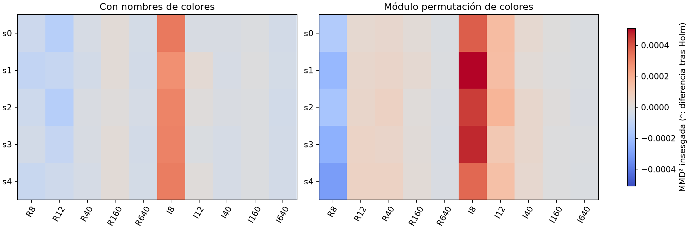
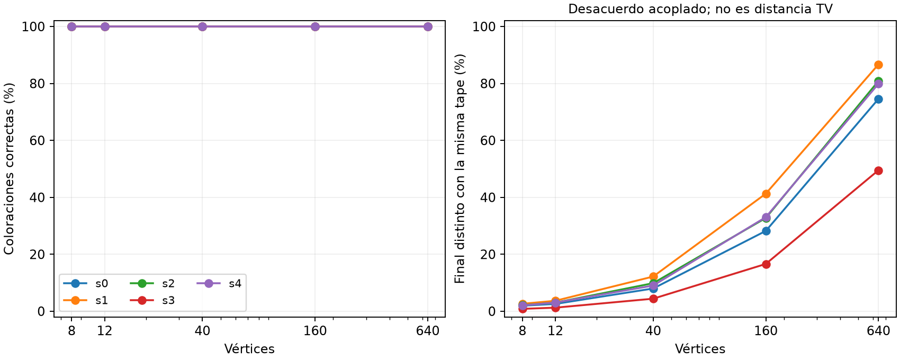
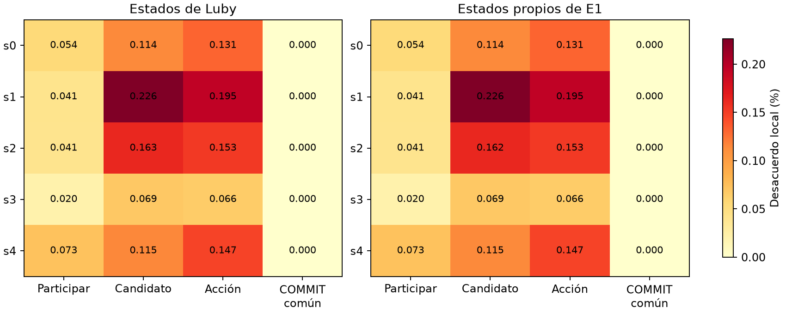
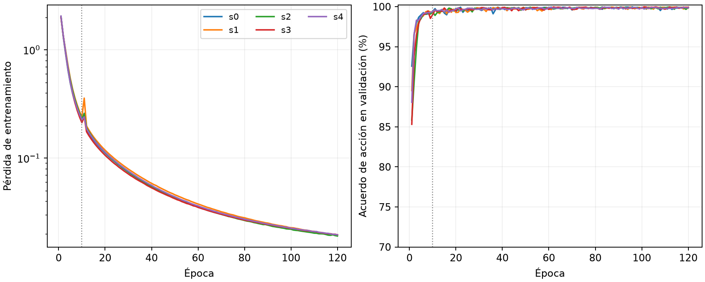

# Cinco E1 nuevas frente a Luby

Se entrenaron cinco réplicas nuevas con la configuración E1 original de Martín: UniversalColorGNN NORMALIZED, COUNTERFACTUAL, 16.035 parámetros, semillas 0–4, 800 grafos REGULAR N40/Δ3/K4 y tres tapes por grafo. Las cinco completaron 120 épocas con Adam, lr 0,001, batch 128 y warmup 10. Entrenador y modelo originales sin modificar, ejecutados en CPU. Sus hashes son propios; no se presentan como los checkpoints históricos.

Los cinco checkpoints de época 120 quedaron congelados antes de abrir el test. La comparación usa 80 grafos nuevos REGULAR/IRREGULAR de 8/12/40/160/640 nodos, más tres controles, y 256 tapes por muestra independiente A/B.

## Distribuciones finales

| Semilla | Éxitos /20480 casos aleatorios | Diferencias con etiquetas /10 | Diferencias módulo colores /10 | TV≤0,05 etiquetas /80 | TV≤0,05 particiones /80 |
|---|---:|---:|---:|---:|---:|
|0|20480|0|0|1|2|
|1|20480|0|0|0|0|
|2|20480|0|0|1|1|
|3|20480|0|0|8|8|
|4|20480|0|0|0|0|

MMD con 3.999 permutaciones dentro de cada grafo y ajuste de Holm sobre 100 tests principales: 0 diferencias detectadas. En los 20 controles independientes Luby/Luby hubo 0 p-valores menores que0,05 sin ajuste. Controles estructurales separados en los CSV.

No rechazar igualdad no prueba cercanía. La TV empírica es descriptiva. Las 830 cotas binomiales simultáneas del desacuerdo final bajo tapes compartidas son cotas superiores de TV; un desacuerdo alto no demuestra separación distribucional. Los certificados se limitan a cada grafo y modelo fijos evaluados.

## Decisiones locales

| Semilla | Estado | Participación | Candidato | Acción WAIT/COMMIT(color) | COMMIT común | Inseguros ejecutados |
|---|---|---:|---:|---:|---:|---:|
|0|Luby|99.9461%|99.8856%|99.8692%|100.0000%|0|
|0|E1|99.9461%|99.8856%|99.8692%|100.0000%|0|
|1|Luby|99.9591%|99.7739%|99.8054%|100.0000%|0|
|1|E1|99.9590%|99.7740%|99.8054%|100.0000%|0|
|2|Luby|99.9594%|99.8375%|99.8472%|100.0000%|0|
|2|E1|99.9594%|99.8376%|99.8473%|100.0000%|0|
|3|Luby|99.9796%|99.9314%|99.9340%|100.0000%|0|
|3|E1|99.9797%|99.9314%|99.9341%|100.0000%|0|
|4|Luby|99.9270%|99.8851%|99.8527%|100.0000%|0|
|4|E1|99.9270%|99.8853%|99.8528%|100.0000%|0|

Todos los acuerdos usan el mismo estado y los mismos sorteos por nodo. COMMIT común se consulta con las propuestas de Luby y su denominador son los participantes de Luby; los otros acuerdos usan todos los nodos activos. Los conteos por nodo/ronda son correlacionados y descriptivos. Los diagnósticos exactos no filtran las acciones aprendidas.

## Entrenamiento y auditoría

Auditoría completa: 148736 coloraciones comprobadas, 332 ejecuciones Luby escalares, 415 ejecuciones E1 escalares originales y 1612 ejemplos locales reproducidos. Fuentes originales y los cinco hashes de pesos verificados. Pruebas dirigidas: 88 pasan. Revisión científica independiente pendiente.

Datos originales, semillas, fuentes y modelos en data/e1-retrained-20261021. frozen.json fija la cohorte; comparison/manifest.json fija los datos del test. Esta evidencia experimental finita no prueba corrección universal ni equivalencia para todos los grafos.
