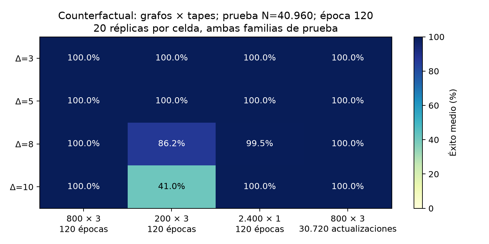

# Informe final M6B: aprendizaje supervisado de coloración distribuida

La prueba independiente terminó el **17 de octubre de 2026 a las 22:43, hora de
Chile**. Se completaron 565 entrenamientos, 1.210 vistas de checkpoints y
931.700 ejecuciones modelo–grafo. Las configuraciones, checkpoints y cohortes se
congelaron antes del test. No se reajustó el protocolo a partir de estos resultados.

El [manifiesto](snapshot.json) conserva los hashes y denominadores. El
[protocolo](../../../docs/M6VALIDATION.md) explica la selección con validación y
la ampliación de presupuestos. Esta entrega conserva también los resultados
negativos y las referencias históricas.

## Diseño e interpretación de los denominadores

El tratamiento principal es M6B-Counterfactual sobre la arquitectura M4B, entrenado
desde cero en 800 grafos REGULAR de 40 nodos, tres tapes por grafo y 120 épocas,
con 20 semillas por grado Δ=3,5,8,10. Own-only comparte datos, inicialización, orden
y actualizaciones; a época 120, P/C/message1 son exactamente iguales en los 80
pares. Se comparan así los dos modos de supervisar message2/COMMIT.

Cada vista se evalúa en 770 casos: por familia REGULAR/IRREGULAR, 100/100/100/50/25/10
grafos para N=40/160/640/2560/10240/40960. Los modelos de un mismo grado comparten
grafos y tapes. En N=40960, **400 ejecuciones significan 20 modelos sobre los mismos
20 grafos**, diez por familia; no son 400 grafos independientes.

## Comparación principal a época 120

En los seis tamaños, el tratamiento principal obtiene **61.600/61.600 coloraciones
correctas y cero commits inseguros**. Son 15.400 evaluaciones por grado. En el
tamaño máximo, la comparación emparejada es:

| Δ | Counterfactual | Own-only | Pares con mejora estricta / 20 | Rondas CF | Rondas Own-only |
|---|---:|---:|---:|---:|---:|
| 3 | 400/400 | 390/400 | 3/20 | 18,215 | 18,215 |
| 5 | 400/400 | 330/400 | 11/20 | 18,498 | 18,478 |
| 8 | 400/400 | 172/400 | 20/20 | 17,590 | 17,470 |
| 10 | 400/400 | 98/400 | 20/20 | 18,210 | 18,105 |

Las rondas son promedios de las ejecuciones, incluidas las incorrectas. Terminar
rápido con una coloración inválida no es una mejora del algoritmo. En esta
comparación, el beneficio de Counterfactual está en la corrección, mientras las
rondas medias se mantienen próximas. En Δ=8 y Δ=10 supera a Own-only en las 20
réplicas emparejadas de cada grado.


La figura muestra medias y desviaciones estándar descriptivas entre semillas,
combinando primero las dos familias dentro de cada réplica. No son intervalos
de confianza. Las desviaciones pueden extenderse por encima del 100% sin que
ninguna tasa observada lo haga.

| Own-only, Δ | Media | Mediana | Desviación estándar | Mínimo–máximo | Bootstrap de semillas, 95% |
|---|---:|---:|---:|---:|---:|
| 3 | 97,5% | 100% | 8,03 puntos | 65–100% | 93,5–100% |
| 5 | 82,5% | 95% | 26,88 puntos | 15–100% | 70–92,75% |
| 8 | 43% | 40% | 12,07 puntos | 30–75% | 38,25–48,75% |
| 10 | 24,5% | 25% | 11,91 puntos | 0–60% | 19,75–30% |

Fuente: [resumen por réplica, ambas familias combinadas](seed-summary.csv). El
bootstrap usa 5.000 remuestreos de semillas y condiciona en los grafos observados.
Counterfactual tiene 100% en todas sus réplicas principales; un bootstrap
degenerado en 100% no cuantifica la incertidumbre sobre grafos nuevos.

## Checkpoint seleccionado por validación y épocas

`best` y `epoch-120` estaban fijados antes del test y se informan por separado.
La validación de selección tiene solo 16 grafos por candidato. En la configuración
principal Counterfactual aparecen dos resultados negativos con `best`:

- Δ=3, semilla 17, época 10: 108 fallos de 770 pruebas, incluidos los 20 grafos de
  N=40960. Esa época aún pertenece al warmup, sin entrenamiento contrafactual.
- Δ=8, semilla 18, época 30: un fallo de 770 pruebas, en REGULAR N=640.

En N=40960, Counterfactual `best` suma 380/400 para Δ=3 y 400/400 para los demás
grados. Los diagnósticos de algunas vistas `best` registran decisiones contrarias
al profesor aun cuando la coloración final es correcta.

Para las 20 réplicas principales Δ=3, las épocas 20/40/60/80/120 obtienen cada una
400/400 en N=40960. Esto no establece que 20 épocas basten para otros grados o
presupuestos. No se sustituye retrospectivamente el resultado de `best` por una
época favorable del test.

## Presupuesto de grafos, tapes y actualizaciones

Los tres presupuestos ampliados se eligieron exclusivamente con validación.
Resultados Counterfactual a época 120 y N=40960, con 20 semillas por celda:

| Δ | 800×3, épocas fijas | 200×3, épocas fijas | 2.400×1, épocas fijas | 800×3, 30.720 actualizaciones |
|---|---:|---:|---:|---:|
| 3 | 400/400 | 400/400 | 400/400 | 400/400 |
| 5 | 400/400 | 400/400 | 400/400 | 400/400 |
| 8 | 400/400 | 345/400 | 398/400 | 400/400 |
| 10 | 400/400 | 164/400 | 400/400 | 400/400 |



El presupuesto pequeño no mantiene la fiabilidad en los grados altos: para
200×3, Δ=10 tiene media 41%, mediana 20% y rango 0–100% entre semillas. En Δ=8,
su media es 86,25% pero su mediana 100%; el promedio oculta réplicas deficientes.

En Δ=3, los nueve presupuestos explorados con épocas fijas saturan el éxito del
test grande a época 120. Varios solo tienen cinco semillas; las tablas conservan
ese denominador. Esta saturación no permite concluir que grafos y tapes sean
intercambiables. Con épocas fijas, cambiar datos cambia también actualizaciones;
los controles de actualizaciones fijas se informan aparte. No se amplió toda la
rejilla a los cuatro grados.

## Generalización estructural y referencias

MIXED a época 120 obtiene también 61.600/61.600 coloraciones correctas, incluyendo
400/400 en N=40960 para cada grado y 200/200 por familia. REGULAR ya satura ese
éxito; este test no distingue una mejora de MIXED en corrección. En MIXED Δ=10
se observan dos commits inseguros según la regla del profesor, en k=7, sin
coloración final incorrecta. Con `best`, MIXED obtiene 400/400, 395/400, 387/400 y
384/400 en el tamaño máximo, para Δ=3,5,8,10 respectivamente.

Las referencias Δ=3 tienen cinco semillas. En N=40960:

| Referencia | `best` | Época 120 |
|---|---:|---:|
| ORACLE_MATCHED, tres tapes | 84/100 | 100/100 |
| TRADITIONAL, tres tapes | 84/100 | 100/100 |
| TRADITIONAL, un tape | 43/100 | 54/100 |

El presupuesto de datos y la selección de época importan. Estas referencias
pequeñas y limitadas a Δ=3 no demuestran una superioridad universal de un método
ni permiten atribuir toda diferencia a la corrección de etiquetas.

## Diagnósticos locales y causas residuales

En Own-only principal, época 120 y N=40960, se registran 10/367/1.016/96.781
commits inseguros para Δ=3/5/8/10. El patrón histórico k=1 no se generaliza:

- Δ=3: los diez commits inseguros están en k=1.
- Δ=5: aparecen en k=1,5,6.
- Δ=8: aparecen en k=1,2,3.
- Δ=10: aparecen en todos los k=1,…,11; 56.646 ocurren en k=11.

Con k=11 no hay colores permanentes que excluyan candidatos: son relevantes los
conflictos entre propuestas simultáneas. Los dos diagnósticos de conflicto pueden
solaparse. Las tasas y accuracies se calculan con los denominadores de estados,
propuestas o confirmaciones correspondientes, disponibles en
[k-by-seed.csv](k-by-seed.csv).

Un commit inseguro compara con la regla exacta para todas las propuestas, incluso
si el vecino finalmente espera. Por eso no equivale siempre a una arista
monocromática final. La corrección global se mide directamente; no se deduce de
la accuracy local ni del contador de decisiones inseguras.

## Coste, incertidumbre y límites

El tiempo registrado de los 565 entrenamientos, incluida generación inicial de
datos, suma 37,55 horas. En la configuración principal, Counterfactual requiere
en promedio 204/228/266/293 segundos por réplica para Δ=3/5/8/10; Own-only,
171/176/187/194 segundos. Igualar actualizaciones no iguala tiempo de pared.
Estos costes dependen del servidor y del entorno registrados; no estiman coste
de despliegue en una red física. Véase [training.csv](training.csv).

Los intervalos Wilson y Clopper–Pearson del [archivo por semilla](success-by-seed.csv)
son por modelo/familia/tamaño. Con diez éxitos de diez grafos por familia en el
tamaño máximo, el límite inferior exacto bilateral del 95% es aproximadamente
69,2%. Las réplicas no crean grafos de prueba adicionales. Los intervalos entre
semillas condicionan en esa cohorte; McNemar en [paired-by-seed.csv](paired-by-seed.csv)
es por par sobre los mismos grafos y tapes, exploratorio y sin corrección por
multiplicidad. No se calcula una prueba binomial sobre las 931.700 ejecuciones.

La evidencia apoya una fiabilidad global alta y reproducible del tratamiento
principal en estas familias y grados. No establece corrección universal, ni
transferencia de un único modelo entre grados, ni generalización a familias
estructurales arbitrarias. La implementación simula comunicación local en un
proceso; no es una medición de un sistema físicamente distribuido.

## Reproducción

Los CSV del [índice de resultados](README.md) se regeneran desde los JSON originales
y checkpoints congelados del servidor. Para regenerar además el resumen entre
semillas y las figuras de este informe desde los CSV públicos:

```bash
.venv/bin/python experiments/summarize_m6study_results.py results/m6study/2026-10-17-final
```

El generador no ajusta ni selecciona modelos. Las tablas originales y los gráficos
por los 64 grupos se generan con `experiments/report_m6study_cohorts.py`; los
archivos por grafo y checkpoints permanecen fuera de Git por su volumen.
