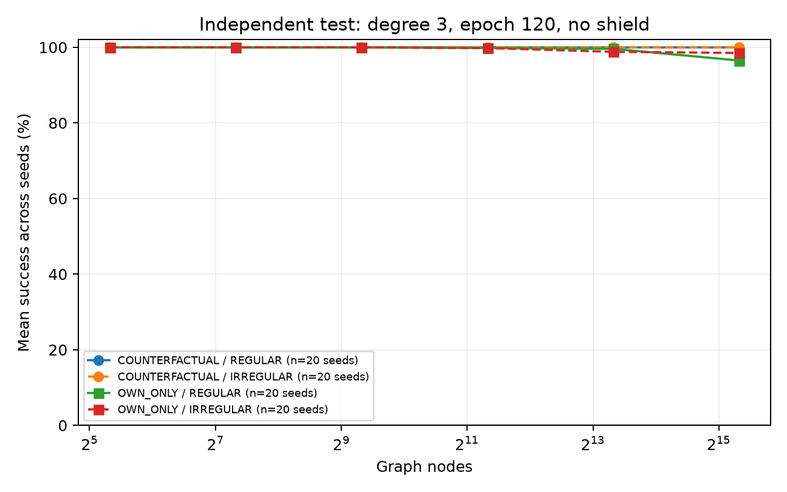

# M6B: resultados finales de la prueba independiente

El [informe científico final](ANALISIS.md) interpreta las comparaciones, presupuestos,
diagnósticos y limitaciones. El [resumen por réplica](seed-summary.csv) combina ambas
familias dentro de cada semilla y conserva medias, medianas, dispersión y bootstrap.
Las [figuras principales](main-comparison.pdf) y de [presupuestos](budget-comparison.pdf)
también están disponibles en PDF.

Corte UTC: 2026-10-18T01:45:37.789365+00:00.

Estado: **evaluación final completada**. 565 entrenamientos terminados; 1210/1210 vistas de checkpoints completas publicadas, con 931,700 evaluaciones por grafo. Se incluyen todas las vistas previstas.

Los modelos de referencia se entrenaron en 800 grafos regulares de 40 nodos, tres tapes y 120 épocas. La inferencia es autónoma, sin shield ni correcciones externas. La vista de época 120 y la selección best por validación se fijaron antes de abrir la prueba final.

## Pruebas de 40.960 nodos, época 120

| Método | Grado | Réplicas | Coloraciones correctas | Commits inseguros |
|---|---:|---:|---:|---:|
| COUNTERFACTUAL | 3 | 20/20 | 400/400 | 0 |
| COUNTERFACTUAL | 5 | 20/20 | 400/400 | 0 |
| COUNTERFACTUAL | 8 | 20/20 | 400/400 | 0 |
| COUNTERFACTUAL | 10 | 20/20 | 400/400 | 0 |
| OWN_ONLY | 3 | 20/20 | 390/400 | 10 |
| OWN_ONLY | 5 | 20/20 | 330/400 | 367 |
| OWN_ONLY | 8 | 20/20 | 172/400 | 1016 |
| OWN_ONLY | 10 | 20/20 | 98/400 | 96781 |

Cada grado utiliza los mismos 20 grafos grandes (10 REGULAR y 10 IRREGULAR) en todas sus réplicas. Las 400 evaluaciones corresponden a 20 modelos × 20 grafos compartidos. Los grados con menos réplicas evaluadas son resultados parciales y no deben compararse como cohortes completas.



## Interpretación y límites

- La comparación principal de mecanismo usa época 120, donde P/C/message1 están emparejados entre Counterfactual y Own-only. La selección best puede escoger épocas diferentes.
- Las decisiones locales contrarias al profesor y los errores de coloración global son métricas distintas. El desglose por k se conserva en k-by-seed.csv, con sus denominadores.
- Los intervalos Wilson y Clopper–Pearson son por modelo/familia/tamaño. No se trata el total de evaluaciones de modelos distintos como ensayos binomiales independientes. McNemar es por par de modelos sobre los mismos grafos/tapes, exploratorio y sin corrección por multiplicidad.
- Estos resultados no establecen corrección universal. No se modifica el protocolo ni el entrenamiento a partir del test.

## Resultados negativos de la selección best

- Counterfactual Δ=3, semilla 17, época seleccionada 10 (dentro del warmup): 108 coloraciones incorrectas. Se conserva esa vista y su detalle en errors.csv.
- Counterfactual Δ=8, semilla 18, época seleccionada 30: 1 coloraciones incorrectas. Se conserva esa vista y su detalle en errors.csv.

## Archivos

- [Resumen entre semillas](success-summary.csv)
- [Resultados e intervalos por semilla](success-by-seed.csv)
- [Comparaciones emparejadas por semilla](paired-by-seed.csv)
- [Coloraciones incorrectas](errors.csv)
- [Diagnóstico por colores disponibles](k-by-seed.csv)
- [Presupuesto y coste de entrenamiento](training.csv)
- [Corte, protocolo y hashes de checkpoints](snapshot.json)

## Reproducción

```bash
.venv/bin/python experiments/export_m6study_results.py --root data/m6study-release --output results/m6study/NUEVO_CORTE
```

Este comando requiere los resultados originales del servidor. GitHub contiene tablas, figuras, código y hashes; los checkpoints y JSON originales por grafo permanecen fuera de Git por su volumen. La cola de evaluación y el análisis final están documentados en [M6VALIDATION.md](../../../docs/M6VALIDATION.md).

## Tablas científicas complementarias

- [Rondas, tiempos de inferencia e intervalos por semilla](scientific-success-by-seed.csv)
- [Resumen entre semillas por familia](scientific-between-seeds.csv)
- [Comparación REGULAR / MIXED emparejada](structural-paired.csv)
- [Comparación de métodos entre semillas](paired-between-seeds.csv)
- [Cierre automático de los 64 grupos](final-report-state.json)
- [SHA-256 de los archivos publicados](publication-manifest.json)

Los CSV complementarios son copias de las tablas consolidadas automáticamente
desde los resultados originales. El análisis del informe enlaza las figuras y
explica cómo interpretar sus denominadores.
