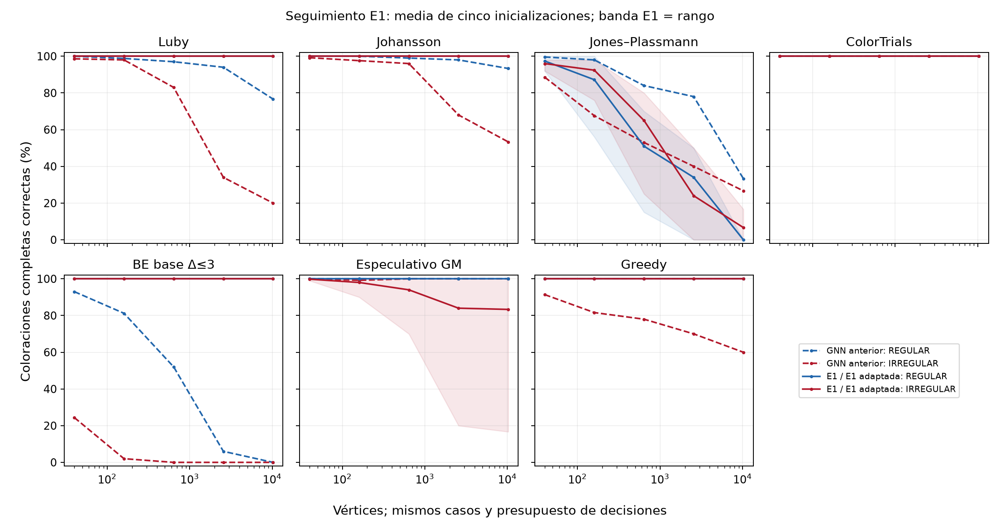
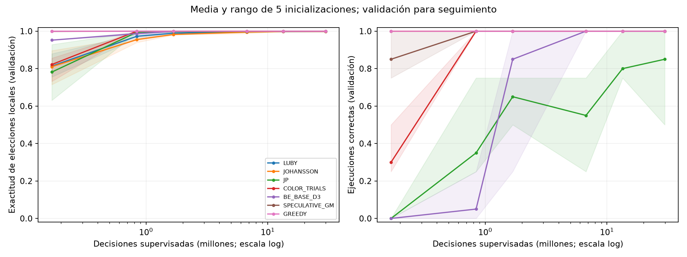
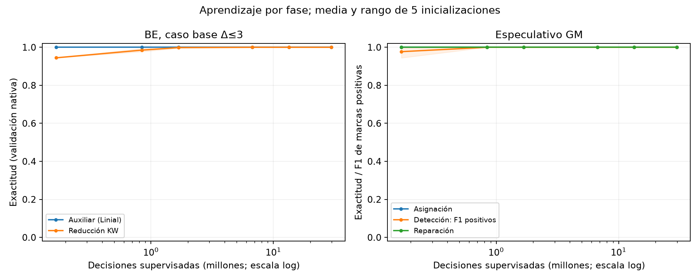

# Siete maestros con E1: seguimiento experimental

Se repite la comparación anterior usando el núcleo UniversalColorGNN NORMALIZED
y entrenamiento contrafactual. Luby/Johansson/greedy:16035 parámetros; los otros
cuatro incluyen adaptadores nativos explícitos y suman19396. Los fuentes
canónicos E1 siguen intactos. Protocolo y límites de cada adaptación en
[MULTITEACHER_E1.md](../../../docs/MULTITEACHER_E1.md).

| Maestro | GNN anterior: éxitos | E1 / adaptada: éxitos | Cambio (puntos %) | E1 REG N10240 | E1 IRREG N10240 |
|---|---:|---:|---:|---:|---:|
| Luby | 1857/1980 | 1980/1980 | +6.21 | 100.00% | 100.00% |
| Johansson | 1919/1980 | 1980/1980 | +3.08 | 100.00% | 100.00% |
| Jones–Plassmann | 1635/1980 | 1631/1980 | -0.20 | 0.00% | 6.67% |
| ColorTrials repetido | 1980/1980 | 1980/1980 | +0.00 | 100.00% | 100.00% |
| BE, caso base Δ≤3 | 872/1980 | 1980/1980 | +55.96 | 100.00% | 100.00% |
| Especulativo GM | 1975/1980 | 1951/1980 | -1.21 | 100.00% | 83.33% |
| Greedy secuencial | 1842/1980 | 1980/1980 | +6.97 | 100.00% | 100.00% |

Se completaron **35 modelos**, **396 casos comunes por
actor** y **16632 evaluaciones**. Las
2772 coloraciones de referencia exactas
coinciden con las de la comparación original. Todos los checkpoints corresponden
al último paso prefijado y quedaron congelados antes de evaluar.

Cada modelo recibió800 grafos N40/Δ3, tres tapes y17760 actualizaciones de1680
decisiones:29836800 decisiones muestreadas. Cinco inicializaciones comparten
ese pool; sus resultados no son cinco conjuntos de grafos independientes.
El test reutiliza casos ya publicados: seguimiento exploratorio, no test nuevo
ciego. En N10240 hay tres grafos por familia y dos tapes; las medias incluyen
las cinco inicializaciones sobre esos mismos casos.







La tabla agrupa todos los tamaños y controles; para estudiar transferencia se
deben consultar las familias/tamaños y semillas por separado. Una precisión
local alta no garantiza que la coloración completa sea correcta.
Se conserva cada fallo; no se elige la mejor réplica.

La comparación antes/después cambia arquitectura, factorización de la pérdida
y algunas representaciones nativas simultáneamente; no aísla causalmente solo
la arquitectura. En BE se aprende el punto Linial y se calcula localmente su
valor polinomial, una restricción adicional respecto de la cabeza antigua de
169 pares. ColorTrials transmite disponibilidad aprendida y preferencias en
el segundo intercambio. Las fases y calendarios se suministran; los costes
secuenciales/paralelos no son rondas LOCAL equivalentes. Las predicciones
aprendidas se aplican sin llamadas al maestro ni filtros de validez.

Evidencia experimental finita; no prueba corrección universal. Revisión
científica independiente pendiente. Esta entrega no modifica los resultados
antiguos ni los cinco E1/Luby publicados aparte.

Artefactos: [tabla antes/después](architecture-comparison.csv),
[cambios sobre casos emparejados](paired-changes.csv),
[resultados por semilla](success-by-seed.csv),
[componentes](component-learning.csv), [fases](learning-by-phase.csv),
[congelación de pesos](frozen.json) y [manifiesto](manifest.json).
Los datos completos/checkpoints quedan en `data/multiteacher-e1-20261022`;
los pools fuente inmutables permanecen en `data/multiteacher-20261019`.


## Cómo cambia el aprendizaje

Primer hito observado desde el cual se mantienen20/20 rollouts de seguimiento
correctos en todos los hitos posteriores. Son cuatro grafos N40/N160 compartidos
por cinco inicializaciones; no son20 grafos independientes ni un nuevo test.
Esto describe las curvas; todos los resultados finales usan igualmente17760
actualizaciones y no seleccionan el primer checkpoint exitoso.

| Maestro | GNN anterior: actualización | E1 / adaptada: actualización |
|---|---:|---:|
| Luby | 17760 | 100 |
| Johansson | No alcanzado | 100 |
| Jones–Plassmann | No alcanzado | No alcanzado |
| ColorTrials repetido | 500 | 500 |
| BE, caso base Δ≤3 | No alcanzado | 4000 |
| Especulativo GM | 8000 | 500 |
| Greedy secuencial | No alcanzado | 100 |

Luby y Johansson generalizan correctamente en todos los casos del test y con
menos actualizaciones alcanzan el seguimiento completo. ColorTrials mantiene
los1980 éxitos. BE y greedy pasan de872/1842 a1980 éxitos, respectivamente.
JP conserva una tasa global parecida, pero **empeora en los grafos grandes**:
en N10240 obtiene0/30 ejecuciones REGULAR y2/30 IRREGULAR; la GNN anterior
obtenía10/30 y8/30. GM obtiene1951 éxitos frente a1975, con29 ejecuciones
incompletas. No hubo colisiones observadas en los modelos nuevos:los378 fallos
fueron incompletos (349JP y29GM).

El acuerdo local final de JP es99,9735 %; el de GM es100 %. Estos valores no
sustituyen el rollout autónomo sobre estados propios ni la generalización en
N. La precisión agregada y los muchos casos pequeños pueden ocultar los
fallos de extrapolación; la figura por tamaño y los CSV por semilla los muestran.

La mejora BE incluye la restricción del par local `(x,p_v(x))` suministrada por
el adaptador. Las diferencias antes/después son del conjunto de arquitectura,
representación y entrenamiento contrafactual; no aíslan solo la arquitectura.
El test reutiliza casos ya publicados y sigue siendo exploratorio.

## Verificación y datos de apoyo

Pasaron176 pruebas dirigidas. La auditoría final reprodujo105 rollouts de los35
modelos y45 ejecuciones sobre los módulos E1 originales (2308 decisiones);
las acciones y logits comparados coincidieron exactamente. Las2772 coloraciones
exactas de referencia coinciden con las del estudio anterior. El archivo crudo
se copió y comprobó por SHA256:16964 archivos, más su manifiesto.

- [Auditoría de modelos](audit.json).
- [Hitos de aprendizaje](learning-milestones.csv).
- [Costes nativos emparejados](paired-cost.csv) y [procedencia](paired-cost-provenance.json).
- [Definiciones de métricas](../../../docs/MULTITEACHER_E1_METRICAS.md).
- [Verificación y conservación](verification.json).
- [Manifiesto complementario](postprocessing-manifest.json).

Los costes usan solo éxitos de la GNN y los mismos casos del profesor; no son
una unidad LOCAL o de tiempo común entre algoritmos. En GM se registra también
el número de nodos enviados a reparación. Los análisis complementarios se
identifican aparte del manifiesto crudo congelado. Revisión científica
independiente pendiente.

## Informe en PDF

[Descargar el informe con gráficos](INFORME.pdf): seis páginas con cuatro
figuras, comparación por maestro/tamaño, curvas de aprendizaje y explicación
de qué cambia entre E1 canónica, su núcleo original y las adaptaciones nativas.
En particular, BE aprende el punto `x` y el adaptador calcula `p_v(x)`.

Fuentes: [LaTeX](INFORME.tex), [tablas generadas](report-tables.tex) y
[procedencia del documento](pdf-manifest.json). El PDF reutiliza los datos y
gráficos sellados; no vuelve a entrenar ni evaluar modelos. Desde la raíz:

```bash
python3 experiments/build_multiteacher_e1_pdf.py
python3 experiments/build_multiteacher_e1_pdf.py --check
```

La compilación requiere Python, `pdflatex` (TeX Live) y `pdfinfo` (Poppler).
