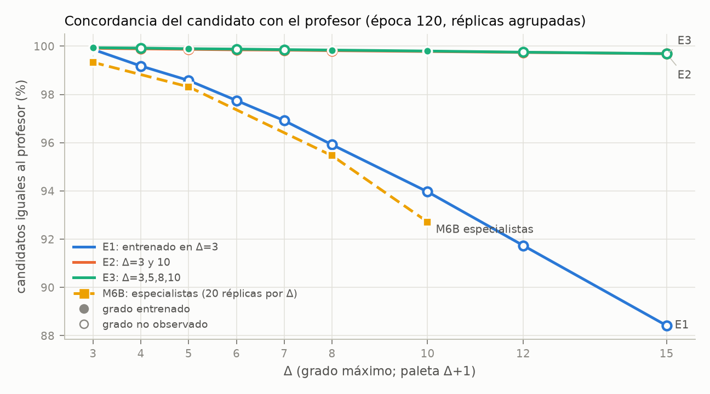
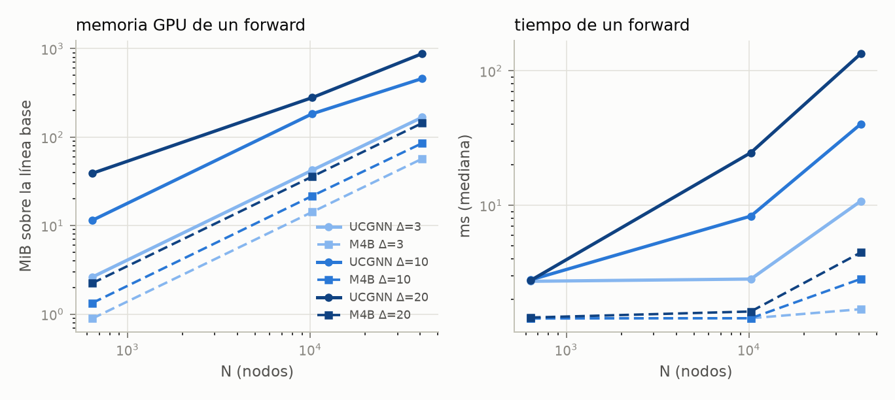

# Universal Color GNN: cierre de experimentos y revisión

Corte: 20 de octubre de 2026. Rama original: `feat/universal-color-gnn`.

**Las colas planificadas terminaron.** Los 22 entrenamientos de Claude están
completos: 19 de 120 épocas y tres pilotos de 20. La cola 3 acabó el 19 de octubre
a las 21:06 de Chile. El estudio extremo terminó el 20 de octubre a las 08:38,
tras 11,12 horas activas. No quedan casos pendientes ni exclusiones técnicas
en esa cola. La GPU estaba libre al comenzar esta revisión.

Claude quedó preparando el informe cuando alcanzó su límite de sesión. Esta
continuación actualiza las tablas con todas las réplicas y los presupuestos
ampliados, audita los JSON originales y reproduce negativos. La arquitectura,
los pesos, el profesor y los protocolos experimentales se conservan.

## Resultado principal

Una red con **16.035 parámetros**, entrenada exclusivamente en Δ=3 y N=40,
produjo coloraciones correctas en todos los casos medidos de las cohortes
originales y del estudio extremo. Sus parámetros admiten paletas variables;
su fidelidad al candidato del profesor disminuye al aumentar la paleta.
Estos son resultados finitos, no una demostración de corrección universal.

| Modelo | Grados de entrenamiento | Réplicas | Éxitos en cohortes originales, época 120 | Éxitos en estudio extremo |
|---|---|---:|---:|---:|
| E1, normalizado | 3 | 5 | 24.400/24.400 | 8.629/8.629 |
| E2, normalizado | 3, 10 | 5 | 24.400/24.400 | 2.000/2.000 |
| E3, normalizado | 3, 5, 8, 10 | 5 | 24.400/24.400 | 2.000/2.000 |
| A1, prefijo sin normalizar | 3 | 1 | 4.880/4.880 | 357/400 |
| C1, COMMIT Own-only | 3 | 1 | 4.880/4.880 | 400/400 |
| E2F, presupuesto ampliado | 3, 10 | 1 | 4.880/4.880 | No planificado |
| E3F, presupuesto ampliado | 3, 5, 8, 10 | 1 | 4.880/4.880 | No planificado |

Cada modelo original se evalúa sobre los mismos **4.880 grafos**: 3.080 de la
cohorte congelada y 1.800 de grados adicionales. Cinco réplicas dan 24.400
ejecuciones sobre 4.880 grafos, sin aumentar el número de grafos independientes.
Los totales de la última columna tienen coberturas distintas y no son una
comparación agregada entre modelos. [Inventario de evaluaciones](evaluation-inventory.csv),
[resultados extremos por modelo](extreme-by-model.csv).

## A y B. Comparación con M6B y transferencia de E1

En Δ=3, E1 obtiene 3.850/3.850 éxitos: cinco modelos sobre los mismos 770
grafos. Los especialistas M6B obtienen 15.400/15.400: veinte inicializaciones
sobre esos 770 grafos. E1 iguala el éxito observado; estos denominadores no
establecen equivalencia estadística de sus probabilidades de fallo.

Sin reentrenamiento, E1 obtiene 3.850/3.850 en cada uno de Δ=5, 8 y 10.
La cohorte congelada usa N=40/160/640/2.560/10.240/40.960; los grados adicionales
4/6/7/12/15 llegan a N=10.240. Todos los modelos de época 120 tienen cero commits
inseguros en esas cohortes.

La concordancia del candidato se mide sobre los estados visitados por cada
política autónoma. Se agregan recuentos de estados; no es una media simple de
porcentajes ni una comparación sobre idénticas trayectorias.

| Δ | E1, cinco réplicas | E2, cinco réplicas | E3, cinco réplicas | M6B especialista, veinte réplicas |
|---:|---:|---:|---:|---:|
| 3 | 99,87 % | 99,92 % | 99,94 % | 99,33 % |
| 5 | 98,58 % | 99,87 % | 99,90 % | 98,32 % |
| 8 | 95,92 % | 99,82 % | 99,84 % | 95,46 % |
| 10 | 93,97 % | 99,78 % | 99,80 % | 92,72 % |
| 15 | 88,42 % | 99,69 % | 99,69 % | No medido |



[Tabla completa por grado](ucgnn-by-degree.csv) ·
[detalle por réplica](ucgnn-by-replica-degree.csv) ·
[especialistas M6B](m6b-specialists-by-degree.csv).

## C. Selección de candidatos y los 43 negativos

Los 43 fallos extremos pertenecen exclusivamente a **A1 en Δ=100**. Son
ejecuciones que alcanzaron el límite de 256 rondas con nodos sin colorear;
no se registraron commits inseguros, propuestas prohibidas ni aristas
monocromáticas. En 35 de los 43 casos no se coloreó ningún nodo.

| Familia | N | Fallos / casos A1 en Δ=100 |
|---|---:|---:|
| REGULAR | 160 | 20/20 |
| REGULAR | 640 | 19/20 |
| IRREGULAR | 160 | 3/20 |
| IRREGULAR | 640 | 1/20 |

Se repitió un fallo de cada fila con el **evaluador original**, sin el adaptador
de fragmentación por colores. Coinciden las métricas discretas, los colores
finales y los hashes de pesos antes/después. Se reproducen cuatro casos ya
medidos; no se añaden cuatro muestras independientes. La evidencia está en
[failure-reproduction.json](failure-reproduction.json); el inventario completo,
en [extreme-failures.csv](extreme-failures.csv).

En esos cuatro casos, la primera ronda concentra entre 81 y 328 participantes
en sólo cuatro de los 101 colores. El observador exacto encuentra cero propuestas
seguras y COMMIT no ejecuta ninguna. Esto apoya el diagnóstico de falta de progreso
por colisiones de candidatos; no se trata de confirmar colores en conflicto.

La ablación sin normalización ya pierde concordancia de candidato en los grados
originales: 18,16 % en Δ=10 y 9,78 % en Δ=15, aunque todavía termina correctamente
esos grafos. Los negativos de Δ=100 muestran que esa terminación no se mantiene
en toda la extensión evaluada.

Para E1 normalizado, los barridos controlados del estudio extremo separan
disponibilidad, extremos de intervalos y selección final. En la réplica 0,
K=k=201, la malla de 1.001 valores sólo da 5 selecciones iguales al profesor,
pese a identificar correctamente la disponibilidad y tener errores de extremos
del orden de 10⁻⁷. Esto localiza una desviación en la puntuación de candidatos;
no convierte las coloraciones autónomas correctas en reproducciones exactas del
profesor. Los barridos y sus puntos de frontera son diagnósticos controlados,
no ensayos binomiales sobre grafos independientes.

## D y E. Interpolación, entrenamiento mixto y controles

E2 no vio Δ=5 ni 8 en entrenamiento. Acierta las 3.850 evaluaciones de cada grado,
con concordancias de candidato 99,87 % y 99,82 %. E3 también conserva el éxito
observado y se aproxima mucho al profesor. En Δ=15, fuera del rango entrenado
por ambos, sus concordancias siguen alrededor del 99,69 %.

E1/E2/E3 usan 800 grafos totales, tres cintas y 120 épocas, repartidos 800,
400+400 y 200×4. No se igualan exactamente las rondas supervisadas ni las
actualizaciones. En la réplica 0 son 17.760, 17.880 y 18.000 actualizaciones,
con tiempos medidos de 263, 561 y 474 segundos; la carga compartida de la máquina
también puede afectar esos tiempos. E2F usa 1.600 grafos y E3F 3.200, con 36.000 y
72.120 actualizaciones. Se informan como secundarios de presupuesto mayor,
sin mezclarlos con el control de presupuesto principal.
[Costes de entrenamiento](ucgnn-training.csv).

C1 obtiene éxito en sus rollouts observados, pero falla en el diagnóstico
contrafactual exhaustivo de COMMIT: 48/64 conjuntos de tipos de vecino,
frente a 64/64 para las cinco réplicas E1. En la batería contrafactual adicional
acepta 78 commits inseguros, tanto en CPU como en CUDA. E1-0 y C1 comparten
exactamente los pesos de participación y candidato; sólo difiere COMMIT.
Por tanto, el éxito autónomo de C1 no demuestra que haya aprendido la regla
de seguridad para todas las propuestas.

`best.pt` de E1-0 corresponde a la época 1 y también obtiene 48/64 en ese
diagnóstico, con 16 aceptaciones inseguras. La vista principal sigue siendo
la época 120 predefinida. Las épocas intermedias y `best` se conservan como
diagnósticos secundarios, sin selección posterior por los resultados extremos.

## Extensión extrema: cobertura y límites

La cola completa midió **13.429 ejecuciones**, con 13.386 éxitos y 43 negativos,
sobre 1.765 fingerprints de grafo compartidos entre modelos. No hubo OOM,
timeouts ni resultados técnicos excluidos. El piloto CPU de 50/50 es una
cohorte separada. La equivalencia CUDA del adaptador quedó comprobada antes
de comenzar la batería.

E1 tiene 8.629/8.629 éxitos y cero commits inseguros. Se evaluaron las cinco
réplicas hasta Δ=200; las pruebas de **Δ=500 son exploratorias, sólo E1-0**:
un grafo de cada familia REGULAR/IRREGULAR/HETEROGENEOUS/BIPARTITE con N=1.002
y un completo con N=501. No son cinco réplicas ni una estimación precisa
de la tasa de éxito en Δ=500.

Hay 1.716 grafos evaluados con las cinco réplicas E1 y éxito conjunto observado.
Las cohortes principales usan 20 grafos por familia, grado, tamaño y modelo,
ampliados a 60 en N=640 y Δ=15/20/30/50/100. Los casos grandes usan cinco por
familia y se admiten por recursos: N=40.960 llega hasta Δ=50 en esta extensión;
N=10.240 incluye Δ=100. No se extrapola la cobertura grande de un grado a otro.

Los intervalos exactos del 95 % se dan por modelo, grado, tamaño y familia:
20/20 tiene límite inferior 83,16 %; 60/60, 94,04 %. No se calcula un intervalo
binomial global mezclando modelos, familias o tamaños. Los completos son estrés
determinista y no llevan ese intervalo.

## F. Coste de la representación por color

NORMALIZED tiene 16.035 parámetros para cualquier paleta; RAW_PREFIX, 16.099.
Se conservan dos comunicaciones vecinales por ronda. El mensaje implementado
por arista dirigida y etapa tiene **32K floats**, frente a 32 del especialista.
Los parámetros constantes no hacen constantes la memoria, los mensajes ni
el cálculo local.

| Δ | N | Forward UCGNN | Forward M4B | Pico adicional UCGNN | Pico adicional M4B |
|---:|---:|---:|---:|---:|---:|
| 3 | 40.960 | 10,77 ms | 1,69 ms | 167,54 MiB | 57,03 MiB |
| 10 | 40.960 | 40,26 ms | 2,84 ms | 459,84 MiB | 85,47 MiB |
| 20 | 40.960 | 134,27 ms | 4,47 ms | 878,27 MiB | 144,13 MiB |

Este benchmark compara el coste de un forward de UCGNN y de la arquitectura
M4B; el M4B se instancia para medir operaciones, no para comparar predicciones
de checkpoints entrenados. Los picos son sobre la línea base del proceso.
No son tiempos de una coloración completa.
[Mediciones originales](ucgnn-forward-cost.csv).



El estudio extremo usa bloques de ocho colores y conserva los mismos pesos.
Su mayor pico asignado medido fue 479,48 MiB, con un máximo de 16,71 segundos
de inferencia por grafo; son mediciones de otra implementación y otra cobertura.
La fragmentación recalcula la primera etapa para reducir memoria. El volumen
lógico por ronda es 2·E_dir·K·32·4 bytes; el trabajo de agregación por fragmentos
procesa 3·E_dir·K·32·4 bytes. No añade una dependencia vecinal al protocolo ni
elimina la dependencia en K del mensaje implementado.

## Verificación, procedencia y reproducción

La auditoría nueva lee los JSON originales, comprueba los 22 entrenamientos
contra sus planes, reconstruye cada cohorte, detecta duplicados y compara
hashes de checkpoints. Comprueba también las 13.429 tareas extremas contra
sus resultados y que los pesos no cambian durante inferencia. Resultado:
`complete`, sin incidencias. [Estado verificable](experiment-status.json) ·
[inventario de modelos y hashes](run-inventory.csv).

La vista antigua `final_test/e1-s00-epoch-120/view.json` sólo conserva los
metadatos de su último lote, 80 casos. La auditoría reconstruye la grilla
congelada del protocolo y verifica sus 3.080 registros completos; no modifica
el manifiesto histórico ni interpreta los 80 como su cohorte total.

Pasaron **103 pruebas** de `tests/test_universal.py` y `tests/test_extreme.py`.
Los recuentos de las tablas coinciden con la auditoría independiente de las
47 vistas originales ajenas a los pilotos. [Verificación](verification.json).
Las comprobaciones de permutación de nodos coinciden en 80/80 grafos para cada
uno de E1-0, E2-0 y E3-0. Se revisaron visualmente las tres figuras; se corrigió
el solapamiento de las etiquetas E2/E3 y se precisó la leyenda de especialistas.

Desde `/workspaces/AlgoLearning/distributed-coloring-learning`, dentro del
contenedor `codex-disco`:

```bash
.venv/bin/python experiments/ucgnn_make_report.py --output results/ucgnn/2026-10-20-final
.venv/bin/python experiments/ucgnn_audit_completed.py --extreme-root ../ucgnn-extreme-degree-study/data/ucgnn-extreme --output results/ucgnn/2026-10-20-final
.venv/bin/python experiments/ucgnn_verify_extreme_failures.py --extreme-root ../ucgnn-extreme-degree-study/data/ucgnn-extreme --output results/ucgnn/2026-10-20-final/failure-reproduction.json
```

Para las 103 pruebas, desde el worktree extremo:

```bash
OMP_NUM_THREADS=1 OPENBLAS_NUM_THREADS=1 ../distributed-coloring-learning/.venv/bin/python -m pytest -q tests/test_universal.py tests/test_extreme.py
```

El estudio extremo y sus CSV detallados permanecen en
`/workspaces/AlgoLearning/ucgnn-extreme-degree-study/data/ucgnn-extreme/report/`.
El snapshot `ucgnn-audit-handoff-20261019` conserva su fecha y condición de
entrega parcial; este cierre incorpora los resultados posteriores.

Las baterías predefinidas están cerradas. Una eventual ampliación de Δ=500,
una nueva arquitectura o pruebas nuevas de las limitaciones de C1 requerirían
una extensión explícita del protocolo; no forman parte de pendientes de las
colas completadas.
